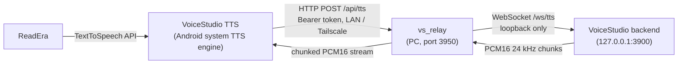

# AndroidVoiceStudio

Listen to EPUBs in **ReadEra** (or any Android reading app) using a voice generated by
[VoiceStudio](https://github.com/debpalash/VoiceStudio) running on your Windows PC.

The Android app is a **system text-to-speech engine**. Your reading app sends it one sentence
at a time, the sentence is synthesized by VoiceStudio on the PC, and the audio streams back to
the phone as it is generated.



| Folder     | What it is |
|------------|------------|
| `server/`  | `vs_relay`: a small Python (aiohttp) relay that runs next to VoiceStudio. |
| `android/` | The Kotlin system TTS engine (`TextToSpeechService`) and its settings screen. |

## Why a relay instead of VoiceStudio's built-in LAN share?

VoiceStudio can expose itself on the LAN, but its share is off by default, and it generates a
**new PIN every time it is enabled**, so the phone would need re-pairing after every restart.
The relay gives you:

* **A stable token.** You pair once.
* **VoiceStudio stays loopback-only.** The phone can only call three narrow endpoints, not the
  whole VoiceStudio admin API.
* **Fast, clean failures.** If VoiceStudio is down or still loading its model, the phone gets an
  immediate error instead of hanging.
* **Text clean-up.** Soft hyphens, zero-width characters and punctuation-only "sentences" are
  removed or answered with silence. Otherwise VoiceStudio would synthesize noise for them.

## 1. Run the relay on the PC

Requirements: Windows, Python 3.10+, and VoiceStudio installed and running. VoiceStudio's
backend listens on `127.0.0.1:3900` by default.

```powershell
cd D:\Dev\AndroidVoiceStudio\server
.\run-relay.ps1            # first run creates .venv and installs aiohttp + qrcode
```

The relay prints its token, the URLs the phone can use, and a pairing QR code. Settings are
stored in `server\data\config.json` (git-ignored). Useful options:

```powershell
.\run-relay.ps1 --port 3960                      # different port
.\run-relay.ps1 --voicestudio-url http://127.0.0.1:3900
.\run-relay.ps1 --rotate-token                   # new token (re-pair the phone afterwards)
.\run-relay.ps1 --show-pairing                   # print pairing info and exit
```

Environment overrides: `VS_RELAY_PORT`, `VS_RELAY_HOST`, `VS_RELAY_TOKEN`, `VOICESTUDIO_URL`
and `VS_RELAY_DATA`.

> **First use after installing VoiceStudio:** VoiceStudio downloads and loads its model
> (about 2.5 GB) the first time it synthesizes. Until that finishes, the relay answers with
> *"VoiceStudio is not ready yet"*. Once warm, a typical sentence starts playing about 1 s after
> it is requested on an RTX 5080.

### Windows firewall (once)

The phone has to reach TCP port 3950 on the PC. From an **elevated** PowerShell, run:

```powershell
cd D:\Dev\AndroidVoiceStudio\server
.\allow-firewall.ps1        # or: .\allow-firewall.ps1 -Port 3960
```

This adds an inbound allow rule for the Domain and Private profiles. Your Wi-Fi network must
be set to **Private** in *Settings → Network & internet → (your network) → Network profile
type*. To add the rule by hand instead:

```powershell
New-NetFirewallRule -DisplayName "VoiceStudio TTS relay (TCP 3950)" -Direction Inbound -Protocol TCP -LocalPort 3950 -Action Allow -Profile Domain,Private
```

### Start it automatically (optional)

Create a Task Scheduler task that runs at log-on:

```powershell
$a = New-ScheduledTaskAction -Execute "powershell.exe" -Argument "-NoProfile -WindowStyle Hidden -ExecutionPolicy Bypass -File D:\Dev\AndroidVoiceStudio\server\run-relay.ps1"
Register-ScheduledTask -TaskName "VoiceStudio TTS relay" -Action $a -Trigger (New-ScheduledTaskTrigger -AtLogOn)
```

### Away from home (Tailscale)

If the PC and phone are both on Tailscale, use the PC's Tailscale address (`100.x.y.z`) or
MagicDNS name as the server URL, e.g. `http://my-pc:3950`. The relay lists Tailscale addresses
when it starts.

## 2. Build and install the Android app

Requirements: JDK 17 and the Android SDK (platform 35, build-tools 35). Android Studio
provides both. Alternatively, a portable JDK 17 can live in `D:\Dev\.toolchains` and the
command-line SDK in `%LOCALAPPDATA%\Android\Sdk`.

```powershell
cd D:\Dev\AndroidVoiceStudio\android
$env:JAVA_HOME = "D:\Dev\.toolchains\jdk-17.0.20.1+1"     # or Android Studio's JBR
$env:ANDROID_HOME = "$env:LOCALAPPDATA\Android\Sdk"
.\gradlew.bat assembleDebug
# -> app\build\outputs\apk\debug\app-debug.apk
```

Install it on the phone with either method:

* **USB:** enable *Developer options → USB debugging*, then run `adb install -r app\build\outputs\apk\debug\app-debug.apk`.
* **Sideload:** copy `app-debug.apk` to the phone, open it, and allow *Install unknown apps* for the file manager when asked.

## 3. Pair the phone

The phone must be on the same Wi-Fi as the PC (or on Tailscale).

1. On the PC, open **http://127.0.0.1:3950/** in a browser. It shows a QR code for each of
   the PC's addresses. This page is only served to the PC itself because it contains the token.
2. Scan the QR code for your Wi-Fi address (usually `192.168.x.x`) with the phone's camera and
   open the link in Chrome.
3. Tap **Open VoiceStudio TTS**. The app saves the URL and token and tests the connection.

To pair manually instead, open the **VoiceStudio TTS** app and enter the server URL (for
example `http://192.168.86.10:3950`, or just the IP) and the token printed by the relay. Then
tap **Save & test connection**.

When it works, the app shows *Connected. VoiceStudio 0.5.6, engine: omnivoice, model: ready*.

## 4. Make it the system engine and use it in ReadEra

1. In the app, tap **Open text-to-speech settings**. You can also go to *Settings → System →
   Languages & input → Text-to-speech output*; on Samsung it's *General management →
   Text-to-speech*.
2. Set **Preferred engine** to **VoiceStudio TTS**. The gear icon next to it opens this app's
   settings.
3. In ReadEra, open a book, then start **Read aloud / TTS** (headphones icon in the book menu).
   ReadEra uses the system preferred engine. If its TTS settings list engines or voices, pick
   **VoiceStudio TTS** there.

ReadEra's own speed control still works: it's multiplied by the app's **Speed** setting.

### App settings

| Setting | Meaning |
|---------|---------|
| Voice | *Engine default voice* or any voice profile saved in VoiceStudio, including clones. Tap **Save & test connection** to refresh the list. |
| Style instruction | Optional OmniVoice instruction, e.g. `calm, low pitch, british accent`. |
| Language | *Follow the reading app's language* sends the book's language (e.g. "English") to VoiceStudio. *Let VoiceStudio detect it* sends none. *Always use* sends a fixed name. |
| Speed | 0.5×–2.0×, multiplied by the reading app's rate. |
| Test voice | Speaks the sample text through the engine, exactly as ReadEra would. |

## Troubleshooting

* **"Last error" in the app** shows the most recent failure reported by the relay, for example
  "VoiceStudio is not ready yet: Loading TTS weights on cuda…".
* **Could not reach the relay:** check that the relay is running, that you added the firewall
  rule, that the network is *Private*, and that the phone is on the same Wi-Fi. From the
  phone's browser, `http://<pc-ip>:3950/api/ping` should return JSON.
* **The relay rejected the token:** you rotated the token. Pair again.
* **Gaps between sentences:** each sentence is synthesized on demand. If ReadEra queues
  sentences ahead, Android synthesizes the next one while the current one plays. Otherwise the
  gap is roughly VoiceStudio's synthesis time for that sentence.
* **PC unreachable mid-chapter:** the engine fails the utterance within a few seconds
  (`ERROR_NETWORK`) instead of hanging, and ReadEra stops reading.

## Relay API (for reference)

All `/api/*` routes except `/api/ping` need `Authorization: Bearer <token>`.

| Route | Description |
|-------|-------------|
| `GET /api/ping` | Liveness check; no auth needed. |
| `GET /api/health` | Relay status, plus VoiceStudio's reachability, version, engine and model status. |
| `GET /api/voices` | `{"voices": [{"id", "name", "type", "language"}]}`. The id `""` means the engine default. |
| `POST /api/tts` | Body `{"text", "voice"?, "language"?, "speed"?, "instruct"?}`. Returns `200` with a chunked raw **PCM16LE mono** body; the `X-Sample-Rate` header (24000) gives the rate. Errors before any audio come back as JSON `{"error": ...}` with status 400, 401, 413, 502, 503 or 504. A failure mid-stream aborts the connection. Closing the connection cancels synthesis. |
| `GET /pair` | Pairing landing page; the token stays in the URL fragment. |
| `GET /` | QR codes. Only served to loopback clients. |

## Development

```powershell
# relay tests (fake VoiceStudio; covers streaming, errors, cancellation, auth, text clean-up)
cd server; .\.venv\Scripts\python.exe -m pip install -e ".[test]"; .\.venv\Scripts\python.exe -m pytest

# Android unit tests (PCM chunking, language mapping, URL normalisation)
cd android; .\gradlew.bat testDebugUnitTest

# On-device engine tests (phone connected via adb, relay + VoiceStudio running). They bind to
# the engine directly, so the phone's default engine is untouched, and use synthesizeToFile,
# so nothing plays aloud. They cover real synthesis, stop(), a rejected token and an
# unreachable PC. Note: connected tests uninstall the app afterwards; reinstall it and pair again.
.\gradlew.bat connectedDebugAndroidTest `
  "-Pandroid.testInstrumentationRunnerArguments.relayUrl=http://192.168.86.10:3950" `
  "-Pandroid.testInstrumentationRunnerArguments.relayToken=<token>"
```

VoiceStudio itself is never modified. The relay only uses its public endpoints `/ws/tts`,
`/model/status`, `/health`, `/engines/tts` and `/v1/audio/voices`.
