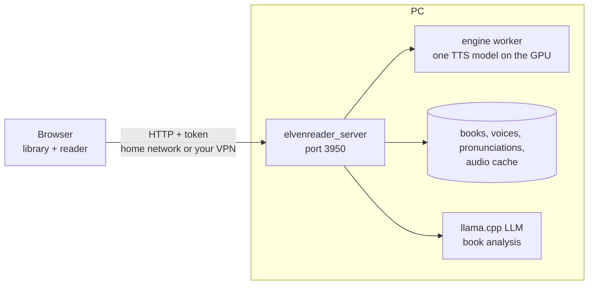

# ElvenReader

Listen to your EPUBs read by high-quality voice models running on **your own PC**, in your browser,
at home or away. No cloud service: a PC server plus its website.

* **The PC server** (`server/`) loads open-weight text-to-speech models on the GPU itself, clones
  voices from a short reference clip, applies your pronunciation fixes and caches every sentence.
* **Dramatized reading:** a local LLM works out who says each line and how (*"Stop!" she shouted*
  → the character's voice, shouting), sorts the cast into main, supporting and extras, and each
  character gets a voice.
* **The website** (`http://<PC>:3950/books`) is the library and reader: add EPUBs, read along
  while it plays with every character's voice, correct speakers, edit voices. It works on any
  device on your network or your own VPN.



The Android app that used to be the reader has been retired (see *The Android app* at the end).

## Voice models

All four run on an RTX 5080 (16 GB) with PyTorch 2.8 + CUDA 12.8. The site reads with one of them,
the **speech model** chosen on the **Settings** page (default OmniVoice). It is what the site reads
with, and requests can't swap it for another; it makes way only for book analysis while nobody
uses the site (see *How analysis shares the GPU*). Voice design with another model (Qwen3-TTS by
default) runs as a separate, design-only worker next to it (about 4 GB) while you design and is
unloaded after three minutes without designs; a design waits for it to load. Voices are always
designed with Qwen3-TTS, which follows the whole description (OmniVoice only takes fixed tags such
as "male, low pitch"). Measured on this PC with `scripts\bench_engines.py` (five
sentences, two with a delivery, imported voice *The Documentarian*, after one warm-up sentence).
*RTF* is generation time ÷ audio length, so below 1.0 is faster than real time. *WER* is
Whisper-turbo's word error rate on the output (intelligibility).

| Engine (id) | Why it's here | Delivery control | Phonemes | RTF | First audio | Load | VRAM | WER | Licence |
|---|---|---|---|---|---|---|---|---|---|
| **OmniVoice** (`omnivoice`, default) | VoiceStudio's model, so imported voices sound the same; 600+ languages; 32-step quality preset | non-verbal tags only (`[laughter]`, `[sigh]`) | CMU `[B EY1 S]` | 0.27 | 0.9 s | 9 s | 4.0 GB | 0% | Apache-2.0 |
| **Fish Audio S2 Pro** (`fish_s2`) | Best-rated open model for clarity and expressiveness; free-form inline tags | `[shouting, urgent]` tags | – | 0.60 | 2.0 s | ~3 min | 13.8 GB | 0% | Fish Audio Research (non-commercial) |
| **IndexTTS 2.5** (`indextts`) | Expressive cloning; emotion from a delivery text | emotion text → emotion vector | CMU `<word\|PH>` | 0.54 plain, ~1.5–2.7 on short lines with a delivery | 2.8 s | 1 min | 6.8 GB | 0% | bilibili (non-commercial) |
| **Qwen3-TTS 1.7B** (`qwen3tts`) | Base model for cloning plus **VoiceDesign** to create character voices from a description | – (VoiceDesign only) | – | 1.76 | 6.1 s | 15 s | 4.4 GB | 0% | Apache-2.0 |

Whisper transcribes *"Stop!" she shouted* with an exclamation mark only for the two engines that
received the delivery (Fish S2 Pro, IndexTTS); OmniVoice and Qwen3-TTS read it as *"Stop,"*.
Speaker similarity to the reference wasn't measured objectively; listen to
`server\data\bench\<engine>-<voice>.wav` to compare.

Notes:
* Fish S2 Pro and IndexTTS use `torch.compile` (via `triton-windows`), which roughly doubles
  their speed (Fish: RTF 1.8 → 0.6) but makes loading slow; keep the reader's default engine on
  OmniVoice or set `default_engine` and let it preload at start-up.
* Fish S2 Pro's context is capped at 4k tokens and its codec runs in bf16; otherwise it needs
  ~21 GB and spills out of a 16 GB card at a third of the speed.
* IndexTTS spends ~1.5 s per line analysing a delivery text, so short dramatized lines are slower
  than real time; the reader's look-ahead absorbs it.
* Qwen3-TTS is slower than real time on Windows (Python-bound, no FlashAttention) and slower still
  while the LLM runs on the CPU. It is the **voice-design** engine; for continuous listening
  prefer the other three.
* Excluded on purpose: speed/lightweight models (Kokoro, Piper, Chatterbox Turbo), VibeVoice 7B
  (~19 GB of weights, doesn't fit), Higgs Audio v2 (needs 24 GB).

## 1. Set up the PC server

Requirements: Windows, an NVIDIA GPU with recent drivers, ~60 GB free disk for models and
environments. [`uv`](https://docs.astral.sh/uv/) is installed automatically with winget if missing.

```powershell
cd D:\Dev\AndroidReader\server
# Where models and per-engine Python environments go (outside git). Default: server\data\models
'{"models_dir": "D:\\Models\\AndroidReader"}' | Set-Content -Encoding ascii data\config.json

.\setup-engines.ps1                 # one venv per engine (torch cu128); or e.g. .\setup-engines.ps1 omnivoice fish_s2
.\download-models.ps1               # weights into <models_dir>\hf and <models_dir>\checkpoints
.\run-server.ps1 --import-voicestudio   # optional: copy VoiceStudio's voice profiles (read-only)
.\run-server.ps1                    # start; prints the token and the library's addresses
```

`run-server.ps1` creates the server's own small environment (`server\.venv`) on first run.
Options: `--port 3960`, `--engine fish_s2` (default engine), `--no-preload`, `--rotate-token`,
`--show-links`. Settings live in `server\data\config.json` (git-ignored, contains the token):

| Key | Default | Meaning |
|---|---|---|
| `models_dir` | `data\models` | Engine venvs, model weights, compile caches, LLM files. |
| `default_engine` / `default_voice` | `omnivoice` / first voice | The site's speech model (set on the Settings page) / the voice used when the reader doesn't choose. |
| `extra_urls` | `[]` | More addresses for the links and QR codes on the server's page, e.g. `["http://10.8.0.2:3950"]` for the PC on your VPN. |
| `preload` | `true` | Load the default engine at start-up. |
| `engine_options` | `{}` | Per engine, e.g. `{"omnivoice": {"num_step": 16}, "indextts": {"compile": true}}`. |
| `sentence_pause_ms`, `trim_silence` | `300`, `true` | Pacing between sentences. |
| `cache_max_mb` | `4096` | Sentence audio cache (`data\cache`). |
| `llm_model`, `llm_mode`, `idle_after_s`, `design_pause_s`, `llm_cpu_moe_shared`, `llm_cpu_moe`, `llm_threads` | Qwen3.5-35B-A3B, `adaptive`, `300`, `600`, `32`, `20`, `12` | Dramatization LLM and how it shares the GPU (see below; the mode and both pauses are on the Settings page). |
| `llm_label_context_words`, `llm_label_recent_lines` | `600`, `12` | Story text before each passage and earlier attributions shown when labelling; `0`, `6` = the old, slightly faster pass (see *What does more time per book buy?*). |
| `llm_label_profiles` | `true` | The labelling pass also notes each speaker's voice profile (see *Voice profiles*). |
| `llm_dossier_model`, `llm_dossier_effort`, `llm_dossier_words` | empty (off), `medium`, `3500` | Optional pass 1: a reasoning model builds character dossiers (see *Character dossiers*). |
| `whisper_venv`, `whisper_model` | `indextts`, `whisper/large-v3-turbo.pt` | Transcribes new reference clips in the voice editor. |
| `voice_design_engine`, `designer_idle_s` | `qwen3tts`, `180` | Creates character voices (must follow free-text descriptions; Qwen3-TTS); the designer is unloaded after this many seconds without designs. |
| `cast_supporting_voices` | `12` | How many supporting characters (most lines first) get a designed voice of their own; main characters and narrators always do, extras share pool voices. |

Environment overrides: `ELVENREADER_PORT`, `ELVENREADER_HOST`, `ELVENREADER_TOKEN`,
`ELVENREADER_DATA`, `ELVENREADER_MODELS`. Every request is logged with its engine, audio
length, time to first audio and RTF in `server\data\server.log`.

### Voices

Voices live in `server\data\voices` as a WAV plus a JSON file (name, transcript, language,
seed). Every voice has reference audio and its transcript, so every engine can clone it and the
speaker never changes between sentences. Add voices by importing from VoiceStudio
(`--import-voicestudio`, read-only), by `POST /api/voices` (WAV + transcript), or by designing
one from a description (`POST /api/voices/design`).

### Windows firewall (once, elevated)

```powershell
cd D:\Dev\AndroidReader\server
.\allow-firewall.ps1        # TCP 3950 on Domain and Private networks
```

Your home network must be a **Private** network (and so must your VPN's adapter, if other devices
reach the PC through it). Without this rule other devices can't open the library.

### Start automatically (optional)

```powershell
$a = New-ScheduledTaskAction -Execute "powershell.exe" -Argument "-NoProfile -WindowStyle Hidden -ExecutionPolicy Bypass -File D:\Dev\AndroidReader\server\run-server.ps1"
Register-ScheduledTask -TaskName "ElvenReader server" -Action $a -Trigger (New-ScheduledTaskTrigger -AtLogOn)
```


The server parses EPUBs itself, so there is nothing else to install: no JDK, Android SDK or adb.

## 2. Open it on other devices

On the PC, **http://127.0.0.1:3950/books** opens the library directly. For other devices, open
**http://127.0.0.1:3950/** on the PC (it's served only to the PC itself because it shows the token).
It lists a link and a QR code for each of the PC's addresses, in the form
`http://<PC address>:3950/books#token=…`. The browser keeps the `#` part to itself, stores the token
and removes it from the address bar. Without the link, the library asks for the token. The page
itself is served to any address but holds no token, and every book, script and audio request needs
the token.

**Away from home:** use your own VPN to reach the PC, and add the PC's address on that VPN to
`extra_urls` in `server\data\config.json` so the server's page shows a link for it too. Don't
port-forward 3950 on your router: the server speaks plain HTTP, protected only by its token.

## 3. Add books

In the library, **+ Add book** and choose one or more EPUB files from the device you're using: a
phone, a tablet or another computer on the network. Pick the book's **series** first if you know it
(by default it is detected from the title). After the upload the dialog shows each book's series and
lets you fix it before the cast is created; books in a series share their cast and voices (see
*Series* below).

The server parses the EPUB, keeps a copy with its cover and pictures, and starts working:
1. **Analysis:** who says each line and how, as described in section 5. It takes about an hour
   per 100k words while nobody uses the site, about 1.5 hours while you read or listen, and
   pauses while you design voices (see *How analysis shares the GPU*). You can read and listen
   along as lines come in.
2. **Tiers:** the cast is sorted into main, supporting and extras.
3. **Voices:** the cast's voices are created (untick *Create the cast's voices* to skip this).

The library shows progress, with the books of a series grouped under its name in volume order.
**Re-analyse** on a book starts its analysis again from scratch; your corrections, cast and voices
are kept. Adding a book that is already in the library keeps its analysis.

**Queue** (in the library header, with the number of books waiting) shows the book being analysed
with its progress, the books next in line with a rough time each (about 1,800 words a minute with
the whole GPU), and the books whose voices are still to be created. ▶ analyses a waiting book now:
the current one stops, keeps the passages it has finished, and goes next. Drag a book, or use ⤒
(next), ↑, ↓ and ⤓ (bottom; on the current book it stops it and sends it to the end), to change
the order; ✕ takes a book out of the queue, keeping what's done. **Continue
analysis** on its library card puts it back at the end. The order is saved, so a restart resumes
the same way, the interrupted book first.

From the command line (which can also add a file by its path on the PC), the same thing is
`.\.venv\Scripts\python.exe scripts\process_book.py "E:\...\Book.epub"` (options `--no-cast`,
`--engine qwen3tts`, `--reanalyze`). It prints progress until the book is done, then the cast by
tier.

**Series.** A book's series is detected from its title (*Sasaki and Peeps, Vol. 10* → *Sasaki and
Peeps*). To change it, use the 📚 picker next to the book's title: the series known so far,
*Detect from title* or *New series…*. If the new series already has a cast from its other books,
you're offered **Apply series cast now**: matching characters take the series' voices, profiles
and tiers, and the series' characters join the cast, without labelling the lines again (voices you
picked yourself are kept). Otherwise the series cast is applied when the book is next analysed. The
book also leaves its old series' memory. The **Series** page lists each series with its books and
cast size, and can **rename** a series (for all its books) or **merge** it into another (the same
characters become one; the other series' voices win).

**Volume order** follows each book's title: the number after *Vol.*, *Volume*, *V*, *Book* or *Part*
(*Part 2 Volume 3* sorts as 2, 3), or a number at the very end. A book without one is listed last
and marked *(no volume number)* on the Series page. Rename it with ✎ (next to the title on the
book's page, or on the Series page), e.g. *Sword Art Online 19: Moon Cradle* → *Sword Art Online,
Vol. 19: Moon Cradle*. The book stays in its series, and uploading the file again keeps your
title. A book added for analysis queues ahead of later volumes of its series that are still
waiting, so they inherit its cast.

Book IDs are the first 16 hex digits of the EPUB file's SHA-1, and each quotation's ID is
`c<chapter>p<paragraph>q<offset>`. The parser (`elvenreader_server/epub.py`) is a port of the
retired Android app's parser and gives identical chapters, paragraphs, quotation IDs and pictures.
Chapters follow the book's own table of contents: a chapter that a publisher split into several
files (often at every illustration) is joined back into one. Pictures are attached to the paragraph
after them, so they never shift the text.

## 4. Read and listen

* **Library:** every book with its cover, word count, analysis progress and cast status; **+ Add
  book** and **Re-analyse** (section 3).
* **Book:** chapters in reading order, with the book's illustrations (click one to open it full
  size); quotations coloured by speaker with the speaker's name and
  delivery (*shouting, urgent*); ✎ marks your corrections.
* **Cast panel:** characters grouped as **Main / Supporting / Extras** (Extras folded), each row
  just a colour dot, the name, the line count and ▶ (voice sample). Type in *Find a character* to
  filter. Click a character to open its panel:
  * **Overview:** aliases (editable; they help recognise the character in the text) and the tier
    (*Main / Supporting / Extra*; *use automatic* hands it back to the model, whose reason is shown).
  * **Voice:** play, change, or *Edit voice…*; shows the assigned voice's own description (a character with a voice of its own takes that voice's description whenever the voice is chosen or edited).
  * **Profile (for voice design)**, folded: gender, apparent age, physical appearance, speech style and important characteristics (see *Voice profiles*), editable, and *Design voice from profile*. It is used to design the voice and for later volumes in the series; it doesn't change who-said-what.
  * **Lines:** *Show this character's lines*.
  * **⋯:** rename, or merge into another character.

  The ⋯ next to *Cast* holds the book's cast actions:
  * *Sort cast into tiers*
  * *Create missing voices*
  * *Give supporting characters their own voices* (replaces their shared pool voices)
  * *Re-label lines* (your corrections are kept)
  * *Highlight lines of* everyone / main / main + supporting (dims everyone else's lines)

  Tiers also appear in the Voices page's *Used by* lists. Unnamed speakers are shown as names
  ("Prisoner", "Tattoo Artist"), as the model's "a prisoner" is stored. After labelling, a character
  the model named by description ("Urano's mother", "Dad") takes a proper name it was also called
  (Effa, Gunther), and anyone takes an alias the book uses at least three times as often ("Myne"
  over her past-life name "Urano"); the old names stay aliases. Names you type are kept
  exactly. The speaker filter (top) also offers *quotes given to the narrator*; search finds text.
  On a narrow screen (phone), ☰ slides the chapters and the cast over the text, wherever you are
  in the book; picking a chapter, tapping outside, ✕ or Esc closes it. **⛶ Reading mode** (or the F
  key) goes full screen with just the text: the header, sidebar and player go away, and a small
  ▶/■ and *Exit reading mode* float in the corner, fading when you don't move. Esc, the button
  or leaving full screen ends it.
* **Playback:** click any line or narration to play from there through the chapter with each
  speaker's voice and delivery, using the chosen narrator voice and the site's speech model
  (Settings). While a passage plays, the next 10 are already being made on the PC; jumping
  elsewhere cancels the ones you won't hear. Sentences already
  synthesized come from the server's cache, so re-listening is instant. Speech reaches the
  browser as Ogg Opus at 64 kbit/s (MP3 where the browser can't play Opus), about a sixth of the
  raw 24 kHz audio: roughly 30 MB per hour of listening instead of 170 MB.
* **Editing:** click a speaker tag to change the speaker or delivery; corrections always win
  over the model. The book's series is shown next to the title and can be changed there (see
  *Series* in section 3).

## 5. How books are dramatized

When a book is added, the server analyses it in the background:

1. **Deterministic segmentation:** quotation marks split each paragraph into quotations
   (character voices) and narration, so *"Stop!" she shouted.* becomes the quotation and *she
   shouted.* (narrator). The text is never rewritten, so highlighting always matches the EPUB.
2. **LLM pass per ~600-word chunk** (llama.cpp, JSON-schema constrained): for each numbered
   speaker turn, the speaker and a short delivery (*shouting, urgent*), using a rolling character
   roster and the last few attributions.
3. **Roster pass:** gender, apparent age (how old they look and sound, not their true age),
   accent, temperament and a voice description per main character, from their lines and the
   narration's descriptions of them.
4. **Cast:** after the lines, the LLM sorts the characters into three tiers (see *Character
   tiers* below): **main**, **supporting** and **extras**. *Create missing voices* designs a voice
   (Qwen3-TTS VoiceDesign) for every main character and narrator and for up to
   `cast_supporting_voices` (12) supporting characters, most lines first. Each designed voice is
   locked as a cloned reference so it stays consistent. Extras share a small pool of voices by
   gender and age. Any character can be renamed, merged with an alias (*Lizzy* = *Elizabeth*),
   moved to another tier or given any voice.
5. Click a speaker tag in the reader to change the speaker or delivery. Corrections always win
   over the model.

**Character tiers.**
* **Main:** the protagonists and core recurring cast, plus anyone who narrates.
* **Supporting:** recurring, named characters with a real presence.
* **Extras:** walk-ons, meaning anyone unnamed ("a prisoner") or a named character seen in only
  one chapter.

The model gets per-character evidence: line count and share, chapters where they speak or are
mentioned, first and last appearance, named or not, narrating, and the description. Rules back
it up:
* A narrator is always main.
* An unnamed character is an extra unless they speak at least 5% of the lines.
* Nobody with at least 5% of the lines is an extra.
* An answer far from the line counts is flagged (⚠ in the viewer).

Your choice always wins. The series memory keeps tiers: a character who was main in an earlier
volume stays at least main in the next one, and your choices carry over.

Books analysed before tiers existed get rule-based tiers when opened; *Sort cast into tiers*
(viewer) or `POST /api/books/{id}/roles` asks the LLM, in about 45 seconds, without re-labelling.
On *Sasaki and Peeps* v10:
* **Main:** Sasaki, Yingling, Futarishizuka, Captain Mason, Suiran, Hoshizaki, Type Twelve,
  Peeps and the Neighbor.
* **Supporting:** Akutsu, Prince Lewis, Lady Elsa, Abaddon, Count Müller, Miss Inukai and
  Magical Pink.
* **Extras:** the prisoner, robber, guard, driver and other walk-ons, plus Nick, Mr. Joseph and
  Michael, who speak in only one chapter.

Two runs agreed except on Magical Pink (supporting or extra). The labelling prompt already lists
the roster by line count, so it was not changed.

Lines are voiced as soon as their chunk is analysed. Delivery is applied by engines that support
it (Fish S2 Pro: inline tag; IndexTTS: emotion; OmniVoice: laughter/sigh only); others read the
line plainly in the character's voice. Voice and delivery are part of the cache key.

**LLM setup:** `download-llm.ps1` fetches llama.cpp and **Qwen3.5-35B-A3B** (Q4_K_M, 22 GB,
Apache-2.0; a mixture of experts with about 3B parameters active per token, run with thinking off).
`-Alternative` adds the previous default, Qwen3-30B-A3B-Instruct-2507, and gpt-oss-20b. The
server starts and stops llama.cpp itself, and frees its memory when idle.

Measured on hand-labelled chapters (*Pride and Prejudice* ch. 1, *Alice* ch. 7; 182 quotations,
`scripts\eval_attribution.py`). The whole of *Alice* (27k words) was analysed on the GPU in
12.5 minutes (1,117 lines, 42 characters), and casting created 20 voices.

| LLM | Where | Speaker accuracy | Time per 100k-word book |
|---|---|---|---|
| **Qwen3.5-35B-A3B** Q4_K_M (default) | GPU (experts of 20 layers in RAM) | **180/182 = 98.9%** | ~70 min |
| Qwen3-30B-A3B-Instruct-2507 Q4_K_M | GPU (experts of 20 layers in RAM) | 179/182 = 98.4% | ~65 min |
| Qwen3-30B-A3B-Instruct-2507 Q4_K_M | CPU only (16 threads) | 179/182 = 98.4% | ~4 h |
| gpt-oss-20b MXFP4 | GPU (fully on the card) | 180/182 = 98.9% | ~19 min |
| gpt-oss-20b MXFP4 | CPU only | 174/182 = 95.6% | ~4 h |

The difference shows on harder text. On two hand-labelled *Sasaki and Peeps* vol. 10 excerpts
(`scripts\eval_dossier.py --no-dossier --label-model ...`), Qwen3.5 scored **95/102 = 93.1%** on a
prison scene where Qwen3-30B scored 86/102 = 84.3%. Qwen3.5 recognises an unnamed prisoner as the
character who gives his name later. Both scored 55/59 = 93.2% on group banter, at the same speed
(about 45 minutes for that 85k-word book).

The remaining misses are an illustration caption, a chorus line ("Sh! sh!") and, for gpt-oss on
the CPU, Alice's thoughts and an untagged Bennet exchange. Qwen is preferred over gpt-oss because it
is equally accurate on CPU and GPU and writes more actable deliveries (*"dry, amused"*, *"gossipy,
animated"*, *"exasperated, reproachful"* vs gpt-oss's *"curious"*, *"annoyed"*). For reference,
BookNLP scores 56.7% on the PDNC benchmark and the 2026 state of the art (ModernBookNLP) 94.5%;
our two chapters are a small sample, not a benchmark. Two prompt details mattered: numbering
*speaker turns* (both halves of *"Yes," he said, "I will."* share a number) and having the model
echo each quote's first words. Without them labels drifted by one after an interrupted quote
(91.8%).

**ModernBookNLP as a second opinion (tried, not used).** The encoder model from *Fast and Accurate
Quotation Attribution in Literary Texts* (2026; 94.5% on PDNC) runs on the CPU in about 7 minutes
per book. On our gold sets it was far weaker than the LLM: 55.9% vs 85.7% on the *Sasaki and
Peeps* excerpts, and 85.7% vs 98.9% on the two classic chapters (it does well on *Alice*, 98.7%, but
gets 27% on *Pride and Prejudice* ch. 1, where Mrs. Bennet is never named). Lines where the two
disagree contain 23 of the LLM's 25 errors, but they make up 43% of *Sasaki*'s lines with 30%
precision, and 15% of the classics' lines with 7% precision. Re-checking that many lines costs
more than it can gain, so it is not part of the pipeline. `scripts\eval_flagger.py` reproduces
the numbers.

**Jev-like classifiers as a second opinion (tried, not used).** Each quotation is asked as one
multiple-choice question: the local scene (about 250 words before, the quote marked, 80 after,
plus a note naming the first-person narrator), with options = characters the LLM found speaking
nearby + "someone else" + "nobody". The same gold sets as above; minutes per 2,600-quotation book.

| Second opinion | Alone: *Sasaki* / classics | Lines flagged (*Sasaki*) | Precision | LLM errors caught | min/book |
|---|---|---|---|---|---|
| ModernBookNLP (for comparison) | 55.9% / 85.7% | 43% | 30% | 23 of 25 | 7 (CPU) |
| OpenJev-Flash-9B Q8_0, every disagreement | 65.2% / 98.4% | 26.1% | 17% | 7 of 23 | 7 |
| OpenJev, disagreement with confidence ≥ 0.5 | | 6.8% | 45% | 5 of 23 | |
| OpenJev, confidence ≥ 0.8 | | 1.2% | 100% | 2 of 23 | |
| jeff + GLiFormer-large, every disagreement | 19.9% / 42.9% | 79.5% | 15% | 19 of 23 | 2.5 |

OpenJev ([openjev/OpenJev-Flash-9B-GGUF](https://huggingface.co/openjev/OpenJev-Flash-9B-GGUF),
CC BY-NC; the "APUS-OpenJev" name on community pages does not exist) runs on llama.cpp and its
confidence is usable: thresholding shrinks the flags to a small, precise set (on the classics,
≥ 0.5 flags 1.1% of lines, ≥ 0.8 flags one line, an actual error). jeff with GLiFormer mostly
picks the first-listed option with near-uniform confidence; with only the quote's paragraph as
the state it reaches 85.7% on the classics but still 24.8% on *Sasaki*, so it is not useful here.

Routing OpenJev's ≥ 0.5 flags back to Qwen3.5 with reasoning on:

| Re-check | *Sasaki* (161 lines) | Classics (182) | Added time |
|---|---|---|---|
| Re-label the flagged passages (as in the normal pass) | 85.7% → 88.8% (+5, none broken) | | ≈ 8 h per book |
| Ask about each flagged line on a wider scene (600 words) | 85.7% → 86.3% (+2, −1) | 98.9% → 99.5% | ≈ 1–5 h per book |

The passage re-check works but costs several times the whole labelling pass for three points,
so it is not in the default path. `scripts\eval_jev.py` reproduces the classifier numbers
(`--backend openjev|jeff`, and `--recheck rows.json` for the per-line routing);
`scripts\eval_flagger.py route --jev rows.json --min-conf 0.5` runs the passage re-check.

**What does more time per book buy? More context, not more reasoning.** With up to double the
labelling time allowed, each option below labelled the chunks that contain the *Sasaki and Peeps*
gold excerpts (161 lines, empty cast) and the two classic chapters (182 lines) on the GPU
(`scripts\eval_reasoning.py`). Time is relative to the old single pass. Repeated runs of the old
pass scored 148, 148 and 139 on *Sasaki*, so differences of a line or two are noise.

| Variant | *Sasaki* | Classics | Time |
|---|---|---|---|
| Old pass: Qwen3.5, thinking off, 6 recent lines | 145.0/161 = 90.1% (mean of 3) | 180/182 | 1.0× |
| **+ 600 words of preceding text, 12 recent lines (new default)** | **152.7/161 = 94.8%** (152, 153, 153) | 180/182 | **1.05×** |
| + 1,200 words of preceding text, 20 recent lines | 153/161 = 95.0% | 180/182 | 1.6× |
| 1,200-word chunks + 600 words before | 150/161 = 93.2% | 180/182 | 1.0× |
| Qwen3.5 thinking, 1,024-token budget | 148/161 = 91.9% | 180/182 | 2.0× |
| gpt-oss-20b, medium reasoning (whole model on the GPU) | 124/161 = 77.0% | 176/182 | 1.0× |
| Review pass: a second call per chunk checks the first pass's labels | 150/161 = 93.2% | 180/182 | 2.0× |
| More context + review pass | 152/161 = 94.4% | 180/182 | 2.0–2.8× |
| Self-consistency: second run on shifted chunks, disagreeing chunks reviewed | 149/161 = 92.5% | 180/182 | 3.2× |

Showing the model the story just before each passage (who entered, who was talking) fixes most
untagged turns that the old pass got wrong. It is also steadier from run to run. Reasoning,
reviews and second opinions on top of that add time without adding accuracy, so the extra
budget is left unused. What remains wrong is mostly fast multi-party banter (Type Twelve, the
Neighbor and Futarishizuka). The new default is `"llm_label_context_words": 600` and
`"llm_label_recent_lines": 12`; set them to `0` and `6` for the old pass.
Re-labelling the whole of *Sasaki and Peeps* v10 with the new default took 64 minutes instead of
46, about 75 minutes per 100k words; whole-book prompts carry the full cast, so the extra text
costs more than on the excerpts. It kept the reader's corrections, cast, voices and narrators. On
the gold excerpts the book went from 138/161 = 85.7% to 142/161 = 88.2% (group banter 54 → 57/59).
Twelve of the remaining 19 misses come from one chunk at the start of a chapter, which has no
preceding text to use: there the then-unnamed Nick comes out as "a prisoner", "Nick" or another
character from run to run, with either setting.

**Letting later passages revise earlier lines (tried, not used).** A reader often only works out
who said something a page later, for example when the "prisoner" introduces himself as Nick. With
`"llm_label_revise_window": K`, each labelling call also sees the chapter's last K labelled lines
([R1], [R2]…, never the reader's corrections) and may revise them, giving the evidence. Revisions
are logged in the script and flagged as `revised` on the line. Three guards apply. A revision must
echo the line's first words, so it can't land on the wrong line. Its reason must quote the passage,
or rest on an accepted revision ("same as R1"). `llm_label_revise_unnamed` limits it to lines given
to unnamed speakers ("a prisoner"). Measured on the gold-chunk harness (three runs each; time vs
the default):

| Variant | *Sasaki* (mean of 3) | Classics | Revisions in 3 runs: fixed / broke | Time |
|---|---|---|---|---|
| Default (600 words before, 12 recent lines) | 152.0/161 = 94.4% | 180/182 | — | 1.0× |
| Revise the last 12 lines | 153.0 = 95.0% | 180/182 | 0 / 2 (8 changed nothing) | 1.15× |
| Revise the last 30 lines | 149.7 = 93.0% | 180/182 | 0 / 0 (1 made) | 1.15× |
| Revise the last 60 lines | 150.3 = 93.4% | 180/182 | 0 / 5, plus 7 wrong on unscored lines | 1.6× |
| Unnamed speakers only (last 60) | 151.3 = 94.0% | 180/182 | 0 / 0, but 12 wrong on unscored lines | 1.05× |
| Revise 30, Qwen3.5 thinking (1,024 tokens; 1 run) | 153 = 95.0% | 180/182 | none made | 2.1× |

The gold chunks start from an empty cast, where the Nick lines come out right anyway (12/12 in
every run), so they can't show the case this is for. A separate probe reproduces the whole-book
run: the prison chapter's first three chunks re-labelled with the full cast and earlier chapters
in place, three runs each (`scripts\eval_reasoning.py --nick-probe 3 ...`):

| Variant | Nick's 12 lines before he gives his name |
|---|---|
| Default, revise 12 or 30 | 0/12 in every run ("a prisoner" or "Mr. Akutsu") |
| Unnamed speakers only, without the evidence check | **12/12 in all three runs** |
| Unnamed speakers only, with the evidence check | 1, 12 and 1/12 |

It does fix Nick, but the same mechanism also rewrites other unnamed speakers. In the prison yard,
six lines of other prisoners' chatter ("Zhang Lee? What's Nick talking about?") were "a prisoner"
too. In most runs they were revised to Nick, Zhang Lee, the Neighbor or a soldier. Wider windows
break correct lines (Sasaki's own "Yes. Kenta Nakano." given to a soldier). The evidence check
removes those mistakes only by also removing most of the Nick fix, because the model can't tell
which of several people a description such as "a prisoner" means. No variant gained on *Sasaki*,
so it stays off (`0`). Correcting the Nick lines in the viewer remains the reliable fix.

**How analysis shares the GPU** (Settings → *Book analysis*, `llm_mode`). `"adaptive"` (default)
follows what the site is used for:

| You are… | On the GPU | Book analysis | New books' voices |
|---|---|---|---|
| **reading or listening** (a page in use, or audio playing) | speech model, plus the LLM next to it (experts of 32 layers in RAM, `llm_cpu_moe_shared`) | runs, about 1.5× slower (37 instead of 60 tokens/s) | wait |
| **designing voices** (and for `design_pause_s`, 10 min, after the last design) | speech model + voice designer (8.5 GB together) | paused | — |
| **away** (nobody has used the site for `idle_after_s`, 5 min) | the LLM on the whole GPU, or the designer | full speed | created, one book at a time between analysis steps |

Moving between them is quick: when you open a page after being away, the analysis LLM is stopped at
once and the speech model loads (about 10 s); when you start designing, the LLM stops and the voice
designer loads next to the speech model (10–30 s). A banner at the top of every page shows these
loads with a progress bar (estimated from the previous load) and confirms when the model is ready.
While both the speech model and the LLM work, speech stays faster than real time (OmniVoice at
0.5–0.6 RTF instead of 0.2–0.35) and VRAM peaks around 13.3 of 16 GB. A step stopped by a change
of state is retried, never lost. Things you ask for (sorting the cast into tiers, *Create missing
voices*) run at once. Fixed alternatives: `"shared"` (always next to the speech model), `"auto"`
(the whole GPU after two minutes without speech, otherwise the CPU), `"gpu"`, `"cpu"`.

**Quoted terms are narration.** Words in quotation marks inside a sentence (*Chinese for “cat.”*,
*all the “inspections” we did*, *labelled “DRINK ME,”*) are not dialogue. The prompt says so
explicitly. In first-person books the model used to give them to the narrating character: 11–13
of 18 right in *Sasaki and Peeps* v10, 16–17 with the new wording. A rule backs it up: a short
quote straight after a word, with no punctuation inside and no speech verb before it ("then said
“The fourth.”" stays dialogue). Such quotes stay inside the narration: the whole sentence is read in
one go, in the narrator's voice, and the reader shows them as plain text
(dotted underline); double-click one to give it to a speaker. Books analysed earlier
are fixed when the server opens them. Quotations given to the narrator (signs, notes) are also
read in the narration's voice, so in first-person passages they no longer switch to a different
voice mid-sentence.

**First-person books.** Many novels (and most light novels) are told by "I". The model reports
each passage's narrator, the next passage is told who "I" was, and a point-of-view heading such as
*(The Neighbor's POV)* starts a new passage with an explicit "the narrator changes here". The
model also reports nicknames ("Makeup", "Robot Girl"), which are merged into the character they
belong to. On a hand-labelled excerpt of *Sasaki and Peeps* vol. 10 (108 quotations: Sasaki's
first-person prison scene, then the neighbor's POV with her nicknames for everyone) this raised
accuracy from 36% to 88%. The remaining misses are group banter in the neighbor's chapter; fix
them in the reader. That excerpt is copyrighted, so it lives in the git-ignored
`server\tests\gold\private\`.

**Two narrators in different tenses.** Some books switch narrator without marking the way back.
In *Sasaki and Peeps* the neighbor's sections start with *(The Neighbor's POV)*, are told in the
present tense and end at an unmarked scene break. Sasaki narrates in the past tense, and the table
of contents gives the heading as the title of chapters that actually open with Sasaki. When the
narration alternates between tenses, the server:

* finds the switches from the narration itself (dialogue removed);
* splits passages there and ignores POV chapter titles;
* tells the model who narrated earlier passages in the same tense;
* afterwards moves any "…," I said line to the narrator of its tense.

The same switches decide whose voice reads the narration. Single-narrator and third-person books
are unaffected.

On the full *Sasaki and Peeps* vol. 10, the hand-labelled excerpt spans one of the neighbor's
sections. There, wrong speakers fell from 15 to 7 (93.5%). The other 12 misses are Nick's lines
before he gives his name, which are labelled "a prisoner".

**Series memory.** A book's series is detected from its title (*Sasaki and Peeps, Vol. 10* →
*Sasaki and Peeps*; change it next to the book's title, see section 3). After casting, and whenever you edit a character, the
main cast is stored per series: names, aliases, apparent gender and age, dossier and voice. A new
volume of the series starts its analysis with that cast, so the characters keep the voices you
chose, including your corrections. *Sasaki and Peeps* is seeded from vol. 10's corrected cast
(Futarishizuka as a girl's voice with an old woman's manner, the Neighbor as a teenage girl, Peeps
as an elderly sage, and so on).

**Character dossiers (optional pass 1).** With `"llm_dossier_model"` set (e.g.
`"gpt-oss-20b-MXFP4.gguf"`), a reasoning model first reads the whole book in about 3,500-word
passages. It builds a dossier per character: aliases, apparent age and form (what a listener should
hear), true nature, personality, speech style, relationships, how they first appear, and evidence
quotes. A final consolidation call merges duplicates. Line labelling then uses the dossier. It is
**off by default**, because on our gold excerpts it made attribution worse. Wrong identity merges
from the first read (e.g. Nick made an alias of Sasaki's cover name) spread into many lines, and it
did not improve the apparent ages either. Measured on *Sasaki and Peeps* vol. 10 (two hand-labelled
excerpts, 161 quotations; `scripts\eval_dossier.py`):

| Pipeline | Prison scene (ch. 8) | Group banter (ch. 12) | Age/gender/form checks | Pass 1 time |
|---|---|---|---|---|
| **Single pass (default)** | **86/102 = 84.3%** | **55/59 = 93.2%** | 18/24 | — |
| + dossier, gpt-oss-20b, medium reasoning | 72/102 = 70.6% | 53/59 = 89.8% | 18/24 | 16 min |
| + dossier, gpt-oss-20b, high reasoning | 64/102 = 62.7% | 51/59 = 86.4% | 17/24 | 68 min |
| Qwen3-30B-A3B-Thinking-2507 / Qwen3.5-35B-A3B | not completed | | | ~2 h (3–3.5 min per passage) |

The opt-in dossier pass is separate from the voice profiles below.

**Voice profiles.** Each character has a short profile that exists only to design their voice:
* **Gender**
* **Apparent age** (what a listener should hear)
* **Physical appearance** ("young girl in a kimono", "Java sparrow")
* **Speech style** (how they talk, verbal tics)
* **Important characteristics** (true age or nature, temperament, accent)

The labelling pass fills it as it reads: each passage's answer may include `profile_updates` with
what that passage shows about its speakers, and only that. The server merges them:
* Gender and apparent age go by majority over the passages, so a disguise or role-play doesn't stick.
* Appearance is replaced only by a more specific version.
* Speech style and characteristics accumulate.
* At the end of the analysis, entries that grew too long are compacted in one short LLM call.
* The roster step fills whatever is still empty from the appearance evidence it gathers.
* Your edits (character panel → *Profile (for voice design)*) always win.

The profile is used to design voices (casting, *Design voice from profile*) and is carried to
later volumes by the series memory. It is not given to attribution, so it never changes who says
what. `"llm_label_profiles": false` turns the reading-time notes off, so the profile then comes
only from the roster step. Books analysed before profiles existed are converted when opened. The
old dossier fields map over: form becomes appearance; speech style is kept; true nature,
personality, temperament and accent become characteristics. Your earlier edits stay yours.

Noting profiles while labelling doesn't change attribution, and costs about 14% more labelling time.
On the gold-chunk harness, three interleaved runs each (`scripts\eval_reasoning.py context-small
context-profiles`):
* *Sasaki*: 153, 153, 153/161 without profiles; 152, 153, 153/161 with them.
* Classics: 180/182 in every run.
* Time: 226 s vs 258 s on *Sasaki*, 145 s vs 166 s on the classics.

Compacting a book's profiles at the end takes one call of about 15 seconds.

## 6. Voice editor

Edit any voice by hand in the viewer: *Edit voice…* in a character's panel, or **Voices**
(http://127.0.0.1:3950/books/voices, linked from every viewer page). The Voices page lists every
voice, including imported VoiceStudio voices, pool voices and character voices, with who uses it.

Describe the voice in plain words ("a young girl's high, light voice, but old-fashioned and teasing
like a grandmother"), press **Make 3 options**, listen, and press **Use this** on the one you like.
That's all. It takes about a minute, and **Undo** goes back to the previous voice (the last 5 are
kept). A character's voice belongs to the character across the series: a voice you pick, design or
edit for Tuuli in volume 1 also goes to Tuuli in the series' other volumes (unless you gave her a
different voice in one of them) and to the series memory. **↓ Younger** / **↑ Older** make 3 options one age group younger or older (child, teen,
young adult, adult, middle-aged, elderly): the description's age is rewritten ("a gravelly adult
male voice" → "a gravelly young adult male voice"; "a 16-year-old girl" → "a 24-year-old young
woman"), shown in the box so pressing again goes further, and option 1 keeps the voice's seed to
stay closest to it. A description without an age asks for a younger- or older-sounding voice. A voice shared by several characters, such as a pool voice for minor characters, is
copied for the character you are editing. Tick *Also change it for N other characters* to change
it for all of them.

**Advanced** holds the rest:

* **Sample line:** what the options say (the design model is set on the Settings page).
* **Details:** name, language, seed and the transcript of the reference clip.
* **Use a real recording instead:** upload a WAV, MP3 or other clip, or record one in the browser
  (only on the PC itself or over HTTPS, a browser rule). Trim it, and *Fill in what is said* runs
  Whisper (large-v3-turbo in the IndexTTS venv); correct the text before saving. 5–20 s of one
  clear speaker works best.
* **Test with your own text:** any text, a delivery (*shouting*) and any installed engine.

The audio cache key includes a fingerprint of the voice's reference audio, transcript, language,
seed and design description, not only its ID. Edited voices are therefore never served from old
cached audio, and undoing an edit finds the old clips again.

## 7. Pronunciations

When the voice says a name or word wrong, fix it for the whole series:

* **Select the word** in a book's text: a *🗣 Pronunciation…* button appears next to it (on a phone
  or tablet, at the bottom of the screen). Or use *Pronunciations…* in the cast's ⋯ menu, *How the
  name is said…* in a character's ⋯ menu, or *Pronunciations…* on the **Series** page.
* Type how it sounds (`MY-nuh`, `BEN-oh`; capitals mark the stressed part), press **▶ Listen** to
  hear it in the sentence it came from (with your fix once you've typed one), and **Save**. Saved
  fixes are listed below, with ▶, ✎ and ✕.
* *More options* sets where it applies: **every book of the series** (default), **only this book**,
  or **all books**. For the same word, the narrower one wins (book over series over all books).
  Renaming or merging a series keeps its pronunciations.

How it works: the fixes are applied to the text before synthesis, so they work with every voice and
model. A respelling works everywhere (stress capitals are lower-cased before speaking); *More options*
also takes CMU/ARPAbet phonemes such as `HH ER0 M AY1 AH0 N IY0`, used by OmniVoice and IndexTTS.
Matching is whole-word and case-insensitive unless *Match case* is ticked (*May* the name, not
*may*), and covers possessives and plurals (*Hermione's*) and multi-word names. Fixes are part of
the audio cache key, so a changed fix never reuses stale audio. The API is `GET/POST
/api/pronunciations` and `PATCH/DELETE /api/pronunciations/{id}` (see *API*).

## Troubleshooting

* **Another device can't open the library:** is the server running? Is the firewall rule added
  (`allow-firewall.ps1`, elevated)? Is the network *Private*? Away from home: is your VPN connected,
  and are you using the PC's VPN address? `http://<pc>:3950/api/ping` should return JSON.
* **The library asks for the token:** open the link or scan the QR code on the PC's server page
  (http://127.0.0.1:3950/), or type the token shown there.
* **First sentence slow:** the model is loading (OmniVoice ~10 s, Qwen3-TTS ~15 s, IndexTTS ~1 min,
  Fish S2 Pro ~3 min because of `torch.compile`). Switching models also reloads.
* **Playback pauses between lines:** the chosen model is slower than real time for this text;
  pick a faster one in the player bar.
* **Wrong voice for a character, or wrong speaker:** fix it in the cast panel, or click the line's
  speaker tag.
* **An EPUB won't add:** the error says why (not an EPUB, no readable text). DRM-protected files
  can't be read.

## API (for reference)

All `/api/*` routes except `/api/ping` need `Authorization: Bearer <token>`.

| Route | Description |
|-------|-------------|
| `GET /api/ping` | Liveness; no auth. |
| `GET /api/health` | Version, default engine, loaded engine/state, voice count, cache stats. |
| `GET /api/engines` · `POST /api/engines/{id}/load` · `POST /api/engines/unload` | Engines with capabilities, licence and measured RTF; make one the site's speech model; free the GPU. |
| `GET/PUT /api/settings` `{speech_engine?, voice_design_engine?, llm_mode?, default_voice?, idle_after_s?, design_pause_s?}` | Site settings (the Settings page). `POST /api/tts` reads with the speech model; naming another `engine` is refused (409). |
| `POST /api/activity` · `GET /api/gpu` | An open page says someone is using the site (pages send it while you interact or audio plays) · what's on the GPU: the state (`reading`, `designing`, `idle`), the speech model and voice designer with loading progress, the analysis LLM (for the banner). |
| `GET/PUT /api/queue` · `DELETE /api/queue/{book}` · `POST /api/queue/{book}/now` · `POST /api/queue/{book}/bottom` | Analysis queue: `{current, queued, casting}` · `PUT {order: [book ids]}` puts those first, in that order · take a waiting book out (its status becomes `none`; `POST /api/books/{id}/analyze` continues it) · analyse a waiting book now (the current one keeps its progress and goes next) · send a book to the end (the current one stops and keeps its progress). Saved in `data/analysis-queue.json`. |
| `GET/POST /api/voices` · `DELETE /api/voices/{id}` · `GET /api/voices/{id}/audio` · `POST /api/voices/design` | Voice store (`?all=1` adds character voices, `?details=1` everything with who uses it). |
| `GET/PATCH /api/voices/{id}` · `PUT /api/voices/{id}/audio` · `POST /api/voices/{id}/revert` · `POST /api/voices/{id}/duplicate` | Voice editor: details, history and users · edit name/description/language/seed/transcript · new reference (multipart `audio`, `start`, `end`, `ref_text`; transcribed when empty) · undo · copy (`{book, character}` assigns the copy). |
| `POST /api/voices/{id}/design` · `GET /api/voice-candidates/{c}/audio` · `POST /api/voices/{id}/design/{c}` · `POST /api/transcribe` | Design candidates `{description, engine?, count?, text?, seeds?, age?}` (`age` -1/1: one age group younger/older; returns the new `description`, `age_from`, `age_to`) · listen · keep one · Whisper transcript of an uploaded clip. |
| `GET/POST /api/pronunciations` · `PATCH/DELETE /api/pronunciations/{id}` | Dictionary: `GET ?book=` (that book's, its series' and the global entries) or `?series=`; `POST {term, respelling?, phonemes?, case_sensitive?, scope: "series"\|"book"\|"global", book?, series?}` (`series` scope with a `book` = that book's series). |
| `POST /api/tts` | Body `{text, voice?, language?, speed?, delivery?, seed?, book?, sentence_pause_ms?, extra_pronunciations?, cache?, format?}`. By default chunked **PCM16LE mono** as it is made, rate in `X-Sample-Rate`; `format: "opus"` (Ogg Opus 64 kbit/s, what the website uses) or `"mp3"` (96 kbit/s, for browsers without Opus) returns the whole passage compressed, about 18% / 25% of the PCM size. `X-Cache: hit/miss`. Errors before audio are JSON; closing the connection cancels synthesis. |
| `POST /api/library/import` | Add a book: multipart `epub` file (any device; what the website uses), or `{"path": ...}` (from the PC only, for `process_book.py`); options `analyze`, `cast` (default true), `reanalyze`, `engine`, `series` (default: from the title). |
| `GET /api/books` · `GET /api/books/{id}` · `GET /api/books/{id}/cover` | Books with analysis/cast status · a book's paragraphs, quotations and pictures · its cover (`?w=120\|240\|400\|800` for a thumbnail). |
| `GET /api/covers?ids=a,b,c&w=240` | Several covers in one JPEG, left to right in 2:3 cells (the library loads one per series). With `&v=` (from the books' `cover_v`) the browser keeps it. |
| `PATCH /api/books/{id}` `{title}` | Rename a book (sets its volume order; it keeps its series; a re-upload keeps the title). Returns its series info. |
| `GET /api/books/{id}/pictures` · `GET /api/books/{id}/picture?path=` | The book's pictures · one picture (by its path in the EPUB; only pictures the book's text refers to). |
| `POST /api/books/{id}` · `GET /api/books/{id}/script` · `POST /api/books/{id}/analyze` | Store already-parsed book text (+`analyze`, `reanalyze`, optional base64 `cover`) · dramatization status and lines · analyse (`{relabel}` labels lines again; `{reanalyze}` starts over, your edits kept). |
| `PATCH /api/books/{id}/lines/{quote}` · `PATCH /api/books/{id}/characters/{id}` · `POST /api/books/{id}/cast` | Corrections · rename/merge/voice/`profile`/`aliases`/`role` (`main`, `supporting`, `extra`; `null` = automatic) · create character voices (`{"own_voices_for": ["supporting"]}` also replaces those tiers' pool voices). |
| `POST /api/books/{id}/roles` · `POST /api/books/{id}/characters/{id}/voice-from-dossier` | Sort the cast into tiers with the LLM (no re-labelling; progress in the script's `roles_state`) · new voice from the character's profile. |
| `GET /api/series` | Every series: its stored cast plus `volumes` (its books in volume order), `cast`, `voiced`. |
| `GET /api/books/{id}/series` · `POST` `{series?, apply?}` | A book's series (`auto`, `detected`, `volume`, `can_apply`) · set it (`""` = from the title; the book leaves its old series); `apply` gives the book the series' cast now without re-labelling. |
| `POST /api/series/rename` `{from, to}` | Rename a series for all its books; if `to` exists, merge into it. |
| `GET /` · `GET /books[/{id}]` · `GET /books/voices` | Links and QR codes for other devices (PC only) · library and reader (any address; asks for the token unless opened on the PC) · voices. |

## Development

```powershell
cd server
# server tests: API, EPUB parsing, dramatization (fake engine and LLM; no GPU needed)
.\.venv\Scripts\python.exe -m pytest

# engine benchmark (real models) and attribution accuracy (real LLM)
.\.venv\Scripts\python.exe scripts\bench_engines.py omnivoice fish_s2 indextts qwen3tts
.\.venv\Scripts\python.exe scripts\eval_attribution.py tests\gold\pride-ch1.json tests\gold\alice-ch7.json
# labelling variants on the gold excerpts (gold excerpts of copyrighted books live in tests\gold\private)
.\.venv\Scripts\python.exe scripts\eval_reasoning.py --list
.\.venv\Scripts\python.exe scripts\eval_dossier.py --dossier-model gpt-oss-20b-MXFP4.gguf --roster tests\gold\sasaki10-roster.json tests\gold\private\sasaki10-ch8.json tests\gold\private\sasaki10-ch12.json
```

## The Android app

Earlier versions had an Android app (an EPUB reader that played the server's voices, with
lock-screen controls and system TTS). It has been removed to focus on the server and the website;
git history has it (`git show cded61d^:android`). A copy already installed on a phone isn't
uninstalled. It may keep working for books and voices against this server, but it is no longer
maintained, and its pairing page and picture upload are gone. You can remove it from the phone
whenever you like. Book IDs and quotation IDs are unchanged, so nothing analysed with it is lost.
