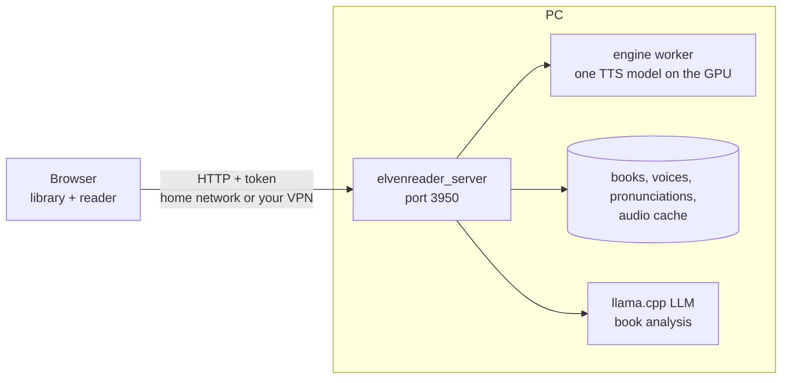

# ElvenReader

Listen to your EPUBs read by high-quality voice models running on **your own PC**, in your browser,
at home or away. No cloud service: a PC server plus its website.

* **The PC server** (`server/`) loads open-weight text-to-speech models on the GPU itself, clones
  voices from a short reference clip, applies your pronunciation fixes and caches every sentence.
* **Dramatized reading:** a local LLM works out who says each line and how (*"Stop!" she shouted*
  → the character's voice, shouting), sorts the cast into main, supporting and extras, and each
  character gets a voice.
* **The website** (`http://<PC>:3950/books`) is the library and reader: add EPUBs, read along
  while it plays with every character's voice, correct speakers, edit voices. It works on any
  device on your network or your own VPN.



The Android app that used to be the reader has been retired (see *The Android app* at the end).

## Voice models

All five run on an RTX 5080 (16 GB) with PyTorch 2.8 + CUDA 12.8; the standard setup installs only
VoxCPM2 and Qwen3-TTS (see *Set up the PC server*). The site reads with one of them,
the **speech model** chosen on the **Settings** page (default VoxCPM2). It is what the site reads
with, and requests can't swap it for another; it makes way only for book analysis while nobody
uses the site (see *How analysis shares the GPU*). Voice design with another model (Qwen3-TTS by
default) runs as a separate, design-only worker next to it (about 4 GB) while you design and is
unloaded after three minutes without designs; a design waits for it to load. Voices are designed
with Qwen3-TTS or VoxCPM2, which follow the whole description (OmniVoice only takes fixed tags such
as "male, low pitch"). With **VoxCPM2 as both the speech model and the voice designer** nothing
extra loads to design, and a design takes 4–7 s instead of Qwen3-TTS's 27–47 s (seven real cast
descriptions, `scripts\design_compare.py`: both read cleanly, 0% WER, with fitting pitch: children
and women ~250–270 Hz, Deusolbert's "deep baritone" 103 Hz against Qwen3-TTS's 155 Hz). Measured on this PC with `scripts\bench_engines.py` (five
sentences, two with a delivery, imported voice *The Documentarian*, after one warm-up sentence).
*RTF* is generation time ÷ audio length, so below 1.0 is faster than real time. *WER* is
Whisper-turbo's word error rate on the output (intelligibility).

| Engine (id) | Why it's here | Delivery control | Phonemes | RTF | First audio | Load | VRAM | WER | Licence |
|---|---|---|---|---|---|---|---|---|---|
| **OmniVoice** (`omnivoice`, default) | VoiceStudio's model, so imported voices sound the same; 600+ languages; 32-step quality preset | non-verbal tags only (`[laughter]`, `[sigh]`) | CMU `[B EY1 S]` | 0.27 | 0.9 s | 9 s | 4.0 GB | 0% | Apache-2.0 |
| **Fish Audio S2 Pro** (`fish_s2`) | Best-rated open model for clarity and expressiveness; free-form inline tags | `[shouting, urgent]` tags | – | 0.60 | 2.0 s | ~3 min | 13.8 GB | 0% | Fish Audio Research (non-commercial) |
| **IndexTTS 2.5** (`indextts`) | Expressive cloning; emotion from a delivery text | emotion text → emotion vector | CMU `<word\|PH>` | 0.54 plain, ~1.5–2.7 on short lines with a delivery | 2.8 s | 1 min | 6.8 GB | 0% | bilibili (non-commercial) |
| **Qwen3-TTS 1.7B** (`qwen3tts`) | Base model for cloning plus **VoiceDesign** to create character voices from a description | – (VoiceDesign only) | – | 1.76 | 6.1 s | 15 s | 4.4 GB | 0% | Apache-2.0 |
| **VoxCPM2** (`voxcpm`) | OpenBMB, 2B, 48 kHz; the only model found that clones **and** follows a free-text delivery in one call; also designs voices | delivery as a style instruction, `(shouting, furious)Stop!` | – | 0.61–0.67 (torch.compile) | **0.2 s** (streams) | ~1 min (5 min the very first time: compiling) | 5.9 GB | 0% | Apache-2.0 |
| **Breeze TTS 2** (`breeze`) | BreezeBlue, #1 open-weight on the Artificial Analysis TTS leaderboard; clones and follows a free-text instruction (the line's delivery), designs voices | delivery as an instruction (*Very angry, speaking loudly.*), CFG 4 | – | **0.41–0.50** (per-token stages compiled) | 0.4–0.8 s | 50 s (several minutes the very first time: compiling) | 9.6 GB | 0–7%* | BreezeBlue research & non-commercial |

Whisper transcribes *"Stop!" she shouted* with an exclamation mark only for the two engines that
received the delivery (Fish S2 Pro, IndexTTS); OmniVoice and Qwen3-TTS read it as *"Stop,"*.
Speaker similarity to the reference wasn't measured objectively; listen to
`server\data\bench\<engine>-<voice>.wav` to compare.

Notes:
* Fish S2 Pro and IndexTTS use `torch.compile` (via `triton-windows`), which roughly doubles
  their speed (Fish: RTF 1.8 → 0.6) but makes loading slow; keep the reader's default engine on
  OmniVoice or set `default_engine` and let it preload at start-up.
* Fish S2 Pro's context is capped at 4k tokens and its codec runs in bf16; otherwise it needs
  ~21 GB and spills out of a 16 GB card at a third of the speed.
* IndexTTS spends ~1.5 s per line analysing a delivery text, so short dramatized lines are slower
  than real time; the reader's look-ahead absorbs it.
* Qwen3-TTS is slower than real time on Windows (Python-bound, no FlashAttention) and slower still
  while the LLM runs on the CPU. It is the **voice-design** engine; for continuous listening
  prefer the other three.
* **VoxCPM2** follows deliveries where OmniVoice can't: the same line asked for *shouting, furious*
  comes out 3 dB louder with its pitch up from 90 to 116 Hz, *tearful* slows from 4.2 to 3.2 words a
  second, while OmniVoice gives the identical clip for every delivery but *laughing*
  (`server\data\bench\deliveries-*.wav`; `delivery_showcase` measures it). It clones two ways: lines
  without a delivery continue the reference clip and its transcript (closest likeness), lines with
  one use the clip for timbre only, steered by the delivery (`mode`: `auto` (default), `reference`
  for one way throughout, `continuation`, which ignores deliveries: given one, it reads the
  instruction aloud). It needs torch.compile (Triton, installed by `setup-engines.ps1`; PyTorch 2.8's
  static CUDA launcher is turned off, it overflows on Windows) to be faster than real time (RTF 2.0
  without). Next to it the analysis LLM keeps 6 more layers' experts in RAM in shared mode (each 0.5
  GB a speech model needs beyond 4 GB costs one layer; VoxCPM2 is counted at 7 GB with the SenseVoice
  that hears short lines back), so the two still fit in 16 GB. Pronunciation
  fixes use respellings (no phoneme input). VoxCPM2 stops when its stop head says the speech is
  over; for some text and seed it misses (one of Kirito's lines trailed off into 5.8 s of
  near-silence and a click, every time, since a voice always uses its own seed), and its own retry
  for over-long output works only without streaming and above six times the text's length. The
  adapter ends the generation after 1.2 s of silence once at least half the text's expected time
  has been spoken (natural pauses inside lines measured up to 0.74 s). Each engine has its own
  piece size (`max_chunk_chars`): text longer than it is made piece by piece, and every piece
  starts its delivery afresh, so the tone could change halfway through a line (one of Ronie's,
  305 characters, at "Sir Nergius…"). VoxCPM2 makes up to 2,000 characters in one go (1,342
  measured: steady pitch, every word said); other engines keep 280. It also takes brackets anywhere
  in the text as style instructions ("Volumes 1 and 2 (Aincrad)" lost the word), so the adapter
  reads them as asides between commas. Only lines these change get new cache keys. A generation that
  runs past 3× its text's expected length + 2 s (at least 4 s) without going quiet has run away (a
  steady whistle, once): it is cut there, and a short line (up to 4 s expected; it is made whole
  before it is sent) is made again with another seed, up to twice. Text ending on a comma or semicolon
  (narration that leads into a quotation: *"…Ronie always said,"*) is given a colon (a period for a
  quotation) for VoxCPM2 only: its stop head took the comma to mean more was coming and ran on after
  the last word into made-up speech in another language (*"Apustinye, Urshokova, Shefen"*) for 2 of 5
  seeds; with a colon or a period, 0 of 5. The page keeps the book's punctuation. Its stop head can
  also miss after a complete short sentence (*"Kirito murmured."* ran on into *"barely beaked anto"*,
  3.5 s), so lines are heard back with SenseVoice-Small (FunASR, ~1 GB of VRAM, ~0.1–0.2 s a line;
  `check_endings`, default on): every line the client takes whole (the website asks for compressed
  audio, so all of its lines) and short streamed ones (up to 4 s expected); long lines streamed as PCM
  are sent as they are made. Six or more letters heard after the text's last word (made-up speech),
  or 15+ letters and a quarter of the text not heard (dropped words: at guidance 1.5 the narrator's
  seed left out the first sentence of a 189-character passage, 72 of 149 letters; one of Kirito's lines
  stopped before *"Anyway, let's hurry and get to that inn"*, 30 of 85 letters, which the earlier limit
  of 40 let through. Over Vol. 20's 522 clips no other reached a quarter with more than 13, all short
  lines with a misheard name, and no long one missed more than 31, 11%: numbers heard as digits and
  names; stutters spelled with "uh" are compared as the word), and the line is made again with another
  seed, up to twice, keeping the best take. **Short lines** (under 15 letters: *"Yes."*, *"Huh?!"*, a
  quoted *"paper"*) can never reach those limits, so they are judged by their own length: half the
  letters not heard, or extra syllables (*"paper"* came out *"tap heaper"*), is a fault. A word of one
  or two letters only has to be heard whole (*"No"*, *"Ah"*). **A take with no sound at all** is
  always the worst fault, with or without a recogniser. Before this, an empty take passed silently: the
  check skipped takes with no audio. Clips made before a check was made stricter stay as they
  are: `POST /api/books/{id}/file/forget` drops a passage's speech so it is made again, also speech
  only in the cache so far. `scripts\recheck_short_lines.py` heard every stored short line back
  once and forgot the 14 that failed (*"No. Nothing."* said *"number nothing"*, *"Sounds good."*
  said *"yeah"*). For run-ons, letters,
  not words, so a name heard as two words (*Kirito* → *cury toe*) isn't extra: over Vol. 20's 319
  clips that line scored 13 and no other more than 3. Stutters written as consonants and a hyphen
  are spelled as they sound for VoxCPM2 (*R-right* → *Ruh-right*, *Wh-what* → *Whuh-what*, *S-s-sorry*
  → *Suh-suh-sorry*): it read the letter, *"Alright"* for 3 of 3 seeds; with "uh", about 14 of 18 lines
  over 6 words came out stuttered (8 as written; a syllable instead, *Ri-right*, came out *"rewrite"*).
  Fragments with a vowel (*I-I*, *Wha-what*) read fine as they are.
* **No quotation marks for VoxCPM2.** The adapter drops them before the model; the page keeps them.
  Given `"paper"` or `"Yes."` (one-word quotations), VoxCPM2 made nothing at all, on every seed,
  while `paper` and `Yes.` were said, and that silence was served. Longer lines came out the same with
  or without marks (8 lines × 2 seeds, SenseVoice). Double marks always go; single ones only where they
  surely open or close a quotation, never as apostrophes (*didn't*, *'em*, *girls' room*).
* **"No." is not "number".** VoxCPM2's normaliser reads a capitalised *No.* as the abbreviation:
  *"No. It looks terrible."* came out *"number, it looks terrible"* (171 times in the library). The word
  is given to it as *no.*; *No. 5* still becomes *Number five*. Lines with *No.* got a new cache key
  (`EngineSpec.reread`), so they are made again.
* **Guidance and temperature per line.** The line dialog has a slider for each per-line setting the
  speech model takes (`EngineSpec.tuning`; VoxCPM2: both). *Guidance* (1–4, VoxCPM2's `cfg_value`,
  default 2): how strongly the model follows the line's text and delivery; lower if a line is
  overacted, higher if its delivery doesn't come through (lower also follows the text less
  closely: one passage lost a sentence at 1.5, which the check below catches).   *Temperature* (0.7–1.3, default 1): the noise each patch of speech starts from in VoxCPM2's
  diffusion decoder, which takes it but is never given it (the adapter wraps the decoder; only its
  estimator is compiled). Measured on one line, two seeds: 0.6 came out silent for one seed and at
  −35 dB for the other; 0.75–1.25 said every word, quieter and slightly clearer below 1 (−25 to
  −27 dB), louder and a little breathier above (−21 to −23); no clear change in pitch range. The
  defaults are set in Settings → *Speech defaults* (saved as `engine_options.voxcpm.cfg_value` /
  `temperature` in the config; changing one makes every line again as it is played, and applies at
  once: each request carries the values, as the engine read its options when it loaded). A line with
  its own settings gets its own clip; they tune the speech only, so they are
  not a correction or a report. Measured on 15 lines
  of 6 voices, guidance 3 did *not* make voices clearer (harmonics-to-noise 1.3–2.2 dB vs 1.8–2.2 at 2):
  what makes lines with a delivery sound husky or unlike the voice is that they are made from the
  reference clip's timbre only (4.7 dB without a delivery, read on from the clip).
* **Delivery slots for VoxCPM2** (`engines/voxcpm_styles.py`). VoxCPM2
  publishes no list of styles it is good at. Candidates came from the style words of the
  expressive-speech datasets such models learn from (EARS: 22 emotions and 7 reading styles;
  Expresso: 26 styles; ParaSpeechCaps: 59 tags), and each was measured. `scripts/style_probe.py`
  makes the clips through the server, and `scripts/style_score.py` scores them with emotion2vec+ large,
  loudness, voicing and rate. That was about 1,600 clips: 4 voices × 2 neutral sentences at guidance
  1.75, rerun at 3.0 and on emotional sentences. Its style control while cloning is real but subtle.
  Most emotion words aren't rendered distinctly; they fall into a few acoustic groups (quiet and
  sad-sounding, higher-pitched, warmer), so one word per group is kept. And much of a line's feeling
  comes from its words: on emotional sentences an instruction added little. *Works* means recognised
  as that emotion; *acoustic* means a clear change in loudness, pitch or pace.

  | Slot | Works | Acoustic | Weak | Dropped (no distinct effect) |
  |---|---|---|---|---|
  | emotion | neutral (no instruction), angry, sad | crying (−5.9 dB, pitch ×1.30, slower), tender (warmer; = calm, sympathetic), happy (+1.5 dB, ×1.16), confused (pitch ×1.20; = amazed, sarcastic), sleepy (−4 dB, slower; = tired, bored) | playful, nervous | excited, cheerful, frightened, scared, anxious, surprised, disgusted, tearful, guilty, proud, determined, cold… (each with what to use instead) |
  | intensity | normal, strong (*very*) | | | slight (*slightly* = the plain word) |
  | manner | | breathless (−4.1 dB), monotonous (flat, −3.8 dB), enunciated (slower) | | stammering, hesitant, laughing, sobbing, gasping, screaming |
  | volume | whisper (−3.6 dB, breathy), soft (−3.2 dB), loud (*speaking loudly*, +1.4 dB, pitch ×1.25) | | | shout (*shouting* came out no louder) |
  | pace | slow (*slowly*, ×0.82) | | fast (*speaking quickly*, ×1.07) | |
  | sound (tag before the line, 12 takes) | sigh `[sigh-hah]` 11/12, surprise `[Surprise-wa]` 10/12, hesitate `[Uhm]` 8/12, displeasure `[Dissatisfaction-hnn]` 8/12 | | laugh `[laugh-haha]` 5/12 (`[laugh-hehe]` 3, `[laughing]` 2), gasp `[gasp-hah]` 6/12, hush `[Shh]` 5/12 | `[Laughter]`, `[cough]`, `[crying]`, `[gasp]`, `[groan]`, `[yawn]`, `[scream]`, `[breath]`, `[sniff]` and spelled-out ones (`[cry-huhuhu]`, `[groan-ugh]`…) |

  "Angry" is the one emotion clearly recognised (anger 0.43 against 0.21 read neutral; told apart from
  the others 56–69%, chance 6%). Guidance 3 didn't make any of them clearer. Only tag families VoxCPM2
  learned do anything (laugh-, sigh-, Surprise-, Dissatisfaction-, Question-, Uhm, Shh); any other tag
  is silently ignored. `instruction()` builds the words (*very angry, speaking loudly*), and an
  all-neutral line gets none, so it carries on from the voice's own clip.

  The analysis labels lines with the **approved delivery tags** (next section), and `render()` turns
  each into what VoxCPM2 measurably follows: *amused* → *playful*, *afraid* → *nervous*, *surprised* →
  *amazed*, *cold* and *flat* → *monotonous*, *tired* → *sleepy*, *shout* and *loud* → *speaking
  loudly*, *soft*, *thought* and *aside* → *speaking softly*, *fast* → *speaking quickly*, *clear* →
  *enunciated*; *slightly* is dropped (it did nothing) and *very* kept. Sounds become a tag before the
  line (*laugh* `[laugh-haha]`, *sigh* `[sigh-hah]`, *gasp* `[gasp-hah]`, *um* `[Uhm]`, *hmph*
  `[Dissatisfaction-hnn]`, *whoa* `[Surprise-wa]`) unless the text has its own sound tag. Tags with
  nothing that works (*firm*, *hesitant*, *reading*, *sob*, *cough*…) give no instruction, so a line
  with only those carries on from the voice's clip. Words a reader types that aren't approved tags
  are passed on as they are. Lines with a delivery got a new cache key with this (`styles`).
* **Sounds written in the text** (`sounds.py`). The books write sounds into their dialogue rather than
  describing them: over the library's 47,304 quotations, *Ummm* ×135, *Mmm* ×102, *Huh?* ×128 as a
  whole line, *Haaah* ×34, *Ngh* ×31, *Hmph*, *Tch*, *Eheheh*, *Ahahaha*, *Kyaaah*, *Gyaaah*, *Eek*, *Shhh*,
  and creature noises (*Krrrr*, *Kyurrr*, *Quack*); no `*sigh*` or `(laughs)` forms. The analysis
  marks them in the line's spoken form as **`{kind|written}`**, e.g. `{laugh|Ahaha}, that's fine.`,
  with 16 kinds: laugh, sigh, gasp, um, hmph, whoa, huh, shh, sob, groan, cough, sniff, yawn,
  scream, yell (battle cries) and growl (creatures). The format is ours, not an engine's. Braces
  occur in none of the books, and any that do turn into parentheses before speech, so a mark is never
  mistaken. Each engine renders marks its own way (`EngineSpec.sound_tags`): a kind it has a tag
  for becomes the tag, with the punctuation right after the sound dropped; any other is read as
  written; a line that is nothing but sounds (*"Kyaaah!"*) is always read as written. Engines
  without tags read every sound as written, as before.
  `scripts/sound_probe.py` measured VoxCPM2 on 15 of the library's own lines (3 voices × 2 takes,
  SenseVoice), each read as written, with the tag instead, and with both:

  | Kind | As written | Tag instead | VoxCPM2 gets |
  |---|---|---|---|
  | laugh (*Ahaha*, *Eheheh*) | heard as laughter 8/12 (*Eheheh* mostly not) | `[laugh-haha]` 11/12 | the tag |
  | sigh (*Haaah*) | read as a syllable, *ha* | `[sigh-hah]`: an exhale (11/12 earlier) | the tag |
  | hmph | 4/6 | `[Dissatisfaction-hnn]` 5/6 | the tag |
  | um (*Ummm*, *Um*) | 12/12 | `[Uhm]` 12/12 | as written |
  | huh (*Huh?!*, *Bwuh?*) | *huh* 6/6 | `[Question-*]` ran into the next word (*"ammyal"*) | as written |
  | shh (*Shhh!*) | 5/6 | `[Shh]` 2/6 | as written |
  | scream (*Kyaaah*, *Gyaaah*) | 5/6, no runaways | `[scream-aaah]` 2/6 | as written |
  | whoa | 6/6 | `[Surprise-wa]` says *wah* | as written |

  The tag and the written sound together always came out doubled and longer.
* **Text normalisation.** VoxCPM2's own normaliser (`normalize`, on) reads numbers and abbreviations
  out: "70%" → "seventy percent", "30" → "thirty", "Vol. 20" → "Volume twenty", "Dr." → "doctor". The
  adapter runs it on the words alone (not the style instruction), so the checks compare what was
  heard with what was said, and first puts right what it gets wrong: "2nd-year" ("two nd-year") is
  given as "2nd year" ("second year"), and numbers with thousands commas, which lose their "one"
  ("1,342" → "thousand three hundred…"), are spelled out first. Still read wrong, and rare in these
  books: "$5.50" ("five point five dollars"), "3/14" ("three fourteenths").
* **Hum and hiss in a voice.** VoxCPM2 copies everything in a reference clip, background included,
  where OmniVoice smoothed it over: a reference whose pauses sit less than 25 dB under its speech
  hums or hisses through every line read with it (17 voices measured under 20 dB; one VoxCPM2 had
  designed itself, 16 dB, gave its lines pauses at -42 dBFS, mostly at 150-225 Hz). The adapter
  cleans such references once with VoxCPM2's speech enhancer (ZipEnhancer, kept in
  `data\voices\.by-sha\.clean`): that voice's lines went from 16 to 51 dB, and from -28.5 to
  -17.6 dBFS since the enhancer also evens out the loudness; clean references are used as they are.
  New designs are measured too: VoxCPM2's ranged from 6 to 67 dB with the seed alone, so a design
  under 25 dB is made again with another seed (up to 4 tries, the cleanest kept; 4-7 s each; 12
  for the generic voices, which hundreds of characters share). Designs run at VoxCPM2's own
  guidance 2.0 and temperature 1.0, not your reading tuning: at 1.75 / 0.95 every design came out
  at 10-13 dB, and the same description and seed went back to 25.6 dB at 2.0 / 1.0
  (`scripts\voxcpm_park_noise_probe.py --server`). Cloned speech is unaffected (46 dB either way).
  Wordy descriptions hum too: "in her seventies… slightly wavering" stayed under 12 dB over 12 seeds.
  `scripts\artifact_probe.py` measured that the rest isn't the cause: streaming decode differs from
  whole decode by 0.0001% of the energy, and more diffusion steps or lower guidance changed nothing.
* Every finished line, and every cached or stored one as it is served, goes through `tighten`:
  silence at either end is cut to a short lead and tail, gaps inside longer than 1 s are shortened
  to 1 s, and a click after the speech is dropped with the silence before it.
* **Even loudness** (`audio.level`, `level_speech`). Each take comes out of the model at its own
  level, and nothing evened them out. In *Moon Cradle II* Vol. 20 the narration ranged from −31 to
  −16 dB, and short lines were quieter (median −20.9 dB under 60 characters, −18.7 over 150).
  *"One year, three months, and sixteen days, in fact."* came out at −25.3 dB between lines at −20,
  an audible drop. Every whole clip (cached, from the book file, or made for the website) now has its
  speech, pauses left out, brought to −19 dBFS. Gain is at most ±10 dB and never past a 0.95 peak;
  running it twice changes nothing. Deliveries meant to stand out keep an offset: *whisper* −6 dB,
  *soft* and *aside* −3, *thought* −2, *loud* +2, *shout* +3. Clips already cached are levelled as
  they are served, so nothing is made again. Speech streamed as raw PCM while it is made (not the
  website, which takes whole clips) can't be levelled until it is replayed from the cache.
* **Even throughout** (`audio.even_out`, for lines without delivery tags). Levelling a clip as a whole
  left the loudness drifting inside it: in Vol. 20 the narration swelled or faded by a median 4 LU over
  a clip of 8 s or more (90th percentile 6.3, up to 10.1). A slow gain rider now measures loudness as
  the ear hears it (ITU-R BS.1770 K-weighting) over each second, every 0.1 s, and brings it towards
  ?20.5 LUFS (what levelled clips averaged). Pauses take the gain of the speech around them and are
  never boosted on their own; the gain glides over 1.2 s, so words don't pump, at most ?10 dB; peaks
  are held under 0.95. On the same clips the drift fell to a median 1.4 LU (90th percentile 2.1, worst
  3.0); in *Ascendance of a Bookworm* Vol. 1 from 2.9 to 1.6 LU. The odd clip that sounded quieter as a
  whole (down to ?23.2 LUFS) now matches the rest (quietest ?20.8). Lines with delivery tags keep the
  whole-clip levelling above, so a whisper stays under the rest and a shout over it, with the
  dynamics the model gave them. Cached and stored clips get it as they are served.
* **Breeze TTS 2** (`.\setup-engines.ps1 breeze`, then *Settings → Speech model*). It runs on Windows though
  its README says Linux: its own environment (torch 2.9.1 for CUDA 12.8, `triton-windows` 3.5) and
  BreezeBlue's code in `models\src\breeze-tts`. Measured on this PC: eager 9.0 GB at RTF 2.0–2.5, too slow;
  the README's `--fast-all` 15.9 GB (the whole GPU, CUDA graphs for every prompt length) at 0.7–0.9; and the
  mode used, only the stages that run for every sound token compiled (backbone decode, depth decoder, codec),
  9.6 GB at 0.41–0.50, faster than VoxCPM2 (0.58–0.67, 7.1 GB). It said every word of the test lines (*the
  WER differences are Whisper writing "8 o'clock", "Roni"), and follows deliveries as strongly as VoxCPM2:
  shouting +8 dB and pitch 91 → 236 Hz, whispering 10% voiced. Windows needs
  `TORCHINDUCTOR_USE_STATIC_CUDA_LAUNCHER=0` (the adapter sets it): PyTorch's static CUDA launcher passes GPU
  addresses as a 32-bit C long there. English and Chinese only. With OmniVoice narrating next to it the two
  take 14 GB, so book analysis waits while someone reads (`dramatize.shared_fits`); alone it leaves room.
* Excluded on purpose: speed/lightweight models (Kokoro, Piper, Chatterbox Turbo), VibeVoice 7B
  (~19 GB of weights, doesn't fit), Higgs Audio v2 (needs 24 GB).

## 1. Set up the PC server

Requirements: Windows 10/11, an NVIDIA GPU with at least 16 GB (tested on an RTX 5080; an RTX 4090
works the same: the CUDA 12.8 builds cover both) and a driver new enough for CUDA 12.8 (570 or
later), [Git](https://git-scm.com/), and about 60 GB free disk. [`uv`](https://docs.astral.sh/uv/)
is installed automatically with winget if missing, and it fetches the Python versions needed.

The standard setup is three models:

| Model | For | Size |
|---|---|---|
| **VoxCPM2** | reading (the speech model), plus Whisper for the voice editor | ~5 GB + 1.6 GB |
| **Qwen3-TTS 1.7B** | designing character voices from descriptions | ~9 GB |
| **Qwen3.5-35B-A3B** (llama.cpp) | analysing books: who says what, how, the cast | 22 GB |

```powershell
git clone <your repository URL> ElvenReader
cd ElvenReader\server
.\setup-engines.ps1      # VoxCPM2 + Qwen3-TTS environments (exact versions from engine-locks\)
.\download-models.ps1    # their weights (and Whisper) into ..\models
.\download-llm.ps1       # llama.cpp and Qwen3.5-35B-A3B
.\run-server.ps1         # creates server\.venv and data\config.json (new token); prints the addresses
```

Then open `http://127.0.0.1:3950/books`, go to **Settings** and choose VoxCPM2 as the voice designer
too if you prefer quick designs (see *Voice models*), and create a narrator voice on the **Voices**
page: a new install has no voices, and nothing is read aloud until there is one. Optional:
`.\allow-firewall.ps1` (other devices on your network) and `.\install-service.ps1` (start at logon),
both below.

**Other engines** (OmniVoice, Fish S2 Pro, IndexTTS 2.5, Breeze TTS 2) are not installed by
default; add one by name (`.\setup-engines.ps1 omnivoice` then `.\download-models.ps1 omnivoice`)
or all of them with `-All`. The engine environments install the exact package versions in
`server\engine-locks\` (a set known to work: newer releases have broken the adapters before);
`.\setup-engines.ps1 voxcpm -Latest` installs the newest instead and rewrites the lock.

**Moving your library to another PC:** books, voices, pronunciations and settings are in
`server\data` (git-ignored); copy that folder across (it holds the token, so the same links keep
working), or move single books as `.elvenbook` files (see *Book files*). Model weights and
environments (`models\`) are better made again with the scripts above than copied.

`run-server.ps1` creates the server's own small environment (`server\.venv`) on first run.
Options: `--port 3960`, `--engine fish_s2` (default engine), `--no-preload`, `--rotate-token`,
`--show-links`, `--import-voicestudio` (copy VoiceStudio's voice profiles, read-only). Settings live
in `server\data\config.json` (git-ignored, contains the token):

| Key | Default | Meaning |
|---|---|---|
| `models_dir` | `models` (repo root) | Engine venvs, model weights, compile caches, LLM files. |
| `default_engine` / `default_voice` | `voxcpm` / first voice | The site's speech model (set on the Settings page) / the voice used when the reader doesn't choose. |
| `extra_urls` | `[]` | More addresses for the links and QR codes on the Users page, e.g. `["http://10.8.0.2:3950"]` for the PC on your VPN. |
| `preload` | `true` | Load the default engine at start-up. |
| `engine_options` | `{}` | Per engine, e.g. `{"omnivoice": {"num_step": 16}, "indextts": {"compile": true}}`. |
| `sentence_pause_ms`, `trim_silence`, `level_speech` | `300`, `true`, `true` | Pacing between sentences; every clip at one loudness. |
| `cache_max_mb` | `4096` | Sentence audio cache (`data\cache`). |
| `book_file_sync_s` | `300` | How often each book's `.elvenbook` file takes in new speech and edits (see *Book files*); `0` = only when asked. |
| `llm_model`, `llm_mode`, `idle_after_s`, `design_pause_s`, `llm_cpu_moe_shared`, `llm_cpu_moe`, `llm_threads` | Qwen3.5-35B-A3B, `adaptive`, `300`, `600`, `32`, `20`, `12` | Dramatization LLM and how it shares the GPU (see below; the mode and both pauses are on the Settings page). |
| `llm_backend`, `llm_remote_url`, `llm_remote_model`, `llm_remote_label` | `local`, empty | Where books are analysed: this PC, or an OpenAI-compatible inference server (Settings → *Book analysis*; see below). |
| `llm_label_context_words`, `llm_label_recent_lines` | `600`, `12` | Story text before each passage and earlier attributions shown when labelling; `0`, `6` = the old, slightly faster pass (see *What does more time per book buy?*). |
| `llm_label_profiles` | `true` | The labelling pass also notes each speaker's voice profile (see *Voice profiles*). |
| `llm_dossier_model`, `llm_dossier_effort`, `llm_dossier_words` | empty (off), `medium`, `3500` | Optional pass 1: a reasoning model builds character dossiers (see *Character dossiers*). |
| `whisper_venv`, `whisper_model` | `voxcpm`, `whisper/large-v3-turbo.pt` | Transcribes new reference clips in the voice editor (Whisper is installed in VoxCPM2's environment). |
| `voice_design_engine`, `designer_idle_s` | `qwen3tts`, `180` | Creates character voices (must follow free-text descriptions; Qwen3-TTS); the designer is unloaded after this many seconds without designs. |
| `cast_supporting_voices` | `12` | How many supporting characters (most lines first) get a designed voice of their own; main characters and narrators always do, extras share pool voices. |

Environment overrides: `ELVENREADER_PORT`, `ELVENREADER_HOST`, `ELVENREADER_TOKEN`,
`ELVENREADER_DATA`, `ELVENREADER_MODELS`. Every request is logged with its engine, audio
length, time to first audio and RTF in `server\data\server.log`.

### Voices

Voices live in `server\data\voices` as a WAV plus a JSON file (name, transcript, language,
seed). Every voice has reference audio and its transcript, so every engine can clone it and the
speaker never changes between sentences. Add voices by importing from VoiceStudio
(`--import-voicestudio`, read-only), by `POST /api/voices` (WAV + transcript), or by designing
one from a description (`POST /api/voices/design`).

### Windows firewall (once, elevated)

```powershell
cd ElvenReader\server
.\allow-firewall.ps1        # TCP 3950 on Domain and Private networks
```

Your home network must be a **Private** network (and so must your VPN's adapter, if other devices
reach the PC through it). Without this rule other devices can't open the library.

### Start automatically

```powershell
.\install-service.ps1             # runs the server in the background whenever you're logged on
.\install-service.ps1 -Uninstall  # stop it and remove it
```

This registers a scheduled task, **ElvenReader server**, for your account; no administrator rights
are needed. It starts at logon, runs hidden with no time limit, and `run-service.ps1` starts the
server again 10 s after it stops for any reason. Its output goes to `data\service.log`, and the
server's own log is still `data\server.log`. To pause it, run `Stop-ScheduledTask "ElvenReader
server"` and then `Start-ScheduledTask "ElvenReader server"`. While it runs, don't also start
`run-server.ps1`, since both use port 3950. Running it as a real Windows service, without logging
on, would need an administrator account and isn't set up. After logging on, the site answers in
about 15–40 s (PowerShell starts slowly right after a boot), and speech is ready once the speech
model has loaded: a few minutes on the first load after a reboot (the banner shows the progress).


The server parses EPUBs itself, so there is nothing else to install: no JDK, Android SDK or adb.

## 2. Users and their devices

Each user has a token of their own, and the token says who a request is from. On the PC,
**http://127.0.0.1:3950/books** opens the library as the admin. **http://127.0.0.1:3950/** (served
only to the PC itself, which is always the admin) opens the **Users** page (also linked from the
library for the admin). There you can add, rename and delete users, give one a **new link** (their
old one stops working), and see each user's link and QR code for each of the PC's addresses, in the
form `http://<PC address>:3950/books#token=…`. Open your link on a device, or scan its QR code. The
browser keeps the `#` part to itself, stores the token and removes it from the address bar; the
device then stays with that user (there is no switching users in the page). Without the link, the
library asks for the token. The page itself is served to any address but holds no token, and every
book, script and audio request needs a user's token.

* **The admin** is the user whose token is the server's own (`token` in `config.json`; *Xyresic*
  here). The admin can change everything.
* **Everyone else reads the whole library and changes only the books they added.** That covers the
  book's title, series, analysis, lines, cast, voices and pronunciations. A voice counts as theirs
  when only their books' characters use it. The same EPUB added by two people is one book that
  both can change.
* Other people's books are **read-only**. They can still be read and listened to, and a wrong line
  can still be reported. Their library has two parts: **Your library** (the books they added) and
  the **Site library** (everyone else's, folded until opened). The reading page marks them
  🔒 *Read-only*; their *Book settings* page, the line dialog's fields and the character
  panel's controls are not offered.
* Site-wide things are the admin's: Settings, the Voices page (others edit their characters' voices
  from their books' cast), the analysis queue (others see their books' progress in their library),
  renaming and merging series, and the users. The Series page shows others only the series of their
  own books (a series' pronunciations when all its books are theirs).
* Books from before users belong to the admin. Who added a book is in its `meta.json` (`users`);
  users and their tokens are in `data\profiles.json`. The server checks every change
  (`permissions.py`) and answers 403 to anything else.

**Away from home:** use your own VPN to reach the PC, and add the PC's address on that VPN to
`extra_urls` in `server\data\config.json` so the Users page shows a link for it too. Don't
port-forward 3950 on your router: the server speaks plain HTTP, protected only by its token.

## 3. Add books

In the library, **+ Add book** and choose one or more EPUB files from the device you're using: a
phone, a tablet or another computer on the network. Pick the book's **series** first if you know it
(by default it is detected from the title). After the upload the dialog shows each book's series and
lets you fix it before the cast is created; books in a series share their cast and voices (see
*Series* below).

The server parses the EPUB, keeps a copy with its cover and pictures, and starts working:
1. **Analysis:** who says each line and how, as described in section 5. It takes about an hour
   per 100k words while nobody uses the site, about 1.5 hours while you read or listen, and
   pauses while you design voices (see *How analysis shares the GPU*). You can read and listen
   along as lines come in.
2. **Tiers:** the cast is sorted into main, supporting and extras.
3. **Voices:** the cast's voices are created (untick *Create the cast's voices* to skip this).

The library shows progress, with the books of a series grouped under its name in volume order.
**Re-analyse…** on a book's **Book settings** page starts its analysis again from scratch; your
corrections, cast and voices are kept. Adding a book that is already in the library keeps its analysis.

**Queue** (in the library header, with the number of books waiting) shows the book being analysed
with its progress, the books next in line with a rough time each (about 1,800 words a minute with
the whole GPU), and the books whose voices are still to be created. ▶ analyses a waiting book now:
the current one stops, keeps the passages it has finished, and goes next. Drag a book, or use ⤒
(next), ↑, ↓ and ⤓ (bottom; on the current book it stops it and sends it to the end), to change
the order; ✕ takes a book out of the queue, keeping what's done. **Continue
analysis** on its library card puts it back at the end. The order is saved, so a restart resumes
the same way, the interrupted book first.

From the command line (which can also add a file by its path on the PC), the same thing is
`.\.venv\Scripts\python.exe scripts\process_book.py "E:\...\Book.epub"` (options `--no-cast`,
`--engine qwen3tts`, `--reanalyze`). It prints progress until the book is done, then the cast by
tier. It also takes a book file: `process_book.py "E:\...\book.elvenbook"` (`--replace` if the book
is already in the library).

**Book files (`.elvenbook`).** Each book is also kept as one file,
`server\data\books\<id>\book.elvenbook`, with everything a reader needs: the text and pictures, the
analysis (cast, who says each line, narration), the voices it uses, its pronunciations and every
passage of speech made so far. Copy it to another ElvenReader (or a future client) and the book comes
with it as it is: `process_book.py`, or `POST /api/library/import`. Voices the other PC already has
under the same id stay as they are there; the other PC's pronunciations for its series stay the series',
and its user-wide ones apply to this book only.
It is a storage format: the website never downloads it, it uses the API as before.

The server brings each book's file up to date every 5 minutes (`book_file_sync_s`; not while the book
is being analysed): new speech is added, and passages whose words, speaker, delivery or voice changed
lose their old speech. Speech made with another speech model is kept until the new model has read the
passage. The sentence cache (`data\cache`) holds a few GB and forgets old speech; the book file keeps
it, and the server plays it from there (`X-Cache: file`).

Inside, it is a zip that is only ever appended to: new speech is written after the end of the file in
batches, with a fresh table of contents, and the bytes before never change, so an interrupted write
loses only that batch. Replaced and dropped parts stay behind as dead bytes until more than a quarter
of the file is dead; then it is rewritten without them, which bumps its `generation`. Read it with any
zip library that uses the central directory (Python's `zipfile`, libzip, zip.js, Android's
`ZipFile`), not one that reads front to back (Java's `ZipInputStream`). Contents:

| Entry | What |
|---|---|
| `mimetype` | `application/x-elvenbook` (stored, first) |
| `manifest.json` | `format` (`elvenbook`), `format_version` (1), `id`, `title`, `author`, `language`, `series`, `volume`, `engine`, `segments`, `voiced`, `cover`, `images` (EPUB path → entry), `created`, `updated` |
| `text/book.json` | Chapters: `title`, `paragraphs`, `quotes` (`[id, paragraph, start, end]`), `images` (paragraph → EPUB paths, shown before it), `end_images` |
| `images/…` | The pictures, and `images/cover.jpg` |
| `analysis/script.json` | `characters` (name, aliases, role, profile, `voice`…), `lines` (quote id → `speaker`, `delivery` (approved tags, `delivery.py`), `conf`, `alts`, `dodds` (each delivery tag the model gave with its probability), `say`: how the quotation is read when it has words spelled the way they sound or written sounds, marked `{kind\|written}`), `narration` (`[chapter, paragraph, character]`: who narrates from there) |
| `analysis/segments.jsonl` | The spoken passages in reading order, as the reader plays them: `id`, `chapter`, `paragraph`, `start`/`end` in the paragraph, `kind` (`narration`/`quote`), `text` (as spoken: a quotation's `say` when it has one), `speaker`, `voice`, `delivery`, `pause_ms` (silence after it), `speakable` |
| `analysis/pronunciations.json` | The pronunciation fixes that apply to the book |
| `voices/<id>.json`, `.wav` | Each voice the book uses: name, description, transcript, seed, reference clip |
| `audio/index.json` | Passage id → `entry`, `duration`, `rate`, `voice`, `engine`, `key` (the cache key), `content` |
| `audio/c<chapter>/<id>.opus` | Speech, Ogg Opus mono 32 kbit/s, one file per passage (about 14 MB per hour) |
| `source/book.epub` | The original EPUB |
| `x-server/…` | The server's own records, so importing loses nothing; readers ignore `x-*` (`script.json`, `meta.json`, `bookmarks.json`: each user's place) |

The trailing zip comment is JSON with the `generation` and the `dead` bytes. Readers ignore keys and
entries they don't know.

**Series.** A book's series is detected from its title (*Sasaki and Peeps, Vol. 10* → *Sasaki and
Peeps*). To change it, use the *Series* picker on the book's **Book settings** page: the series known so far,
*Detect from title* or *New series…*. If the new series already has a cast from its other books,
you're offered **Apply series cast now**: matching characters take the series' voices, profiles
and tiers, and the series' characters join the cast, without labelling the lines again (voices you
picked yourself are kept). Otherwise the series cast is applied when the book is next analysed. The
book also leaves its old series' memory. The **Series** page lists each series with its books and
cast size, and can **rename** a series (for all its books) or **merge** it into another (the same
characters become one; the other series' voices win).

**Volume order** follows each book's title: the number after *Vol.*, *Volume*, *V*, *Book* or *Part*
(*Part 2 Volume 3* sorts as 2, 3), or a number at the very end. A book without one is listed last
and marked *(no volume number)* on the Series page. Rename it on its **Book settings** page (*Title*), or
with ✎ on the Series page, e.g. *Sword Art Online 19: Moon Cradle* → *Sword Art Online,
Vol. 19: Moon Cradle*. The book stays in its series, and uploading the file again keeps your
title. **Volumes are always analysed in order.** A book added for analysis queues ahead of later
volumes of its series that are waiting. If a later volume is being analysed, it steps aside,
keeps its progress and continues right after. Whatever order the Queue page is given (by hand, *Analyse now*,
*to the bottom*, a restart), the next book taken is the earliest volume of its series that's
waiting. So each volume is labelled knowing the characters of the volumes before it.

Book IDs are the first 16 hex digits of the EPUB file's SHA-1, and each quotation's ID is
`c<chapter>p<paragraph>q<offset>`. The parser (`elvenreader_server/epub.py`) is a port of the
retired Android app's parser and gives identical chapters, paragraphs, quotation IDs and pictures.
Chapters follow the book's own table of contents: a chapter that a publisher split into several
files (often at every illustration) is joined back into one. Pictures are attached to the paragraph
after them, so they never shift the text. **Scene breaks** (the blank line or ornament between two
scenes of a chapter) are kept as that paragraph's `breaks` entry in `book.json`, again without
adding a paragraph: 3,237 across the library. EPUB has no standard mark for one, so the parser
takes any of the ways our publishers use: a class on the paragraph after the break (Yen On's
`space-break`, `space-break1`/`2`/`3`; Gollancz's `spacebreak` on an empty paragraph; J-Novel
Club's `section-break`), a paragraph of separator signs (`* * *`, `◇◇◇`, `⁂`), an
`img.ornament`, a small picture standing alone between paragraphs (at most 240×48 pixels, no
text with it: Way of Kings' 14×12 glyph, and Yen On's ornament where the class is missing; letters
and dashes drawn as pictures inside a sentence don't count), or `<hr>`. They matter: in
*Unital Ring I* chapter 9, Asuna's third-person scene ends at one and Kirito tells the next as "I",
with nothing else to say so. A break is shown in the reader (the book's own ornament, or ⁂ where it
has none), gets a 1.2 s pause in the audio, starts a new narration section, and is marked
`~~~ SCENE BREAK ~~~` on a line of its own in every passage the LLM reads (labelling, its
context and the dossier). Wordless lines (`“…?”`, `“……”`: someone reacts without words) were
dropped as unspeakable; they are kept the same way (`silent`, before the next paragraph), shown
in grey and given to the LLM, but not numbered or read aloud. Books added before this got both
with `scripts\add_scene_breaks.py --narration`.

## 4. Read and listen

* **Bookmarks:** each user (section 2; the library shows 👤 *name*) has a **bookmark** in every
  book. It follows the passage
  playing, or the paragraph at the top of the text when you stop scrolling, and is saved a few
  seconds after it settles and when the page is left. Opening a book goes back there (the
  paragraph is briefly highlighted); a link with a chapter in it (`#c=3`) wins. The library shows
  how far in you are (🔖 42% · *chapter*). A place is a chapter, paragraph and character offset,
  which survives the book being analysed again. Kept in `data\books\<id>\bookmarks.json` (and the
  book file, so an import keeps each user's newer place). Deleting a user forgets their places.
  A narrator voice picked with a book's person button is still kept
  per browser.
* **Library:** every book with its cover, word count, analysis progress and cast status; **+ Add
  book**, and *Analyse* / *Continue analysis* for a book not analysed yet (re-analysing is on the
  book's settings page, section 3).
* **Book:** chapters in reading order, with the book's illustrations (click one to open it full
  size); quotations coloured by speaker with the speaker's name and
  delivery (*angry, shout*); ✎ marks your corrections.
* **Cast panel:** characters grouped as **Main / Supporting / Extras** (Extras folded), each row
  just a colour dot, the name, the line count and ▶ (voice sample). Type in *Find a character* to
  filter. Click a character to open its panel:
  * **Overview:** first the tier (*Main / Supporting / Extra*; *use automatic* hands it back to the
    model, whose reason is shown), then the line count (a link to their lines), where they first
    appear in the series, and their aliases (editable; they help recognise the character in the text).
  * **Voice:** play, switch between generic voices, and the voice's own description (a character with a voice of its own takes that voice's description whenever the voice is chosen or edited). *Edit voice…* opens the voice editor right there in the panel; *Done* folds it away and drops anything not kept (a typed description, options you didn't use). Only *Use this* changes the voice: it keeps the chosen option and the description it was generated from. The Voices page still opens the editor as a dialog.
  * **Profile (for voice design)**, folded: gender, apparent age, physical appearance, speech style and important characteristics (see *Voice profiles*), editable, and *Design voice from profile*. It is used to design the voice and for later volumes in the series; it doesn't change who-said-what.
  * **Lines:** the line count (in the Overview, and in Book settings' *Lines* column) opens the
    character's page, `/books/<id>/characters/<character>`. It lists every line they speak in the book,
    chapter by chapter, with its delivery. ▶ hears a line as the reading page reads it, and ↗ opens the
    book at it (`#c=<chapter>&q=<line>`: scrolled to and briefly outlined).
  * **⋯:** rename, or merge into another character.

  The ⋯ next to *Cast* has *Highlight lines of* everyone / main / main + supporting (dims everyone
  else's lines) and a link to the book's settings.

  **Book settings** (a link in the book's header; `/books/<id>/settings`) is a page for everything
  about the book other than reading it:
  * **Title** (which also sets its place in its series).
  * **Series**: the series picker, and the series' books in your library as a list in volume order
    (*Part 1, Vol. 2*, then the title; this book marked), each linking to its own settings.
  * **Pronunciations** for the series (and those for this book only), with *Add or change…*.
  * **Cast and voices in this book**: everyone who speaks in it (and its narrators), grouped as *Main
    characters*, *Supporting characters* and *Extras* (folded), with columns *Character*, *Voice* (▶
    plays it), *Lines* (a link to the character's lines) and *Edit…*. The columns have the same widths in every
    table, so the tiers and both sections line up. *Edit…* opens the same character panel as the reading page (tier, other
    names, voice, profile, and rename, pronunciation and merge under ⋯), so every setting of a
    character is here too. Its Overview says where they first appear in the series and in how many of
    its books (*first appears in Part 1, Vol. 3 · in 2 of the series' 7 books*). Below it are this book's cast actions (see further down).
  * **The series' cast**: everyone the series remembers from all its volumes in your library, in the
    same tiers and columns, with *Books* (how many of the series' books they're in) instead of *Lines*. *Edit…* on a character who isn't in this book opens
    them in their latest volume, which the panel names.

    In both, a *(generic)* voice comes from the voice pool, which characters without a voice of their own use.
    The pool has 18 voices: Female and Male *Elderly*, *Adult*, *Adult - Strong*, *Adult - Soft*,
    *Adult - Young* (early twenties), *Teen*, *Teen - Strong*, *Teen - Soft* and *Child*. *Strong* is a
    forceful voice (loud, commanding, brash), *Soft* a gentle one (quiet, shy, mild). The analysis has
    the LLM pick the best fit for each character from their profile: the voices of their gender and age,
    and Strong, Soft or plain from how they speak (`pool_pick`); the same character in a later volume
    keeps the pick. Their row has a drop-down of the generic voices to
    switch to another (*Female Teen - Soft (generic)*…). *Edit voice…* in the character panel opens the voice editor for it:
    the changes go to a copy just for that character (and them in the series' other volumes); a
    generic voice is never changed from a book. A character with a voice of their own only has
    *Edit voice…*. The character panel on the reading page works the same way. It works for any character of the series; one from another volume is edited in their
    latest book. Below this book's cast are its
    cast actions, each with what it does and what it would change in this book, and only when there's
    something to do: *Create missing voices* (characters without one, named) and *Design voices for
    supporting characters* (supporting characters still on a generic voice). Choosing a series gives
    the book that series' cast at once: voices, profiles and tiers (voices you picked are kept).
  * **Analysis**: the status, *Re-label lines…* and *Re-analyse…* (your corrections are kept).

  The reading page's header no longer links to the site-wide Voices page; it's on the library page.

  Tiers also appear in the Voices page's *Used by* lists. Unnamed speakers are shown as names
  ("Prisoner", "Tattoo Artist"), as the model's "a prisoner" is stored. After labelling, a character
  the model named by description ("Urano's mother", "Dad") takes a proper name it was also called
  (Effa, Gunther), and anyone takes an alias the book uses at least three times as often ("Myne"
  over her past-life name "Urano"); the old names stay aliases. Names you type are kept
  exactly. A voice made for a character follows a rename too: Gunther's voice, designed while he was
  still "Dad", is called Gunther. It keeps its name while any character it voices is still called that
  (Ortwin is "Lord Ortwin" in another series, so his voice is too), and a name you gave a voice yourself
  is never changed.
  ☰ shows or hides the chapters and cast: on a wide screen the sidebar goes away and the text takes
  the whole width (remembered in this browser); on a narrow screen (phone) they slide over the text,
  wherever you are in the book; picking a chapter, tapping outside, ✕ or Esc closes it.
* **Reading controls:** three square buttons float at the bottom middle of the text: **▶/■** plays
  from where you are or stops, the **person** button picks the narrator's voice for this book (kept in
  this browser; ✓ marks the current one), and **⛶ Reading mode** (or the F key) goes full screen
  with just the text and these buttons, which then fade when you don't move; there its corners turn
  inward to leave (Esc, or leaving full screen, also ends it). An error while playing shows just above them.
* **Screen on while reading aloud:** the sun at the top right, on unless you turn it off (kept per
  device). The Screen Wake Lock API needs HTTPS and phones open the site over plain http://, so a
  hidden video plays a loop of silence while the reader plays: Chrome keeps the screen on for a
  video playing audibly on a visible page, and an audio track at a volume above 0 counts even if
  silent.
* **Sleep timer:** the moon at the top right, next to Pronunciations and Book settings. A tap
  sets it to stop at the end of the next chapter (the one playing counts as the first of two),
  and the button counts down (*2ch*, *1ch*; *60m* … *18s* for a time). A tap while it runs offers
  one more chapter or 15 more minutes, 30/60/90 minutes, 1/2/3 chapters, or off. A timed one
  fades the voice out over its last 15 seconds, then playback stops.
* **Playback:** click any line or narration to play from there with each speaker's voice and
  delivery; at the end of a chapter it carries on at the top of the next one (the look-ahead runs
  on into it, so there is no wait; pausing on a chapter's last passage stops there). It goes on
  with the phone's screen off: Chrome on Android keeps a page running only while it plays media,
  and counts only clips of 5 s or more, so a loop of silence plays beside the passages (each its
  own, often shorter, clip). The lock screen shows the book and chapter with play/pause and
  next/previous chapter. If the browser still refuses to start a passage, the reader says so
  rather than hanging. While the PC is still making the passage about to play, the play
  button shows a spinning ring in place of ■, and a band of light sweeps
  across it; with reduced motion the ring turns slowly and the button pulses. Every other button that
  makes speech or a voice does the same while it works, keeping its size and label (a ▶ becomes the
  ring; other buttons keep their text and just shimmer; no progress text): *Generate Voice*, *↓ Younger* / *↑ Older*,
  *Say it*, *Design voice from profile*, ▶ on a character's lines page and the pronunciation
  dialog's *Listen*. Playback uses the chosen narrator voice and the site's speech model
  (Settings). The narrator voice is picked with the person button or the *Narrator* row at the top
  of the cast. In a first-person book, a *Narrated by …* line starts each chapter, point-of-view
  heading, scene break and change of narrator: clicking it sets who narrates from there to the next
  heading, scene break or
  chapter (anyone in the cast, or the book's narrator voice; *As the analysis found* undoes it).
  That is kept as a correction, so analysing again keeps it, and reported as *Wrong narrator*.
  The same menu opens the narrating character's voice. While a passage plays, the next 10 are already being made on the PC; jumping
  elsewhere cancels the ones you won't hear. Sentences already
  synthesized come from the server's cache, so re-listening is instant. Speech reaches the
  browser as Ogg Opus at 64 kbit/s (MP3 where the browser can't play Opus), about a sixth of the
  raw 24 kHz audio: roughly 30 MB per hour of listening instead of 170 MB.
* **Editing:** each speaker tag shows the speaker and the delivery, each with a dot meter for how
  sure the analysis was: one braille character with a dot per eighth, from ⡀ (up to 12.5%) to ⣿
  (over 87.5%), with the exact figure on hover. The speaker's meter comes after the name and each
  kept delivery tag's after the tag (*Asuna⣷ · angry⣶*); corrected lines have none. The meters use
  a monospace font (Cascadia Mono, DejaVu Sans Mono…) so every one has the same width. Below 60%
  the tag is dashed amber, and so is its speaker meter. Click a tag to change the
  speaker or delivery: the dialog shows what the analysis said and its other likely speakers with
  their odds (*Also possible: Fanatio 30%*), one tap away. The delivery is a row of tags (each
  with × to remove it; what you type becomes a tag at a comma or Enter; Backspace or a click takes
  one back to edit). Typing suggests the approved tags (picking one adds it); a word that isn't one
  is kept but dashed, and the speech model gets it as written. Below the tags the dialog shows how
  sure the analysis was of each (*Delivery: angry 88%*), and the tags it left out as unsure (*Left
  out, unsure: happy 54%*), each one tap from being added. The speaker box is also a drop-down:
  clicking it lists the cast (most lines first), typing filters it, and a name that isn't in the
  cast makes someone new (the box says so); a name the
  analysis had filed under another character (as an alias) is taken from them. Corrections always
  win over the model. The book's series is shown next to the title and can be changed there (see
  *Series* in section 3).
* **Incorrect analysis:** every fix you make is kept as a report of what the analysis got wrong
  (wrong speaker, delivery, a missing speaker, two people filed as one, a wrong name, aliases, tier,
  profile or voice), with the text, what the analysis said and your fix, so the analysis can be
  improved and checked against them later. ⚑ *Incorrect analysis* in a line's dialog flags the line
  without fixing it, with an optional note (characters have no such flag: a whole character has too
  much that could be wrong; the fixes made in its drawer are reported). They are kept in
  `data\books\<id>\reports.jsonl` (API: `GET /api/reports`).

## 5. How books are dramatized

When a book is added, the server analyses it in the background:

1. **Deterministic segmentation:** quotation marks split each paragraph into quotations
   (character voices) and narration, so *"Stop!" she shouted.* becomes the quotation and *she
   shouted.* (narrator). The text is never rewritten, so highlighting always matches the EPUB.
   An interrupted quotation (*"Yes," he said, "I will."*) is labelled once, as one turn, with one
   tag in the reader. That applies only when the narration between the two parts is short, ends on
   a comma or dash, contains no sentence end (*Mr.* and other titles don't count) and doesn't bring
   in someone else by name (*"Sh! sh!" and the Dormouse sulkily remarked, "If you can't be civil…"*;
   a pronoun, *then she asked,*, is still the same speaker). *"…Shall we go to bed now?"
   Asuna whispered. Right behind her ear, Kirito said, "Sounds good."* had been joined into one
   turn, so both lines went to Kirito, and every model gave the Dormouse's line to the Hatter or
   the March Hare. `scripts\fix_merged_quotes.py` relabels the passages with such pairs once.
2. **LLM pass per ~600-word chunk** (llama.cpp, JSON-schema constrained): for each numbered
   speaker turn, the speaker and its delivery as **approved tags** (below), using a rolling character
   roster and the last few attributions. The speaker's **confidence** is the model's own
   probability of the name it wrote, read from the token probabilities llama.cpp returns (not a
   number the model makes up), and the other names it could have started with become the line's
   alternatives. Every answer is kept in `data\books\<id>\llm-answers.jsonl`.

   **Approved delivery tags** (`delivery.py`). The schema lets the model give only these, and **at
   most two**: only when the situation and context call for the voice to carry emotion or a special
   manner, and then the one or two that matter most. Ordinary conversation, explanations and
   questions get `[]`, even in a tense scene. A question is already voiced as one (*confused* is for
   real bewilderment), concern is *tender* rather than *afraid*, and *firm* is for orders and stern
   warnings. An earlier version allowed five and labelled *"Urano, c'mon, that's dangerous. Stay
   close to me."* as *afraid, loud, fast, clear, sigh*; it now gets *afraid*. Any delivery over the
   limit is trimmed, keeping feeling, then volume, situation, sound and manner. A line may have one
   *feeling* (happy, amused, tender,
   sad, crying, angry, cold, afraid, surprised, confused, embarrassed, firm, sarcastic, tired, pained,
   disgusted; *slightly* or *very* may go before it), one *volume* (whisper, soft, loud, shout), one
   *pace/manner* (slow, fast, breathless, flat, clear, hesitant, slurred), one *sound* not written
   in the text (laugh, sigh, gasp, um, hmph, whoa, shh, sob, groan, cough, sniff, yawn, scream; for a
   sound the narration mentions, *"she laughed"*) and one *situation* (thought, aside, reading,
   device, singing). The list condenses the expressive-speech datasets' styles, the caption guides'
   sound and manner words (Netflix SDH, DCMP, BBC), screenplay parentheticals and the 1,835 free-text
   deliveries the analysis had produced. The prompt gives each tag with the words it covers
   (*angry*: furious, irritated, frustrated…). A delivery is stored as the tags joined by ", "
   (*very angry, shout, laugh*). `scripts\approve_deliveries.py` rewrote every existing delivery,
   corrections included, once: covered words map directly (61% of uses), and the model mapped the
   remaining 1,615 words once each (*casual*, *polite* → none; *pleading* → …), kept in
   `data\eval\delivery-mapping.json`. Each script was backed up to `script.before-tags.json`. A
   cached answer from before is mapped the same way (covered words only).

   **Delivery confidence.** The tags are chosen in the same labelling call as the speaker, from the
   rules and tag list above, at temperature 0.1 and constrained to the approved tags by the schema.
   Like the speaker's confidence, each tag's confidence is the model's own probability of giving it,
   read from llama.cpp's token probabilities (`delivery_odds`). That covers the choice to add a tag
   at all, rather than closing the list, through the tag's last token. A tag is kept only at **70%
   or more** (`delivery.MIN_CONF`); every tag the model gave is stored with its probability
   (`dodds`), so the line dialog can offer the left-out ones. On 115 sample quotations
   (`scripts\delivery_conf_probe.py`) the doubtful tags scored low (*"Great! I feel a lot better."*
   → *tired* 9%; *"Oh, okay. That's a relief."* → *happy* 1%) and clear ones high (*"H-how dare
   you!"* → *angry* 88%, *shout* 95%). About half of the 50–70% band was doubtful, and 0.7 kept 37 of
   88 tags. Books labelled before this get their deliveries scored again by a background pass
   between analyses (`score_deliveries`, about 9 s a passage, books listened to last first). It
   asks only for the deliveries, gives the model the known speakers, and leaves speakers and your
   corrections alone. On the same passages this shorter prompt kept the same number of tags, and
   90 of 115 lines came out identical. `delivery_scored` in the script marks a book done. Reasoning
   models give no token probabilities, so their tags are kept as they are.

   **Sounds written in the text.** For each quotation the model also lists the non-verbal sounds it
   writes out and their kind (`"sounds": [{"written": "Ahaha", "sound": "laugh"}]`); they are marked
   in the line's `say` as `{laugh|Ahaha}` for the speech engine (see *Sounds written in the text*
   under *Voice models*).

   **Words spelled the way they sound.** For each quotation the model also names any word written
   the way it sounds (`"respell": [{"written": "whaaaaaaat", "said": "what"}]`) and puts the
   drawing-out in the delivery (*shout, slow*). Speech models can't read such spellings:
   VoxCPM2 turned *"Wh…whaaaaaaat?!"* into 13.6 s of whistling, and garbled it for most seeds even as
   *"whaaat"*, while *"Wh…what?!"* comes out right. The page keeps the book's text; the line's
   `say` (the quotation with just those words swapped) is what the speech model gets. The model
   names words rather than rewriting the line: asked for the whole line, it "tidied" ordinary lines
   (stutters, ellipses) and cut the end off a long one. A word that isn't in the quotation, more
   than one word, a stutter flattened (*Y-yeah* → *Yeah*) or a word made longer (*plea—*, cut off,
   "completed" to *please*) is ignored. Books labelled before this
   get a quick pass that asks only for these words and the written sounds (about 30 s per 60
   quotations), between analyses, books listened to last first; `spoken_forms` in the script marks a
   book done (2 since the sounds were added, so every book gets the pass again).

   **Names and aliases.** A speaker the model hasn't seen joins an existing character only when it
   gives that character's own name as an alias (*Kazuto Kirigaya*, also called *Kirito*), never
   through a title two people share: in *Moon Cradle* Asuna once picked up *Commander*, then
   *Fanatio* (also called *Commander*) was folded into her, the cast list told the model "Asuna, also
   called Fanatio", and Fanatio's lines went to Asuna for the rest of the book and the series. An
   alias that shares no word with the name (*Commander*, *Urano* for Myne) must be reported by two
   passages before it sticks (it still resolves its own passage's lines); the cast list shown to the
   model leaves out aliases another character answers to, and pronouns are never names.
3. **Roster pass:** gender, apparent age (how old they look and sound, not their true age),
   accent, temperament and a voice description per main character, from their lines and the
   narration's descriptions of them.
4. **Cast:** after the lines, the LLM sorts the characters into three tiers (see *Character
   tiers* below): **main**, **supporting** and **extras**. *Create missing voices* designs a voice
   (Qwen3-TTS VoiceDesign) for every main character and narrator and for up to
   `cast_supporting_voices` (12) supporting characters, most lines first. Each designed voice is
   locked as a cloned reference so it stays consistent. Extras share a small pool of voices by
   gender and age. Any character can be renamed, merged with an alias (*Lizzy* = *Elizabeth*),
   moved to another tier or given any voice.
5. Click a speaker tag in the reader to change the speaker or delivery. Corrections always win
   over the model.

**Character tiers.**
* **Main:** the protagonists and core recurring cast, plus anyone who narrates.
* **Supporting:** recurring, named characters with a real presence.
* **Extras:** walk-ons, meaning anyone unnamed ("a prisoner") or a named character seen in only
  one chapter.

The model gets per-character evidence: line count and share, chapters where they speak or are
mentioned, first and last appearance, named or not, narrating, and the description. Rules back
it up:
* A narrator is always main.
* An unnamed character is an extra unless they speak at least 5% of the lines.
* Nobody with at least 5% of the lines is an extra.
* An answer far from the line counts is flagged (⚠ in the viewer).

Your choice always wins. The series memory keeps tiers: a character who was main in an earlier
volume stays at least main in the next one, and your choices carry over.

Books analysed before tiers existed get rule-based tiers when opened; *Sort cast into tiers*
(viewer) or `POST /api/books/{id}/roles` asks the LLM, in about 45 seconds, without re-labelling.
On *Sasaki and Peeps* v10:
* **Main:** Sasaki, Yingling, Futarishizuka, Captain Mason, Suiran, Hoshizaki, Type Twelve,
  Peeps and the Neighbor.
* **Supporting:** Akutsu, Prince Lewis, Lady Elsa, Abaddon, Count Müller, Miss Inukai and
  Magical Pink.
* **Extras:** the prisoner, robber, guard, driver and other walk-ons, plus Nick, Mr. Joseph and
  Michael, who speak in only one chapter.

Two runs agreed except on Magical Pink (supporting or extra). The labelling prompt already lists
the roster by line count, so it was not changed.

Lines are voiced as soon as their chunk is analysed. Delivery is applied by engines that support
it (Fish S2 Pro: inline tag; IndexTTS: emotion; OmniVoice: laughter/sigh only); others read the
line plainly in the character's voice. Voice and delivery are part of the cache key.

**LLM setup:** `download-llm.ps1` fetches llama.cpp and **Qwen3.5-35B-A3B** (Q4_K_M, 22 GB,
Apache-2.0; a mixture of experts with about 3B parameters active per token, run with thinking off).
`-Alternative` adds the previous default, Qwen3-30B-A3B-Instruct-2507. The
server starts and stops llama.cpp itself, and frees its memory when idle.

Measured on hand-labelled chapters (*Pride and Prejudice* ch. 1, *Alice* ch. 7; 182 quotations,
`scripts\eval_attribution.py`). The whole of *Alice* (27k words) was analysed on the GPU in
12.5 minutes (1,117 lines, 42 characters), and casting created 20 voices.

| LLM | Where | Speaker accuracy | Time per 100k-word book |
|---|---|---|---|
| **Qwen3.5-35B-A3B** Q4_K_M (default) | GPU (experts of 20 layers in RAM) | **180/182 = 98.9%** | ~70 min |
| Qwen3-30B-A3B-Instruct-2507 Q4_K_M | GPU (experts of 20 layers in RAM) | 179/182 = 98.4% | ~65 min |
| Qwen3-30B-A3B-Instruct-2507 Q4_K_M | CPU only (16 threads) | 179/182 = 98.4% | ~4 h |
| gpt-oss-20b MXFP4 | GPU (fully on the card) | 180/182 = 98.9% | ~19 min |
| gpt-oss-20b MXFP4 | CPU only | 174/182 = 95.6% | ~4 h |

The difference shows on harder text. On two hand-labelled *Sasaki and Peeps* vol. 10 excerpts
(`scripts\eval_dossier.py --no-dossier --label-model ...`), Qwen3.5 scored **95/102 = 93.1%** on a
prison scene where Qwen3-30B scored 86/102 = 84.3%. Qwen3.5 recognises an unnamed prisoner as the
character who gives his name later. Both scored 55/59 = 93.2% on group banter, at the same speed
(about 45 minutes for that 85k-word book).

The remaining misses are an illustration caption, a chorus line ("Sh! sh!") and, for gpt-oss on
the CPU, Alice's thoughts and an untagged Bennet exchange. Qwen is preferred over gpt-oss because it
is equally accurate on CPU and GPU and writes more actable deliveries (*"dry, amused"*, *"gossipy,
animated"*, *"exasperated, reproachful"* vs gpt-oss's *"curious"*, *"annoyed"*). For reference,
BookNLP scores 56.7% on the PDNC benchmark and the 2026 state of the art (ModernBookNLP) 94.5%;
our two chapters are a small sample, not a benchmark. Two prompt details mattered: numbering
*speaker turns* (both halves of *"Yes," he said, "I will."* share a number) and having the model
echo each quote's first words. Without them labels drifted by one after an interrupted quote
(91.8%).

**ModernBookNLP as a second opinion (tried, not used).** The encoder model from *Fast and Accurate
Quotation Attribution in Literary Texts* (2026; 94.5% on PDNC) runs on the CPU in about 7 minutes
per book. On our gold sets it was far weaker than the LLM: 55.9% vs 85.7% on the *Sasaki and
Peeps* excerpts, and 85.7% vs 98.9% on the two classic chapters (it does well on *Alice*, 98.7%, but
gets 27% on *Pride and Prejudice* ch. 1, where Mrs. Bennet is never named). Lines where the two
disagree contain 23 of the LLM's 25 errors, but they make up 43% of *Sasaki*'s lines with 30%
precision, and 15% of the classics' lines with 7% precision. Re-checking that many lines costs
more than it can gain, so it is not part of the pipeline. `scripts\eval_flagger.py` reproduces
the numbers.

**Jev-like classifiers as a second opinion (tried, not used).** Each quotation is asked as one
multiple-choice question: the local scene (about 250 words before, the quote marked, 80 after,
plus a note naming the first-person narrator), with options = characters the LLM found speaking
nearby + "someone else" + "nobody". The same gold sets as above; minutes per 2,600-quotation book.

| Second opinion | Alone: *Sasaki* / classics | Lines flagged (*Sasaki*) | Precision | LLM errors caught | min/book |
|---|---|---|---|---|---|
| ModernBookNLP (for comparison) | 55.9% / 85.7% | 43% | 30% | 23 of 25 | 7 (CPU) |
| OpenJev-Flash-9B Q8_0, every disagreement | 65.2% / 98.4% | 26.1% | 17% | 7 of 23 | 7 |
| OpenJev, disagreement with confidence ≥ 0.5 | | 6.8% | 45% | 5 of 23 | |
| OpenJev, confidence ≥ 0.8 | | 1.2% | 100% | 2 of 23 | |
| jeff + GLiFormer-large, every disagreement | 19.9% / 42.9% | 79.5% | 15% | 19 of 23 | 2.5 |

OpenJev ([openjev/OpenJev-Flash-9B-GGUF](https://huggingface.co/openjev/OpenJev-Flash-9B-GGUF),
CC BY-NC; the "APUS-OpenJev" name on community pages does not exist) runs on llama.cpp and its
confidence is usable: thresholding shrinks the flags to a small, precise set (on the classics,
≥ 0.5 flags 1.1% of lines, ≥ 0.8 flags one line, an actual error). jeff with GLiFormer mostly
picks the first-listed option with near-uniform confidence; with only the quote's paragraph as
the state it reaches 85.7% on the classics but still 24.8% on *Sasaki*, so it is not useful here.

Routing OpenJev's ≥ 0.5 flags back to Qwen3.5 with reasoning on:

| Re-check | *Sasaki* (161 lines) | Classics (182) | Added time |
|---|---|---|---|
| Re-label the flagged passages (as in the normal pass) | 85.7% → 88.8% (+5, none broken) | | ≈ 8 h per book |
| Ask about each flagged line on a wider scene (600 words) | 85.7% → 86.3% (+2, −1) | 98.9% → 99.5% | ≈ 1–5 h per book |

The passage re-check works but costs several times the whole labelling pass for three points,
so it is not in the default path. `scripts\eval_jev.py` reproduces the classifier numbers
(`--backend openjev|jeff`, and `--recheck rows.json` for the per-line routing);
`scripts\eval_flagger.py route --jev rows.json --min-conf 0.5` runs the passage re-check.

**What does more time per book buy? More context, not more reasoning.** With up to double the
labelling time allowed, each option below labelled the chunks that contain the *Sasaki and Peeps*
gold excerpts (161 lines, empty cast) and the two classic chapters (182 lines) on the GPU
(`scripts\eval_reasoning.py`). Time is relative to the old single pass. Repeated runs of the old
pass scored 148, 148 and 139 on *Sasaki*, so differences of a line or two are noise.

| Variant | *Sasaki* | Classics | Time |
|---|---|---|---|
| Old pass: Qwen3.5, thinking off, 6 recent lines | 145.0/161 = 90.1% (mean of 3) | 180/182 | 1.0× |
| **+ 600 words of preceding text, 12 recent lines (new default)** | **152.7/161 = 94.8%** (152, 153, 153) | 180/182 | **1.05×** |
| + 1,200 words of preceding text, 20 recent lines | 153/161 = 95.0% | 180/182 | 1.6× |
| 1,200-word chunks + 600 words before | 150/161 = 93.2% | 180/182 | 1.0× |
| Qwen3.5 thinking, 1,024-token budget | 148/161 = 91.9% | 180/182 | 2.0× |
| gpt-oss-20b, medium reasoning (whole model on the GPU) | 124/161 = 77.0% | 176/182 | 1.0× |
| Review pass: a second call per chunk checks the first pass's labels | 150/161 = 93.2% | 180/182 | 2.0× |
| More context + review pass | 152/161 = 94.4% | 180/182 | 2.0–2.8× |
| Self-consistency: second run on shifted chunks, disagreeing chunks reviewed | 149/161 = 92.5% | 180/182 | 3.2× |

Showing the model the story just before each passage (who entered, who was talking) fixes most
untagged turns that the old pass got wrong. It is also steadier from run to run. Reasoning,
reviews and second opinions on top of that add time without adding accuracy, so the extra
budget is left unused. What remains wrong is mostly fast multi-party banter (Type Twelve, the
Neighbor and Futarishizuka). The new default is `"llm_label_context_words": 600` and
`"llm_label_recent_lines": 12`; set them to `0` and `6` for the old pass.
Re-labelling the whole of *Sasaki and Peeps* v10 with the new default took 64 minutes instead of
46, about 75 minutes per 100k words; whole-book prompts carry the full cast, so the extra text
costs more than on the excerpts. It kept the reader's corrections, cast, voices and narrators. On
the gold excerpts the book went from 138/161 = 85.7% to 142/161 = 88.2% (group banter 54 → 57/59).
Twelve of the remaining 19 misses come from one chunk at the start of a chapter, which has no
preceding text to use: there the then-unnamed Nick comes out as "a prisoner", "Nick" or another
character from run to run, with either setting.

**Letting later passages revise earlier lines (tried, not used).** A reader often only works out
who said something a page later, for example when the "prisoner" introduces himself as Nick. With
`"llm_label_revise_window": K`, each labelling call also sees the chapter's last K labelled lines
([R1], [R2]…, never the reader's corrections) and may revise them, giving the evidence. Revisions
are logged in the script and flagged as `revised` on the line. Three guards apply. A revision must
echo the line's first words, so it can't land on the wrong line. Its reason must quote the passage,
or rest on an accepted revision ("same as R1"). `llm_label_revise_unnamed` limits it to lines given
to unnamed speakers ("a prisoner"). Measured on the gold-chunk harness (three runs each; time vs
the default):

| Variant | *Sasaki* (mean of 3) | Classics | Revisions in 3 runs: fixed / broke | Time |
|---|---|---|---|---|
| Default (600 words before, 12 recent lines) | 152.0/161 = 94.4% | 180/182 | — | 1.0× |
| Revise the last 12 lines | 153.0 = 95.0% | 180/182 | 0 / 2 (8 changed nothing) | 1.15× |
| Revise the last 30 lines | 149.7 = 93.0% | 180/182 | 0 / 0 (1 made) | 1.15× |
| Revise the last 60 lines | 150.3 = 93.4% | 180/182 | 0 / 5, plus 7 wrong on unscored lines | 1.6× |
| Unnamed speakers only (last 60) | 151.3 = 94.0% | 180/182 | 0 / 0, but 12 wrong on unscored lines | 1.05× |
| Revise 30, Qwen3.5 thinking (1,024 tokens; 1 run) | 153 = 95.0% | 180/182 | none made | 2.1× |

The gold chunks start from an empty cast, where the Nick lines come out right anyway (12/12 in
every run), so they can't show the case this is for. A separate probe reproduces the whole-book
run: the prison chapter's first three chunks re-labelled with the full cast and earlier chapters
in place, three runs each (`scripts\eval_reasoning.py --nick-probe 3 ...`):

| Variant | Nick's 12 lines before he gives his name |
|---|---|
| Default, revise 12 or 30 | 0/12 in every run ("a prisoner" or "Mr. Akutsu") |
| Unnamed speakers only, without the evidence check | **12/12 in all three runs** |
| Unnamed speakers only, with the evidence check | 1, 12 and 1/12 |

It does fix Nick, but the same mechanism also rewrites other unnamed speakers. In the prison yard,
six lines of other prisoners' chatter ("Zhang Lee? What's Nick talking about?") were "a prisoner"
too. In most runs they were revised to Nick, Zhang Lee, the Neighbor or a soldier. Wider windows
break correct lines (Sasaki's own "Yes. Kenta Nakano." given to a soldier). The evidence check
removes those mistakes only by also removing most of the Nick fix, because the model can't tell
which of several people a description such as "a prisoner" means. No variant gained on *Sasaki*,
so it stays off (`0`). Correcting the Nick lines in the viewer remains the reliable fix.

**Where books are analysed** (Settings → *Book analysis*, `llm_backend`): `"local"` (default) runs
`llm_model` on this PC as below; `"remote"` sends every analysis request to an OpenAI-compatible
server, `llm_remote_model` at `llm_remote_url` (named `llm_remote_label` in Settings), here
llama-swap on the inference PC (`http://10.8.0.4:9292/v1`, `qwen38-flash-next-uncensored-pp2`,
2× CMP 170HX). The requests are the same (JSON schema, logprobs, thinking off), but nothing waits
for this PC's GPU, so books are analysed while people read; switching to it stops a local LLM
at once and its step is redone on the server. llama-swap loads the model with the first request
(about 4 minutes), then answers in about 10 s a passage. Its vLLM fails schema-constrained
requests with speculative decoding (HTTP 500), so after the first such answer the schema goes into
the prompt and the JSON is taken from the reply. On our benchmark it labelled 338 of 345 gold
quotations against 317 for the local Qwen3.5-35B.

**How analysis shares the GPU** (Settings → *Book analysis*, `llm_mode`; analysing on this PC). `"adaptive"` (default)
follows what the site is used for:

| You are… | On the GPU | Book analysis | New books' voices |
|---|---|---|---|
| **reading or listening** (a page in use, or audio playing) | speech model (and the narration model, if set), plus the LLM next to them (experts of 32 layers in RAM, `llm_cpu_moe_shared`, and one more per 0.5 GB the speech models need beyond 4 GB) | runs, about 1.5× slower (37 instead of 60 tokens/s next to VoxCPM2; 35 next to VoxCPM2 + OmniVoice) | wait |
| **two or more people listening to new speech** (each asked for a passage not made yet within a minute) | the speech models only | stops at once; continues 3 minutes after there's been one such listener | wait |
| **designing voices** (and for `design_pause_s`, 10 min, after the last design) | speech model + voice designer (8.5 GB together) | paused | — |
| **away** (nobody has used the site for `idle_after_s`, 5 min) | the LLM on the whole GPU (VoxCPM2 waits in system RAM), or the designer | full speed | created, one book at a time between analysis steps |

Moving between them is quick: when you open a page after being away, the analysis LLM is stopped at
once and the speech model comes back. VoxCPM2 doesn't unload when the site goes idle
(`park_speech_model`): it moves its loaded, compiled model to system RAM in about 1.5 s and back in
a few seconds. Before, it was stopped and loaded again from scratch, about a minute plus up to 80 s
compiling on the first line. The parked worker still holds about 2 GB of VRAM (its CUDA context and
graphs), so the LLM keeps 4 more layers in RAM then (24 instead of 20). After being away, the first
line comes back in about 11 s and the next in under 2 s. The LLM restarts next to the speech model
only once that first speech is made (at most 30 s later): starting both at once doubled the first
line's time. Engines that can't park are stopped and reloaded as before.
`scripts\voxcpm_load_probe.py` times a VoxCPM2 load step by step (with warm caches: weights 9 s,
reference denoiser 7 s, torch.compile set-up 9 s, normaliser and SenseVoice 6 s).
`scripts\voxcpm_park_probe.py` checks parking. SenseVoice used to set PyTorch's thread count when
it loaded, which made torch.compile compile again on the first line after every load (8 s). It is
now given the current count. When you start designing, the LLM stops and the voice
designer loads next to the speech model (10–30 s). A banner at the top of every page shows these
loads with a progress bar and confirms when the model is ready. The estimate is the slowest of the
last three loads of that model, kept in `data\load-times.json` across restarts: the first load after
a reboot reads from a cold disk cache (VoxCPM2: 170–250 s, against about 50–80 s warm).
It only mentions pausing book analysis when analysis runs on this PC (`/api/gpu` reports the
`backend`): analysis on the inference server never waits for this GPU. A designer load that is
cancelled (the speech model switched under it) goes back to idle rather than staying "loading".
While both the speech model and the LLM work, speech stays faster than real time (OmniVoice at
0.5–0.6 RTF instead of 0.2–0.35) and VRAM peaks around 13.3 of 16 GB. A step stopped by a change
of state is retried, never lost. Things you ask for (sorting the cast into tiers, *Create missing
voices*) run at once. Fixed alternatives: `"shared"` (always next to the speech model), `"auto"`
(the whole GPU after two minutes without speech, otherwise the CPU), `"gpu"`, `"cpu"`.

**Quoted terms are narration.** Words in quotation marks inside a sentence (*Chinese for “cat.”*,
*all the “inspections” we did*, *labelled “DRINK ME,”*) are not dialogue. The prompt says so
explicitly. In first-person books the model used to give them to the narrating character: 11–13
of 18 right in *Sasaki and Peeps* v10, 16–17 with the new wording. A rule backs it up: a short
quote straight after a word, with no punctuation inside and no speech verb before it ("then said
“The fourth.”" stays dialogue). Such quotes stay inside the narration: the whole sentence is read in
one go, in the narrator's voice, and the reader shows them as plain text
(dotted underline); double-click one to give it to a speaker. The rule can't catch everything:
*how to say “paper” in this place's language* has a speech verb before it, so it stayed a clip of
its own and sounded cut out of its sentence. The line dialog's **Not dialogue: read as part of the
narration** turns any quote into this. It's kept as your correction, reported as `mention`, and
can be unticked to make it a line of its own again. Books analysed earlier
are fixed when the server opens them. Quotations given to the narrator (signs, notes) are also
read in the narration's voice, so in first-person passages they no longer switch to a different
voice mid-sentence.

**First-person books.** Many novels (and most light novels) are told by "I". The model reports
each passage's narrator, the next passage is told who "I" was, and a point-of-view heading such as
*(The Neighbor's POV)* starts a new passage with an explicit "the narrator changes here" (a scene
break says the narrator *may* change). Who narrates each section (split at chapters, point-of-view
headings and scene breaks) comes from the lines tagged "…," I said; a section without such a line
is read in the book's narrator voice when it is told in the third person (no "I/me/my" in the
narration, or fewer than 0.8 "I/me/my/we/us/our" per 100 words of it: prologues, epilogues, the
chapters about someone else; a first-person scene can be carried by "we": 0.89 in *Unital Ring I*
ch. 8, against 0.74 at most for the third-person scenes), goes on with
the narrator of the scene before when it follows a scene break (a flashback or time skip is
usually told by the same "I"), and otherwise keeps the book's main narrator. The labelling
prompt only marks the break and asks the model to work out who narrates the new scene, without
suggesting either way. The
model also reports nicknames ("Makeup", "Robot Girl"), which are merged into the character they
belong to. On a hand-labelled excerpt of *Sasaki and Peeps* vol. 10 (108 quotations: Sasaki's
first-person prison scene, then the neighbor's POV with her nicknames for everyone) this raised
accuracy from 36% to 88%. The remaining misses are group banter in the neighbor's chapter; fix
them in the reader. That excerpt is copyrighted, so it lives in the git-ignored
`server\tests\gold\private\`.

**Two narrators in different tenses.** Some books switch narrator without marking the way back.
In *Sasaki and Peeps* the neighbor's sections start with *(The Neighbor's POV)*, are told in the
present tense and end at an unmarked scene break. Sasaki narrates in the past tense, and the table
of contents gives the heading as the title of chapters that actually open with Sasaki. When the
narration alternates between tenses, the server:

* finds the switches from the narration itself (dialogue removed);
* splits passages there and ignores POV chapter titles;
* tells the model who narrated earlier passages in the same tense;
* afterwards moves any "…," I said line to the narrator of its tense.

The same switches decide whose voice reads the narration. Single-narrator and third-person books
are unaffected.

On the full *Sasaki and Peeps* vol. 10, the hand-labelled excerpt spans one of the neighbor's
sections. There, wrong speakers fell from 15 to 7 (93.5%). The other 12 misses are Nick's lines
before he gives his name, which are labelled "a prisoner".

**Series memory.** A book's series is detected from its title (*Sasaki and Peeps, Vol. 10* →
*Sasaki and Peeps*; change it next to the book's title, see section 3). After casting, and whenever you edit a character, the
main cast is stored per series: names, aliases, apparent gender and age, dossier and voice. A new
volume of the series starts its analysis with the cast of its *earlier* volumes, so the characters
keep the voices you chose, including your corrections. It is never told of characters who only
appear later in the series (no spoilers, and none of a later volume's walk-ons). An extra comes
along only when they appeared in two or more earlier volumes: the Scarecrow of *Kiss and Fly*'s
Oz quest isn't expected in other volumes. When the analysis ends, characters who speak in the book take the
series' voice and profile from any volume (the labeller found them in the text), and those who don't
speak are dropped. Until then, the reading page's cast leaves out series characters who haven't
spoken yet. A character's panel shows where they *first appear* in the series (*Vol. 19*, or *this
book*) and in how many of its books. *Sasaki and Peeps* is seeded from vol. 10's corrected cast
(Futarishizuka as a girl's voice with an old woman's manner, the Neighbor as a teenage girl, Peeps
as an elderly sage, and so on).

**Character dossiers (optional pass 1).** With `"llm_dossier_model"` set (e.g.
`"gpt-oss-20b-MXFP4.gguf"`), a reasoning model first reads the whole book in about 3,500-word
passages. It builds a dossier per character: aliases, apparent age and form (what a listener should
hear), true nature, personality, speech style, relationships, how they first appear, and evidence
quotes. A final consolidation call merges duplicates. Line labelling then uses the dossier. It is
**off by default**, because on our gold excerpts it made attribution worse. Wrong identity merges
from the first read (e.g. Nick made an alias of Sasaki's cover name) spread into many lines, and it
did not improve the apparent ages either. Measured on *Sasaki and Peeps* vol. 10 (two hand-labelled
excerpts, 161 quotations; `scripts\eval_dossier.py`):

| Pipeline | Prison scene (ch. 8) | Group banter (ch. 12) | Age/gender/form checks | Pass 1 time |
|---|---|---|---|---|
| **Single pass (default)** | **86/102 = 84.3%** | **55/59 = 93.2%** | 18/24 | — |
| + dossier, gpt-oss-20b, medium reasoning | 72/102 = 70.6% | 53/59 = 89.8% | 18/24 | 16 min |
| + dossier, gpt-oss-20b, high reasoning | 64/102 = 62.7% | 51/59 = 86.4% | 17/24 | 68 min |
| Qwen3-30B-A3B-Thinking-2507 / Qwen3.5-35B-A3B | not completed | | | ~2 h (3–3.5 min per passage) |

The opt-in dossier pass is separate from the voice profiles below.

**Voice profiles.** Each character has a short profile that exists only to design their voice:
* **Gender**
* **Apparent age** (what a listener should hear)
* **Physical appearance** ("young girl in a kimono", "Java sparrow")
* **Speech style** (how they talk, verbal tics)
* **Important characteristics** (true age or nature, temperament, accent)

The labelling pass fills it as it reads: each passage's answer may include `profile_updates` with
what that passage shows about its speakers, and only that. The server merges them:
* Gender and apparent age go by majority over the passages, so a disguise or role-play doesn't stick.
* Appearance is replaced only by a more specific version.
* Speech style and characteristics accumulate.
* At the end of the analysis, entries that grew too long are compacted in one short LLM call.
* The roster step fills whatever is still empty from the appearance evidence it gathers.
* Your edits (character panel → *Profile (for voice design)*) always win.

The profile is used to design voices (casting, *Design voice from profile*) and is carried to
later volumes by the series memory. It is not given to attribution, so it never changes who says
what. `"llm_label_profiles": false` turns the reading-time notes off, so the profile then comes
only from the roster step. Books analysed before profiles existed are converted when opened. The
old dossier fields map over: form becomes appearance; speech style is kept; true nature,
personality, temperament and accent become characteristics. Your earlier edits stay yours.

Noting profiles while labelling doesn't change attribution, and costs about 14% more labelling time.
On the gold-chunk harness, three interleaved runs each (`scripts\eval_reasoning.py context-small
context-profiles`):
* *Sasaki*: 153, 153, 153/161 without profiles; 152, 153, 153/161 with them.
* Classics: 180/182 in every run.
* Time: 226 s vs 258 s on *Sasaki*, 145 s vs 166 s on the classics.

Compacting a book's profiles at the end takes one call of about 15 seconds.

## 6. Voice editor

Edit any voice by hand in the viewer: *Edit voice…* in a character's panel, or **Voices**
(http://127.0.0.1:3950/books/voices, linked from the library for the admin). The Voices page lists every
voice, including imported VoiceStudio voices, pool voices and character voices, with who uses it.
At startup, voices made for characters that nothing reaches any more are deleted with their earlier
versions: left behind when a new analysis renamed, merged or dropped a character, or replaced
without a trace. Kept are voices a book's character uses, the series' memories, the default reader
voice, the generic voices, and those a book's reports name (a character's past voices). Your own
and imported voices, the narrator choices, are never deleted. *Design voice from profile* records the voice it
replaces, so that one stays among the character's past voices.

Describe the voice in plain words ("a young girl's high, light voice, but old-fashioned and teasing
like a grandmother"), press **Generate Voice** (it makes 3 options), listen, and press **Use this** on the one you like.
That's all. It takes about a minute, and **Past voices** brings back what it had before (each voice
keeps its last 5 versions). A character's voice belongs to the character across the series: a voice you pick, design or
edit for Tuuli in volume 1 also goes to Tuuli in the series' other volumes (unless you gave her a
different voice in one of them) and to the series memory. **↓ Younger** / **↑ Older** make 3 options one age group younger or older (child, teen,
young adult, adult, middle-aged, elderly): the description's age is rewritten ("a gravelly adult
male voice" → "a gravelly young adult male voice"; "a 16-year-old girl" → "a 24-year-old young
woman"), shown in the box so pressing again goes further, and option 1 keeps the voice's seed to
stay closest to it. A description without an age asks for a younger- or older-sounding voice. A voice shared by several characters, such as a pool voice for minor characters, is
copied for the character you are editing. Tick *Also change it for N other characters* to change
it for all of them; a generic voice from the voice pool is always copied. Every design says the same
standard passage ("The old house stood at the end of the lane…"), so options and voices compare by
voice alone. The editor says when changes also reach the character in the series' other books.

The editor has four sections, in order, with nothing folded away:

* **Voice description**: for a design, the description it was made from, *Generate Voice*,
  *Younger* / *Older*. For a voice made from a recording the box is empty, and says so in it
  ("A recording you uploaded, not a design. To design a voice from words instead…"); *Younger* /
  *Older* need a description, so they're hidden. A voice is a recording when you uploaded its clip
  (the `recorded` flag, set on upload and cleared when a design replaces it), or when its clip
  doesn't say the standard passage every design says (voices from before the flag, imported ones;
  nothing is changed on them). The character panel says so too.
* **Test the current voice:** any text and a delivery (*shouting*).
* **Upload a recording to use as the voice:** a WAV, MP3 or other clip. Trim it, and *Fill in what
  is said* runs Whisper (large-v3-turbo in the IndexTTS venv); correct the text before saving (the
  voice clones the clip and needs its words). 5–20 s of one clear speaker works best.
* **Past voices:** the 3 most recent voices the character had, with ▶ and *Use this*: earlier
  versions of their voice (kept for every change: a new design, a recording, an edit), and other
  voices they were given before (from the book's reports of voice changes), newest first, without
  copies of the current audio. *Use this* on an earlier version brings it back and keeps the current
  one as a version, so it is undone the same way; on another voice it gives the character that voice
  again (in the series' other volumes too). There is no separate Undo. A voice opened from the Voices
  page lists its own earlier versions.

A voice of your own opened from the Voices page also has **Name** under the title; a character's
voice is named after the character.

The audio cache key includes a fingerprint of the voice's reference audio, transcript, language,
seed and design description, not only its ID. Edited voices are therefore never served from old
cached audio, and undoing an edit finds the old clips again.

## 7. Pronunciations

When the voice says a name or word wrong, fix it for the whole series:

* **Select the word** in a book's text: a *🗣 Pronunciation…* button appears next to it (on a phone
  or tablet, at the bottom of the screen). Or *How the name is said…* in a character's ⋯ menu, or
  *Add…* on the **Pronunciations** page or under *Pronunciations* on a book's **Book settings** page.
* The dialog is about that one word: type how it sounds (`MY-nuh`, `BEN-oh`; capitals mark the
  stressed part), press **▶ Listen** to hear it in the sentence it came from (with your fix once
  you've typed one), and **Save**. A word that already has a fix opens it, with **Delete**.
* The **Pronunciations** page (http://127.0.0.1:3950/books/pronunciations; *Pronunciations* in the
  library, the speaking-head icon on a book you can change (next to the book icon, its Book settings), and on the Series page) lists every fix: *All my books*,
  then each series of your books with its fixes and its single books' (▶, ✎, ✕, a filter, and
  *Add…* for each). A series without fixes is one line. Opened from a book (or the Series page) it
  shows just that series and the user-wide fixes the book is read with, with *Show all*. Others see only their own and their books'
  series; the admin sees everyone's.
* *More options* sets where it applies: **every book of the series** (default), **only this book**,
  or **all my books** (every book in your library, section 2; offered on your own books and the
  Pronunciations page). There are no site-wide fixes: a fix follows the book, so a book is read with its
  owner's fixes whoever listens, and other people's books aren't changed by yours. For the same
  word, the narrower one wins (book over series over all my books). Renaming or merging a series
  keeps its pronunciations.
* Who may change them: a book's, its owner; a series', whoever added all its books; your user-wide
  ones, you; the admin, any.

How it works: the fixes are applied to the text before synthesis, so they work with every voice and
model. A respelling works everywhere (stress capitals are lower-cased before speaking); *More options*
also takes CMU/ARPAbet phonemes such as `HH ER0 M AY1 AH0 N IY0`, used by OmniVoice and IndexTTS.
Matching is whole-word and case-insensitive unless *Match case* is ticked (*May* the name, not
*may*), and covers possessives and plurals (*Hermione's*) and multi-word names. Fixes are part of
the audio cache key, so a changed fix never reuses stale audio. The API is `GET/POST
/api/pronunciations` and `PATCH/DELETE /api/pronunciations/{id}` (see *API*).

## Troubleshooting

* **Another device can't open the library:** is the server running? Is the firewall rule added
  (`allow-firewall.ps1`, elevated)? Is the network *Private*? Away from home: is your VPN connected,
  and are you using the PC's VPN address? `http://<pc>:3950/api/ping` should return JSON.
* **The library asks for the token:** open your link or scan your QR code from the Users page on the
  PC (http://127.0.0.1:3950/).
* **"You can only change books you added" (403):** the book is someone else's (section 2); the admin
  can change it.
* **First sentence slow:** the model is loading (OmniVoice ~10 s, Qwen3-TTS ~15 s, IndexTTS ~1 min,
  Fish S2 Pro ~3 min because of `torch.compile`). Switching models also reloads.
* **Playback pauses between lines:** the chosen model is slower than real time for this text;
  pick a faster one on the Settings page.
* **Two people reading at once:** the PC makes one passage at a time, the one someone needs soonest
  first (how far it is after the passage its reader is playing; read-ahead comes after everyone's next
  passage), so the readers take turns. VoxCPM2 makes speech about 1.1-1.3× faster than real time, so
  with two readers of passages not made yet each gets about half of that: expect pauses between
  passages. Passages already made (the cache, the book file) play at once. Two things help: book
  analysis leaves the GPU while two or more people listen to new speech (see *How analysis shares the
  GPU*), and a **narration model** (Settings → *Speech model* → *Narration*) reads the narration while
  the speech model reads the dialogue, at the same time.

**Narration model** (`narration_engine`, Settings). A second speech model loaded next to the first
reads every narration passage: the narrator's, and a character's in the first person (Myne narrating
*Ascendance of a Bookworm*). Every quotation stays with the speech model, which follows its delivery.
The reading page and the book file say which passages are narration (`{"kind": "narration"}` to
`/api/tts`), so they pick the same model and the same stored clips. With VoxCPM2 for speech and
OmniVoice for narration (fast: 0.27 RTF; the narrator voices came from it), measured on this PC:
both models together take 11.05 GB with Windows, and with the analysis LLM next to them (all its
experts in RAM, 3 GB on the GPU) 14.1 GB of 16.3; analysis then writes 35 tokens/s (38 next to
VoxCPM2 alone, 58 on the whole GPU) and reads its prompts at 200–250 tokens/s instead of ~370. It is
only slower: where the experts are doesn't change what the model writes. Narration made earlier by the
speech model isn't reused (each clip is stored under the model that made it), so it is made again
with the narration model as it is played. Keep the choice fixed: switching back and forth would make
every passage twice and change the narrator's sound mid-book.
* **Wrong voice for a character, or wrong speaker:** fix it in the cast panel, or click the line's
  speaker tag.
* **An EPUB won't add:** the error says why (not an EPUB, no readable text). DRM-protected files
  can't be read.

## API (for reference)

All `/api/*` routes except `/api/ping` need `Authorization: Bearer <token>`.

| Route | Description |
|-------|-------------|
| `GET /api/ping` | Liveness; no auth. |
| `GET /api/health` | Version, default engine, loaded engine/state, voice count, cache stats. |
| `GET /api/engines` · `POST /api/engines/{id}/load` · `POST /api/engines/unload` | Engines with capabilities, licence and measured RTF; make one the site's speech model; free the GPU. |
| `GET/PUT /api/settings` `{speech_engine?, narration_engine?, voice_design_engine?, llm_mode?, llm_backend?, default_voice?, idle_after_s?, design_pause_s?, tuning?}` | Site settings (the Settings page); `narration_engine`: the model for narration (`""` = the speech model); `llm_backend`: `local` or `remote` (GET also gives `llm_local` and `llm_remote`, null when no server is set up). `tuning`: `{guidance?, temperature?}`, the speech model's defaults (GET gives each with the model's own value and range). `POST /api/tts` reads with the speech model; naming another `engine` is refused (409). |
| `POST /api/activity` · `GET /api/gpu` | An open page says someone is using the site (pages send it while you interact or audio plays) · what's on the GPU: the state (`reading`, `designing`, `idle`), the speech model and voice designer with loading progress, the analysis LLM and where it runs (`backend`: `local` / `remote`) (for the banner). |
| `GET/PUT /api/queue` · `DELETE /api/queue/{book}` · `POST /api/queue/{book}/now` · `POST /api/queue/{book}/bottom` | Analysis queue: `{current, queued, casting}` · `PUT {order: [book ids]}` puts those first, in that order · take a waiting book out (its status becomes `none`; `POST /api/books/{id}/analyze` continues it) · analyse a waiting book now (the current one keeps its progress and goes next) · send a book to the end (the current one stops and keeps its progress). Saved in `data/analysis-queue.json`. |
| `GET/POST /api/voices` · `DELETE /api/voices/{id}` · `GET /api/voices/{id}/audio` · `POST /api/voices/design` | Voice store (`?all=1` adds character voices, `?details=1` everything with who uses it). |
| `GET/PATCH /api/voices/{id}` · `PUT /api/voices/{id}/audio` · `GET /api/voices/{id}/history/{stamp}/audio` · `POST /api/voices/{id}/history/{stamp}/restore` · `POST /api/voices/{id}/duplicate` · `GET /api/books/{id}/characters/{id}/past-voices` | Voice editor: details, history (earlier versions, with `stamp`) and users · edit name/description/language/seed/transcript · new reference (multipart `audio`, `start`, `end`, `ref_text`; transcribed when empty) · an earlier version's clip · bring an earlier version back (the current one is kept as a version) · copy (`{book, character}` assigns the copy) · a character's past voices, newest first, at most 3 (`version`: an earlier version of their voice; `voice`: a voice they had before). |
| `POST /api/voices/{id}/design` · `GET /api/voice-candidates/{c}/audio` · `POST /api/voices/{id}/design/{c}` · `POST /api/transcribe` | Design candidates `{description, engine?, count?, text?, seeds?, age?}` (`age` -1/1: one age group younger/older; returns the new `description`, `age_from`, `age_to`) · listen · keep one · Whisper transcript of an uploaded clip. |
| `GET/POST /api/pronunciations` · `PATCH/DELETE /api/pronunciations/{id}` | Dictionary: `GET ?book=` (that book's, its series' and its users' entries: `book`, `series`, `user`, with `users`) or `?series=` (the series' and your own), or `?all=1` (the Pronunciations page: `entries` with `can_edit`, `users`' names, `books` with title and series, and their `series` with `can_edit`); `POST {term, respelling?, phonemes?, case_sensitive?, scope: "series"\|"book"\|"user", book?, series?}` (`series` scope with a `book` = that book's series, the default; `user` = every book in your library). |
| `POST /api/tts` | Body `{text, voice?, language?, speed?, delivery?, seed?, guidance?, temperature?, book?, sentence_pause_ms?, extra_pronunciations?, cache?, format?}` (`guidance`: 1–4, `temperature`: 0.7–1.3, for engines that take them; the engine's defaults otherwise). By default chunked **PCM16LE mono** as it is made, rate in `X-Sample-Rate`; `format: "opus"` (Ogg Opus 64 kbit/s, what the website uses) or `"mp3"` (96 kbit/s, for browsers without Opus) returns the whole passage compressed, about 18% / 25% of the PCM size. `X-Cache: hit/miss/file` (`file`: from the book's `.elvenbook`). Errors before audio are JSON; closing the connection cancels synthesis. |
| `POST /api/library/import` | Add a book: multipart `epub` (or `book`) file (any device; what the website uses), or `{"path": ...}` (from the PC only, for `process_book.py`). The file is an EPUB or a book file (`.elvenbook`). EPUB options `analyze`, `cast` (default true), `reanalyze`, `engine`, `series` (default: from the title); book file option `replace` (409 without it if the book is in the library). |
| `GET /api/books/{id}/file` · `POST /api/books/{id}/file/sync` · `POST /api/books/{id}/file/forget` | The book file's `size`, `dead` bytes, `generation`, `segments` and `voiced` · bring it up to date now (returns what was written) · `{segments: [passage ids]}`: drop their speech from the book file and the cache (also speech only in the cache so far), so it is made again when played (returns `forgotten`). |
| `GET /api/books` · `GET /api/books/{id}` · `GET /api/books/{id}/cover` | Books with analysis/cast status, `can_edit` (whether this user may change it) and this user's `bookmark` (chapter, title, percent) · a book's paragraphs, quotations and pictures · its cover (`?w=120\|240\|400\|800` for a thumbnail). |
| `GET /api/me` · `GET/POST /api/users` · `PATCH/DELETE /api/users/{id}` | Who the token belongs to `{id, name, owner}` · users with their `token` and `links` (each with a `qr` SVG), admin only; POST `{name}` adds one · PATCH `{name}` renames, `{new_link: true}` gives a new token (not the admin's) · DELETE forgets their bookmarks (not the admin). |
| `GET/PUT /api/books/{id}/bookmark` | This user's place in the book: `{chapter, paragraph, offset, updated, percent}` (`{}` if none); PUT `{chapter, paragraph, offset?}`. |
| `GET /api/covers?ids=a,b,c&w=240` | Several covers in one JPEG, left to right in 2:3 cells (the library loads one per series). With `&v=` (from the books' `cover_v`) the browser keeps it. |
| `PATCH /api/books/{id}` `{title}` | Rename a book (sets its volume order; it keeps its series; a re-upload keeps the title). Returns its series info. |
| `GET /api/books/{id}/pictures` · `GET /api/books/{id}/picture?path=` | The book's pictures · one picture (by its path in the EPUB; only pictures the book's text refers to). |
| `POST /api/books/{id}` · `GET /api/books/{id}/script` · `POST /api/books/{id}/analyze` | Store already-parsed book text (+`analyze`, `reanalyze`, optional base64 `cover`) · dramatization status and lines (with `can_edit`, the per-line `tuning` sliders and the approved `delivery_tags`: tag → what it covers) · analyse (`{relabel}` labels lines again; `{reanalyze}` starts over, your edits kept). |
| `PATCH /api/books/{id}/lines/{quote}` · `PATCH /api/books/{id}/characters/{id}` · `POST /api/books/{id}/cast` | Corrections, each kept as a report: `speaker`, `delivery`, `mention` (true: not dialogue, read as part of the narration), and the per-line `guidance`/`temperature` · rename/merge/voice/`profile`/`aliases`/`role` (`main`, `supporting`, `extra`; `null` = automatic) · create character voices (`{"own_voices_for": ["supporting"]}` also replaces those tiers' pool voices). |
| `PATCH /api/books/{id}/narration` | Who narrates a section, from `paragraph` of `chapter` to the next point-of-view heading, scene break or chapter: `narrator` is a character id, `null` (the book's narrator voice) or `"auto"` (as the analysis found). Kept in `narration_fixed`, reported as *Wrong narrator*. |
| `GET /api/books/{id}/reports` · `POST /api/books/{id}/reports` `{line? \| character?, note?}` · `GET /api/reports[?type=]` | Reports of incorrect analysis: a book's (with the report types) · flag a line or character without fixing it · every book's, newest first. |
| `POST /api/books/{id}/roles` · `POST /api/books/{id}/characters/{id}/voice-from-dossier` | Sort the cast into tiers with the LLM (no re-labelling; progress in the script's `roles_state`) · new voice from the character's profile. |
| `GET /api/series` | Every series: its stored cast plus `volumes` (its books in volume order), `cast`, `voiced`. |
| `GET /api/books/{id}/series` · `POST` `{series?, apply?}` | A book's series (`auto`, `detected`, `volume`, `can_apply`) · set it (`""` = from the title; the book leaves its old series); `apply` gives the book the series' cast now without re-labelling. |
| `POST /api/series/rename` `{from, to}` | Rename a series for all its books; if `to` exists, merge into it. |
| `GET /` · `GET /books[/{id}]` · `GET /books/voices` · `GET /books/users` | The PC's start page: redirects to the Users page (PC only) · library and reader (any address; asks for the token unless opened on the PC) · voices · users (admin). |

## Development

```powershell
cd server
# server tests: API, EPUB parsing, dramatization (fake engine and LLM; no GPU needed)
.\.venv\Scripts\python.exe -m pytest

# engine benchmark (real models) and attribution accuracy (real LLM)
.\.venv\Scripts\python.exe scripts\bench_engines.py omnivoice fish_s2 indextts qwen3tts
.\.venv\Scripts\python.exe scripts\eval_attribution.py tests\gold\pride-ch1.json tests\gold\alice-ch7.json
# labelling variants on the gold excerpts (gold excerpts of copyrighted books live in tests\gold\private)
.\.venv\Scripts\python.exe scripts\eval_reasoning.py --list
.\.venv\Scripts\python.exe scripts\eval_dossier.py --dossier-model gpt-oss-20b-MXFP4.gguf --roster tests\gold\sasaki10-roster.json tests\gold\private\sasaki10-ch8.json tests\gold\private\sasaki10-ch12.json
```

## The Android app

Earlier versions had an Android app (an EPUB reader that played the server's voices, with
lock-screen controls and system TTS). It has been removed to focus on the server and the website;
git history has it (`git show cded61d^:android`). A copy already installed on a phone isn't
uninstalled. It may keep working for books and voices against this server, but it is no longer
maintained, and its pairing page and picture upload are gone. You can remove it from the phone
whenever you like. Book IDs and quotation IDs are unchanged, so nothing analysed with it is lost.
