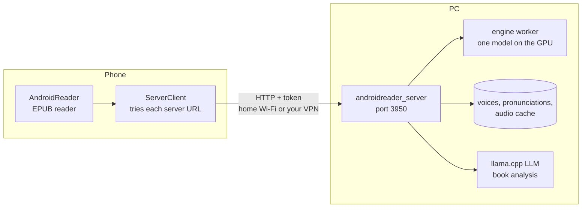

# AndroidReader

Listen to your EPUBs read by high-quality voice models running on **your own PC**, at home or away.
A standalone Android app plus this PC as the server; no cloud service and no other reading app.

* **The PC server** (`server/`) loads open-weight text-to-speech models on the GPU itself (no
  VoiceStudio or cloud service), clones voices from a short reference clip, applies your
  pronunciation fixes, caches every sentence, and streams audio to the phone.
* **The Android app** (`android/`) is an EPUB reader that reads aloud with highlighting, background
  playback and lock-screen/Bluetooth controls.
* **Dramatized reading (optional):** a local LLM works out who says each line and how
  (*"Stop!" she shouted* → the character's voice, shouting), and each character gets a voice.



| Folder | What it is |
|--------|------------|
| `server/` | `androidreader_server`: aiohttp API, engine manager and workers, voice store, pronunciation dictionary, audio cache, dramatization. |
| `android/` | Kotlin/Compose app: library, reader, Media3 playback service, settings. |

## Voice models

All four run on an RTX 5080 (16 GB) with PyTorch 2.8 + CUDA 12.8. Only one is on the GPU at a
time; asking for another swaps it. Measured on this PC with `scripts\bench_engines.py` (five
sentences, two with a delivery, imported voice *The Documentarian*, after one warm-up sentence).
*RTF* is generation time ÷ audio length, so below 1.0 is faster than real time. *WER* is
Whisper-turbo's word error rate on the output (intelligibility).

| Engine (id) | Why it's here | Delivery control | Phonemes | RTF | First audio | Load | VRAM | WER | Licence |
|---|---|---|---|---|---|---|---|---|---|
| **OmniVoice** (`omnivoice`, default) | VoiceStudio's model, so imported voices sound the same; 600+ languages; 32-step quality preset | non-verbal tags only (`[laughter]`, `[sigh]`) | CMU `[B EY1 S]` | 0.27 | 0.9 s | 9 s | 4.0 GB | 0% | Apache-2.0 |
| **Fish Audio S2 Pro** (`fish_s2`) | Best-rated open model for clarity and expressiveness; free-form inline tags | `[shouting, urgent]` tags | – | 0.60 | 2.0 s | ~3 min | 13.8 GB | 0% | Fish Audio Research (non-commercial) |
| **IndexTTS 2.5** (`indextts`) | Expressive cloning; emotion from a delivery text | emotion text → emotion vector | CMU `<word\|PH>` | 0.54 plain, ~1.5–2.7 on short lines with a delivery | 2.8 s | 1 min | 6.8 GB | 0% | bilibili (non-commercial) |
| **Qwen3-TTS 1.7B** (`qwen3tts`) | Base model for cloning plus **VoiceDesign** to create character voices from a description | – (VoiceDesign only) | – | 1.76 | 6.1 s | 15 s | 4.4 GB | 0% | Apache-2.0 |

Whisper transcribes *"Stop!" she shouted* with an exclamation mark only for the two engines that
received the delivery (Fish S2 Pro, IndexTTS); OmniVoice and Qwen3-TTS read it as *"Stop,"*.
Speaker similarity to the reference wasn't measured objectively; listen to
`server\data\bench\<engine>-<voice>.wav` to compare.

Notes:
* Fish S2 Pro and IndexTTS use `torch.compile` (via `triton-windows`), which roughly doubles
  their speed (Fish: RTF 1.8 → 0.6) but makes loading slow; keep the reader's default engine on
  OmniVoice or set `default_engine` and let it preload at start-up.
* Fish S2 Pro's context is capped at 4k tokens and its codec runs in bf16; otherwise it needs
  ~21 GB and spills out of a 16 GB card at a third of the speed.
* IndexTTS spends ~1.5 s per line analysing a delivery text, so short dramatized lines are slower
  than real time; the reader's look-ahead absorbs it.
* Qwen3-TTS is slower than real time on Windows (Python-bound, no FlashAttention) and slower still
  while the LLM runs on the CPU. It is the **voice-design** engine; for continuous listening
  prefer the other three.
* Excluded on purpose: speed/lightweight models (Kokoro, Piper, Chatterbox Turbo), VibeVoice 7B
  (~19 GB of weights, doesn't fit), Higgs Audio v2 (needs 24 GB).

## 1. Set up the PC server

Requirements: Windows, an NVIDIA GPU with recent drivers, ~60 GB free disk for models and
environments. [`uv`](https://docs.astral.sh/uv/) is installed automatically with winget if missing.

```powershell
cd D:\Dev\AndroidReader\server
# Where models and per-engine Python environments go (outside git). Default: server\data\models
'{"models_dir": "D:\\Models\\AndroidReader"}' | Set-Content -Encoding ascii data\config.json

.\setup-engines.ps1                 # one venv per engine (torch cu128); or e.g. .\setup-engines.ps1 omnivoice fish_s2
.\download-models.ps1               # weights into <models_dir>\hf and <models_dir>\checkpoints
.\run-server.ps1 --import-voicestudio   # optional: copy VoiceStudio's voice profiles (read-only)
.\run-server.ps1                    # start; prints the token, URLs and a pairing QR code
```

`run-server.ps1` creates the server's own small environment (`server\.venv`) on first run.
Options: `--port 3960`, `--engine fish_s2` (default engine), `--no-preload`, `--rotate-token`,
`--show-pairing`. Settings live in `server\data\config.json` (git-ignored, contains the token):

| Key | Default | Meaning |
|---|---|---|
| `models_dir` | `data\models` | Engine venvs, model weights, compile caches, LLM files. |
| `default_engine` / `default_voice` | `omnivoice` / first voice | Used when the phone doesn't choose. |
| `extra_urls` | `[]` | More URLs for the pairing codes, e.g. `["http://10.8.0.2:3950"]` for the PC on your VPN. |
| `preload` | `true` | Load the default engine at start-up. |
| `engine_options` | `{}` | Per engine, e.g. `{"omnivoice": {"num_step": 16}, "indextts": {"compile": true}}`. |
| `sentence_pause_ms`, `trim_silence` | `300`, `true` | Pacing between sentences. |
| `cache_max_mb` | `4096` | Sentence audio cache (`data\cache`). |
| `llm_model`, `llm_mode`, `llm_cpu_moe`, `llm_threads` | Qwen3.5-35B-A3B, `auto`, `20`, `12` | Dramatization LLM (see below). |
| `llm_label_context_words`, `llm_label_recent_lines` | `600`, `12` | Story text before each passage and earlier attributions shown when labelling; `0`, `6` = the old, slightly faster pass (see *What does more time per book buy?*). |
| `llm_dossier_model`, `llm_dossier_effort`, `llm_dossier_words` | empty (off), `medium`, `3500` | Optional pass 1: a reasoning model builds character dossiers (see *Character dossiers*). |
| `whisper_venv`, `whisper_model` | `indextts`, `whisper/large-v3-turbo.pt` | Transcribes new reference clips in the voice editor. |
| `voice_design_engine` | `qwen3tts` | Creates character voices. |

Environment overrides: `ANDROIDREADER_PORT`, `ANDROIDREADER_HOST`, `ANDROIDREADER_TOKEN`,
`ANDROIDREADER_DATA`, `ANDROIDREADER_MODELS`. Every request is logged with its engine, audio
length, time to first audio and RTF in `server\data\server.log`.

### Voices

Voices live in `server\data\voices` as a WAV plus a JSON file (name, transcript, language,
seed). Every voice has reference audio and its transcript, so every engine can clone it and the
speaker never changes between sentences. Add voices by importing from VoiceStudio
(`--import-voicestudio`, read-only), by `POST /api/voices` (WAV + transcript), or by designing
one from a description (`POST /api/voices/design`).

### Windows firewall (once, elevated)

```powershell
cd D:\Dev\AndroidReader\server
.\allow-firewall.ps1        # TCP 3950 on Domain and Private networks
```

Your home Wi-Fi must be a **Private** network (and so must your VPN's adapter, if the phone
reaches the PC through it). Without this rule the phone can't connect (the app reports *Could
not reach the PC … failed to connect*).

### Start automatically (optional)

```powershell
$a = New-ScheduledTaskAction -Execute "powershell.exe" -Argument "-NoProfile -WindowStyle Hidden -ExecutionPolicy Bypass -File D:\Dev\AndroidReader\server\run-server.ps1"
Register-ScheduledTask -TaskName "AndroidReader server" -Action $a -Trigger (New-ScheduledTaskTrigger -AtLogOn)
```

## 2. Away from home: your own VPN

Use your own VPN to reach the PC from outside, and add the PC's address on that VPN as an extra
server URL: either in the app (*Settings → Connection*, one URL per line, after the home address)
or in `extra_urls` in `server\data\config.json`, so the pairing QR codes include it. Don't
port-forward 3950 on your router: the server speaks plain HTTP, protected only by its token.

The app tries the URL that worked last; if it can't connect, it tries the others, and it starts
again from the first (home) address whenever the phone's network changes. At home you get the
LAN; on mobile data you get the VPN address, without touching anything.

## 3. Build and install the app

Requirements: JDK 17 and the Android SDK (platform 35).

```powershell
cd D:\Dev\AndroidReader\android
$env:JAVA_HOME = "D:\Dev\.toolchains\jdk-17.0.20.1+1"
$env:ANDROID_HOME = "$env:LOCALAPPDATA\Android\Sdk"
.\gradlew.bat assembleDebug
adb install -r app\build\outputs\apk\debug\app-debug.apk
```

The app id is `com.androidreader`.

## 4. Pair the phone

1. On the PC, open **http://127.0.0.1:3950/** (served only to the PC itself; it contains the token).
2. Scan any QR code with the phone camera, open the link, tap **Open AndroidReader**. Each code
   carries *all* the PC's addresses (plus `extra_urls`) and the token.

Or enter them by hand in *Settings → Connection to your PC*: one URL per line (home address
first, e.g. `192.168.86.10`, then the PC's address on your VPN) and the token, then **Save &
test connection**. *Settings* also holds the default model, voice and sentence pause for books.

## 5. Reading

* **Import:** *Import EPUB* opens the system file picker, and file managers can *Open with
  AndroidReader*. Books are copied into the app, with covers.
  Long-press a book to remove it.
* **Reader:** tap any sentence to start reading from it; the sentence being read is highlighted
  and the page follows it. The list icon opens the table of contents. Chapters follow the book's
  own table of contents: when a publisher splits a chapter into several files (often at every
  illustration), the files are joined back into one chapter. Books imported with an older version
  are re-split the next time you open them, and your place is kept.
* **Controls:** play/pause, previous/next sentence and chapter, also from the lock screen,
  notification and Bluetooth headsets. Unplugging headphones pauses; calls pause reading.
* **Reading options** (sliders icon): text size, theme (light/sepia/dark), speed (pitch is kept),
  sleep timer (15/30/60 min or end of chapter), the **voice model and voice for this book**,
  dramatized reading, and how many sentences to prepare ahead (default 6; raise it for slower
  models). The status line shows how many sentences are ready and when the PC is still working.
* Your position is saved per book. Sentences already synthesized are cached on the PC, so
  re-listening is instant.

## 6. Pronunciations

Long-press a word while reading → **Fix pronunciation**:

* **Say it like:** a respelling such as `her-MY-oh-nee`. Works with every model. (Stress capitals
  are lower-cased before synthesis because some models spell out capitalised syllables.)
* **Phonemes (optional):** CMU/ARPAbet such as `HH ER0 M AY1 AH0 N IY0`. Used by OmniVoice and
  IndexTTS; other models use the respelling.
* **Preview** synthesizes the sentence with the current voice and the unsaved fix.
* **Only in this book** or **in all books.** Book entries win over global ones.
* Matching is whole-word, case-insensitive unless *Match case exactly* is ticked, and covers
  possessives and plurals (*Hermione's*, *Hermiones*) and multi-word names (*Sirius Black*).

Fixes are applied on the PC before synthesis and are part of the audio cache key, so a changed
fix never reuses stale audio; sentences already buffered on the phone are re-synthesized. The
list (spell-check icon) shows, edits and deletes entries.

## 7. Dramatized reading (multi-voice, expressive)

Turn on **Dramatized reading** in a book's reading options. The phone uploads the book's text and
the quotations it found (with stable IDs) to the PC, which analyses it in the background:

1. **Deterministic segmentation** on the phone: sentences are split at quotation marks, so
   *"Stop!" she shouted.* becomes the quotation (character voice) and *she shouted.* (narrator).
   The text is never rewritten, so highlighting and positions always match the EPUB.
2. **LLM pass per ~600-word chunk** (llama.cpp, JSON-schema constrained): for each numbered
   speaker turn, the speaker and a short delivery (*shouting, urgent*), using a rolling character
   roster and the last few attributions.
3. **Roster pass:** gender, apparent age (how old they look and sound, not their true age),
   accent, temperament and a voice description per main character, from their lines and the
   narration's descriptions of them.
4. **Cast:** *Cast → Create voices* designs a voice for each main character (Qwen3-TTS
   VoiceDesign) and locks it as a cloned reference so it stays consistent; minor characters share
   a small pool of voices by gender and age. Any character can be renamed, merged with an alias
   (*Lizzy* = *Elizabeth*) or given any voice.
5. Long-press a quotation → **Change speaker or delivery**. Corrections always win over the model.

Lines are voiced as soon as their chunk is analysed. Delivery is applied by engines that support
it (Fish S2 Pro: inline tag; IndexTTS: emotion; OmniVoice: laughter/sigh only); others read the
line plainly in the character's voice. Voice and delivery are part of the cache key.

**LLM setup:** `download-llm.ps1` fetches llama.cpp and **Qwen3.5-35B-A3B** (Q4_K_M, 22 GB,
Apache-2.0; a mixture of experts with about 3B parameters active per token, run with thinking off).
`-Alternative` adds the previous default, Qwen3-30B-A3B-Instruct-2507, and gpt-oss-20b. The
server starts and stops llama.cpp itself, and frees its memory when idle.

Measured on hand-labelled chapters (*Pride and Prejudice* ch. 1, *Alice* ch. 7; 182 quotations,
`scripts\eval_attribution.py`). The whole of *Alice* (27k words) was analysed on the GPU in
12.5 minutes (1,117 lines, 42 characters), and casting created 20 voices.

| LLM | Where | Speaker accuracy | Time per 100k-word book |
|---|---|---|---|
| **Qwen3.5-35B-A3B** Q4_K_M (default) | GPU (experts of 20 layers in RAM) | **180/182 = 98.9%** | ~70 min |
| Qwen3-30B-A3B-Instruct-2507 Q4_K_M | GPU (experts of 20 layers in RAM) | 179/182 = 98.4% | ~65 min |
| Qwen3-30B-A3B-Instruct-2507 Q4_K_M | CPU only (16 threads) | 179/182 = 98.4% | ~4 h |
| gpt-oss-20b MXFP4 | GPU (fully on the card) | 180/182 = 98.9% | ~19 min |
| gpt-oss-20b MXFP4 | CPU only | 174/182 = 95.6% | ~4 h |

The difference shows on harder text. On two hand-labelled *Sasaki and Peeps* vol. 10 excerpts
(`scripts\eval_dossier.py --no-dossier --label-model ...`), Qwen3.5 scored **95/102 = 93.1%** on a
prison scene where Qwen3-30B scored 86/102 = 84.3%. Qwen3.5 recognises an unnamed prisoner as the
character who gives his name later. Both scored 55/59 = 93.2% on group banter, at the same speed
(about 45 minutes for that 85k-word book).

The remaining misses are an illustration caption, a chorus line ("Sh! sh!") and, for gpt-oss on
the CPU, Alice's thoughts and an untagged Bennet exchange. Qwen is preferred over gpt-oss because it
is equally accurate on CPU and GPU and writes more actable deliveries (*"dry, amused"*, *"gossipy,
animated"*, *"exasperated, reproachful"* vs gpt-oss's *"curious"*, *"annoyed"*). For reference,
BookNLP scores 56.7% on the PDNC benchmark and the 2026 state of the art (ModernBookNLP) 94.5%;
our two chapters are a small sample, not a benchmark. Two prompt details mattered: numbering
*speaker turns* (both halves of *"Yes," he said, "I will."* share a number) and having the model
echo each quote's first words. Without them labels drifted by one after an interrupted quote
(91.8%).

**ModernBookNLP as a second opinion (tried, not used).** The encoder model from *Fast and Accurate
Quotation Attribution in Literary Texts* (2026; 94.5% on PDNC) runs on the CPU in about 7 minutes
per book. On our gold sets it was far weaker than the LLM: 55.9% vs 85.7% on the *Sasaki and
Peeps* excerpts, and 85.7% vs 98.9% on the two classic chapters (it does well on *Alice*, 98.7%, but
gets 27% on *Pride and Prejudice* ch. 1, where Mrs. Bennet is never named). Lines where the two
disagree contain 23 of the LLM's 25 errors, but they make up 43% of *Sasaki*'s lines with 30%
precision, and 15% of the classics' lines with 7% precision. Re-checking that many lines costs
more than it can gain, so it is not part of the pipeline. `scripts\eval_flagger.py` reproduces
the numbers.

**Jev-like classifiers as a second opinion (tried, not used).** Each quotation is asked as one
multiple-choice question: the local scene (about 250 words before, the quote marked, 80 after,
plus a note naming the first-person narrator), with options = characters the LLM found speaking
nearby + "someone else" + "nobody". The same gold sets as above; minutes per 2,600-quotation book.

| Second opinion | Alone: *Sasaki* / classics | Lines flagged (*Sasaki*) | Precision | LLM errors caught | min/book |
|---|---|---|---|---|---|
| ModernBookNLP (for comparison) | 55.9% / 85.7% | 43% | 30% | 23 of 25 | 7 (CPU) |
| OpenJev-Flash-9B Q8_0, every disagreement | 65.2% / 98.4% | 26.1% | 17% | 7 of 23 | 7 |
| OpenJev, disagreement with confidence ≥ 0.5 | | 6.8% | 45% | 5 of 23 | |
| OpenJev, confidence ≥ 0.8 | | 1.2% | 100% | 2 of 23 | |
| jeff + GLiFormer-large, every disagreement | 19.9% / 42.9% | 79.5% | 15% | 19 of 23 | 2.5 |

OpenJev ([openjev/OpenJev-Flash-9B-GGUF](https://huggingface.co/openjev/OpenJev-Flash-9B-GGUF),
CC BY-NC; the "APUS-OpenJev" name on community pages does not exist) runs on llama.cpp and its
confidence is usable: thresholding shrinks the flags to a small, precise set (on the classics,
≥ 0.5 flags 1.1% of lines, ≥ 0.8 flags one line, an actual error). jeff with GLiFormer mostly
picks the first-listed option with near-uniform confidence; with only the quote's paragraph as
the state it reaches 85.7% on the classics but still 24.8% on *Sasaki*, so it is not useful here.

Routing OpenJev's ≥ 0.5 flags back to Qwen3.5 with reasoning on:

| Re-check | *Sasaki* (161 lines) | Classics (182) | Added time |
|---|---|---|---|
| Re-label the flagged passages (as in the normal pass) | 85.7% → 88.8% (+5, none broken) | | ≈ 8 h per book |
| Ask about each flagged line on a wider scene (600 words) | 85.7% → 86.3% (+2, −1) | 98.9% → 99.5% | ≈ 1–5 h per book |

The passage re-check works but costs several times the whole labelling pass for three points,
so it is not in the default path. `scripts\eval_jev.py` reproduces the classifier numbers
(`--backend openjev|jeff`, and `--recheck rows.json` for the per-line routing);
`scripts\eval_flagger.py route --jev rows.json --min-conf 0.5` runs the passage re-check.

**What does more time per book buy? More context, not more reasoning.** With up to double the
labelling time allowed, each option below labelled the chunks that contain the *Sasaki and Peeps*
gold excerpts (161 lines, empty cast) and the two classic chapters (182 lines) on the GPU
(`scripts\eval_reasoning.py`). Time is relative to the old single pass. Repeated runs of the old
pass scored 148, 148 and 139 on *Sasaki*, so differences of a line or two are noise.

| Variant | *Sasaki* | Classics | Time |
|---|---|---|---|
| Old pass: Qwen3.5, thinking off, 6 recent lines | 145.0/161 = 90.1% (mean of 3) | 180/182 | 1.0× |
| **+ 600 words of preceding text, 12 recent lines (new default)** | **152.7/161 = 94.8%** (152, 153, 153) | 180/182 | **1.05×** |
| + 1,200 words of preceding text, 20 recent lines | 153/161 = 95.0% | 180/182 | 1.6× |
| 1,200-word chunks + 600 words before | 150/161 = 93.2% | 180/182 | 1.0× |
| Qwen3.5 thinking, 1,024-token budget | 148/161 = 91.9% | 180/182 | 2.0× |
| gpt-oss-20b, medium reasoning (whole model on the GPU) | 124/161 = 77.0% | 176/182 | 1.0× |
| Review pass: a second call per chunk checks the first pass's labels | 150/161 = 93.2% | 180/182 | 2.0× |
| More context + review pass | 152/161 = 94.4% | 180/182 | 2.0–2.8× |
| Self-consistency: second run on shifted chunks, disagreeing chunks reviewed | 149/161 = 92.5% | 180/182 | 3.2× |

Showing the model the story just before each passage (who entered, who was talking) fixes most
untagged turns that the old pass got wrong. It is also steadier from run to run. Reasoning,
reviews and second opinions on top of that add time without adding accuracy, so the extra
budget is left unused. What remains wrong is mostly fast multi-party banter (Type Twelve, the
Neighbor and Futarishizuka). The new default is `"llm_label_context_words": 600` and
`"llm_label_recent_lines": 12`; set them to `0` and `6` for the old pass.
Re-labelling the whole of *Sasaki and Peeps* v10 with the new default took 64 minutes instead of
46, about 75 minutes per 100k words; whole-book prompts carry the full cast, so the extra text
costs more than on the excerpts. It kept the reader's corrections, cast, voices and narrators. On
the gold excerpts the book went from 138/161 = 85.7% to 142/161 = 88.2% (group banter 54 → 57/59).
Twelve of the remaining 19 misses come from one chunk at the start of a chapter, which has no
preceding text to use: there the then-unnamed Nick comes out as "a prisoner", "Nick" or another
character from run to run, with either setting.

`"llm_mode": "auto"` (default) runs the LLM on the GPU only after two minutes without speech
requests and on the CPU otherwise, so analysis never evicts the voice model while you listen.
`"gpu"` and `"cpu"` force one or the other.

**Quoted terms are narration.** Words in quotation marks inside a sentence (*Chinese for “cat.”*,
*all the “inspections” we did*, *labelled “DRINK ME,”*) are not dialogue. The prompt says so
explicitly. In first-person books the model used to give them to the narrating character: 11–13
of 18 right in *Sasaki and Peeps* v10, 16–17 with the new wording. A rule backs it up: a short
quote straight after a word, with no punctuation inside and no speech verb before it ("then said
“The fourth.”" stays dialogue). Such quotes stay inside the narration: the whole sentence is read in
one go, in the narrator's voice, on the phone and in the viewer, which shows them as plain text
(dotted underline); double-click one to give it to a speaker. Books analysed earlier
are fixed when the server opens them. Quotations given to the narrator (signs, notes) are also
read in the narration's voice, so in first-person passages they no longer switch to a different
voice mid-sentence.

**First-person books.** Many novels (and most light novels) are told by "I". The model reports
each passage's narrator, the next passage is told who "I" was, and a point-of-view heading such as
*(The Neighbor's POV)* starts a new passage with an explicit "the narrator changes here". The
model also reports nicknames ("Makeup", "Robot Girl"), which are merged into the character they
belong to. On a hand-labelled excerpt of *Sasaki and Peeps* vol. 10 (108 quotations: Sasaki's
first-person prison scene, then the neighbor's POV with her nicknames for everyone) this raised
accuracy from 36% to 88%. The remaining misses are group banter in the neighbor's chapter; fix
them in the viewer or the app. That excerpt is copyrighted, so it lives in the git-ignored
`server\tests\gold\private\`.

**Two narrators in different tenses.** Some books switch narrator without marking the way back.
In *Sasaki and Peeps* the neighbor's sections start with *(The Neighbor's POV)*, are told in the
present tense and end at an unmarked scene break. Sasaki narrates in the past tense, and the table
of contents gives the heading as the title of chapters that actually open with Sasaki. When the
narration alternates between tenses, the server:

* finds the switches from the narration itself (dialogue removed);
* splits passages there and ignores POV chapter titles;
* tells the model who narrated earlier passages in the same tense;
* afterwards moves any "…," I said line to the narrator of its tense.

The same switches decide whose voice reads the narration. Single-narrator and third-person books
are unaffected.

On the full *Sasaki and Peeps* vol. 10, the hand-labelled excerpt spans one of the neighbor's
sections. There, wrong speakers fell from 15 to 7 (93.5%). The other 12 misses are Nick's lines
before he gives his name, which are labelled "a prisoner".

**Series memory.** A book's series is detected from its title (*Sasaki and Peeps, Vol. 10* →
*Sasaki and Peeps*; change it in the viewer). After casting, and whenever you edit a character, the
main cast is stored per series: names, aliases, apparent gender and age, dossier and voice. A new
volume of the series starts its analysis with that cast, so the characters keep the voices you
chose, including your corrections. *Sasaki and Peeps* is seeded from vol. 10's corrected cast
(Futarishizuka as a girl's voice with an old woman's manner, the Neighbor as a teenage girl, Peeps
as an elderly sage, and so on).

**Character dossiers (optional pass 1).** With `"llm_dossier_model"` set (e.g.
`"gpt-oss-20b-MXFP4.gguf"`), a reasoning model first reads the whole book in about 3,500-word
passages. It builds a dossier per character: aliases, apparent age and form (what a listener should
hear), true nature, personality, speech style, relationships, how they first appear, and evidence
quotes. A final consolidation call merges duplicates. Line labelling then uses the dossier. It is
**off by default**, because on our gold excerpts it made attribution worse. Wrong identity merges
from the first read (e.g. Nick made an alias of Sasaki's cover name) spread into many lines, and it
did not improve the apparent ages either. Measured on *Sasaki and Peeps* vol. 10 (two hand-labelled
excerpts, 161 quotations; `scripts\eval_dossier.py`):

| Pipeline | Prison scene (ch. 8) | Group banter (ch. 12) | Age/gender/form checks | Pass 1 time |
|---|---|---|---|---|
| **Single pass (default)** | **86/102 = 84.3%** | **55/59 = 93.2%** | 18/24 | — |
| + dossier, gpt-oss-20b, medium reasoning | 72/102 = 70.6% | 53/59 = 89.8% | 18/24 | 16 min |
| + dossier, gpt-oss-20b, high reasoning | 64/102 = 62.7% | 51/59 = 86.4% | 17/24 | 68 min |
| Qwen3-30B-A3B-Thinking-2507 / Qwen3.5-35B-A3B | not completed | | | ~2 h (3–3.5 min per passage) |

Dossiers you edit yourself are still useful. In the viewer (📇 on a character) you can set the
apparent age, form, speech style and other fields. Your fields always win, are used to design the
character's voice (*Design a new voice from this dossier*) and, once any character has edits, are
given to the model when you *Re-label lines with the dossiers*. Edits also go into the series
memory.

## 8. Process a book on the PC

Dramatize a book without touching the phone, then optionally put it on the phone:

```powershell
cd D:\Dev\AndroidReader\server
.\run-server.ps1                               # in another window
.\.venv\Scripts\python.exe scripts\process_book.py "E:\Light Novels\Series\Book v10.epub" --phone
```

1. The EPUB is parsed with **the app's own Kotlin parser** on the JVM (`ExportBookTool`, run through
   Gradle, so JDK 17 and the Android SDK are needed), so the book ID (SHA-1 of the file) and every
   quotation ID match what the phone produces when it imports the same file.
2. The text is uploaded and analysed (progress is printed; about an hour per 100k words on the
   GPU), then voices are created for the cast.
3. With `--phone` (phone connected over adb, app installed and paired) the EPUB is copied into the
   app and imported with dramatized reading switched on. Without it, import the same file in the
   app later: it finds the finished analysis because the IDs match.

Options: `--no-cast`, `--engine qwen3tts` (voice-design engine), `--reanalyze` (start over; your
corrections, names and voices are kept). Running it again on a finished book only does the
missing steps. It always sends the text again, so if a newer version of the app splits the book
into chapters differently, the server moves the existing analysis and your corrections to the new
chapter numbering.

## 9. PC viewer

Open **http://127.0.0.1:3950/books** on the PC. On other devices on your network (or your VPN),
open the viewer link or scan its QR code on the PC's server page (http://127.0.0.1:3950/). That
link is `http://<PC address>:3950/books#token=…`. The browser keeps the `#` part to itself, stores
the token and removes it from the address bar. Without the link, the viewer asks for the token,
which is shown on the server page. The page is served to any address, but holds no token itself;
every book, script and audio request needs the token, like the app's.

The viewer has:

* **Library:** every analysed book with its cover, word count, analysis progress and cast status.
* **Book:** chapters in reading order; quotations coloured by speaker with the speaker's name and
  delivery (*shouting, urgent*); ✎ marks your corrections.
* **Cast panel:** characters with aliases, line counts and voices; ▶ plays the voice sample. Click a
  name to list all of that character's lines across the book (or use the speaker filter, which
  also offers *quotes given to the narrator*); search finds text.
* **Playback:** click any line or narration to play from there through the chapter with each
  speaker's voice and delivery, using the chosen narrator voice and model. Audio comes from the
  same server cache as the phone.
* **Editing:** click a speaker tag to change the speaker or delivery; ✎ on a character renames it,
  merges it into another (aliases) or changes its voice; 📇 opens its dossier (see *Character
  dossiers*); *Create missing voices* runs the cast; *Re-label lines with the dossiers* labels the
  lines again (your corrections are kept). The book's series is shown under the cast and can be changed.
  Changes go through the same API as the app; the phone picks them up the next time you open
  the book (sentences it had already prepared are re-synthesized).

## 10. Voice editor

Edit any voice by hand in the viewer: 🎙 next to a character in a book's cast panel, or **Voices**
(http://127.0.0.1:3950/books/voices, linked from every viewer page). The Voices page lists every
voice, including imported VoiceStudio voices, pool voices and character voices, with who uses it.

Describe the voice in plain words ("a young girl's high, light voice, but old-fashioned and teasing
like a grandmother"), press **Make 3 options**, listen, and press **Use this** on the one you like.
That's all. It takes about a minute, and **Undo** goes back to the previous voice (the last 5 are
kept). A voice shared by several characters, such as a pool voice for minor characters, is
copied for the character you are editing. Tick *Also change it for N other characters* to change
it for all of them.

**Advanced** holds the rest:

* **Voice-design model and sample line:** which model makes the options and what they say.
* **Details:** name, language, seed and the transcript of the reference clip.
* **Use a real recording instead:** upload a WAV, MP3 or other clip, or record one in the browser
  (only on the PC itself or over HTTPS, a browser rule). Trim it, and *Fill in what is said* runs
  Whisper (large-v3-turbo in the IndexTTS venv); correct the text before saving. 5–20 s of one
  clear speaker works best.
* **Test with your own text:** any text, a delivery (*shouting*) and any installed engine.

The audio cache key includes a fingerprint of the voice's reference audio, transcript, language,
seed and design description, not only its ID. Edited voices are therefore never served from old
cached audio, and undoing an edit finds the old clips again. The book script sent to the phone
carries the same fingerprints. When the reader opens a book whose voices changed, it drops the
sentences it had prepared and fetches them again.

## Troubleshooting

* **Could not reach the PC:** server running? Firewall rule added (`allow-firewall.ps1`, elevated)?
  Network *Private*? Away from home: is your VPN connected, and is the PC's VPN address in the
  app's server URLs? From the phone's browser, `http://<pc>:3950/api/ping` should return JSON.
* **Phone on Wi-Fi but routing over mobile data:** for LAN addresses the app binds to the Wi-Fi
  network that owns the subnet (Samsung *Switch to mobile data*); behind a VPN it leaves routing
  to the VPN and falls back to unbound sockets if Android refuses the binding.
* **First sentence slow:** the model is loading (OmniVoice ~10 s, Qwen3-TTS ~15 s, IndexTTS ~1 min,
  Fish S2 Pro ~3 min because of `torch.compile`). Switching models also reloads.
* **Gaps while reading:** the model is slower than real time for this text. Raise *Sentences
  prepared ahead* or pick a faster model for the book.
* **Wrong voice for a character / wrong speaker:** fix it in *Cast* or long-press the line.

## API (for reference)

All `/api/*` routes except `/api/ping` need `Authorization: Bearer <token>`.

| Route | Description |
|-------|-------------|
| `GET /api/ping` | Liveness; no auth. |
| `GET /api/health` | Version, default engine, loaded engine/state, voice count, cache stats. |
| `GET /api/engines` · `POST /api/engines/{id}/load` · `POST /api/engines/unload` | Engines with capabilities, licence and measured RTF; preload; free the GPU. |
| `GET/POST /api/voices` · `DELETE /api/voices/{id}` · `GET /api/voices/{id}/audio` · `POST /api/voices/design` | Voice store (`?all=1` adds character voices, `?details=1` everything with who uses it). |
| `GET/PATCH /api/voices/{id}` · `PUT /api/voices/{id}/audio` · `POST /api/voices/{id}/revert` · `POST /api/voices/{id}/duplicate` | Voice editor: details, history and users · edit name/description/language/seed/transcript · new reference (multipart `audio`, `start`, `end`, `ref_text`; transcribed when empty) · undo · copy (`{book, character}` assigns the copy). |
| `POST /api/voices/{id}/design` · `GET /api/voice-candidates/{c}/audio` · `POST /api/voices/{id}/design/{c}` · `POST /api/transcribe` | Design candidates `{description, engine?, count?, text?, seeds?}` · listen · keep one · Whisper transcript of an uploaded clip. |
| `GET/POST /api/pronunciations` · `PATCH/DELETE /api/pronunciations/{id}` | Dictionary (`?book=` for a book's view). |
| `POST /api/tts` | Body `{text, engine?, voice?, language?, speed?, delivery?, seed?, book?, sentence_pause_ms?, extra_pronunciations?, cache?}`. Chunked **PCM16LE mono**, rate in `X-Sample-Rate`; `X-Cache: hit/miss`. Errors before audio are JSON; closing the connection cancels synthesis. |
| `GET /api/books` · `GET /api/books/{id}` · `GET /api/books/{id}/cover` | Uploaded books with analysis/cast status · a book's paragraphs and quotations · its cover. |
| `POST /api/books/{id}` · `GET /api/books/{id}/script` · `POST /api/books/{id}/analyze` | Upload book text (+`analyze`, `reanalyze`, optional base64 `cover`), dramatization status and lines. |
| `PATCH /api/books/{id}/lines/{quote}` · `PATCH /api/books/{id}/characters/{id}` · `POST /api/books/{id}/cast` | Corrections, rename/merge/voice/`dossier`/`aliases`, create character voices. |
| `POST /api/books/{id}/characters/{id}/voice-from-dossier` · `POST /api/books/{id}/analyze` `{relabel\|reanalyze}` | New voice from the dossier · label lines again (keep dossiers) or analyse from scratch (user edits kept). |
| `GET /api/series` · `POST /api/books/{id}/series` `{series?}` | Series casts · set a book's series and store its cast there. |
| `GET /pair` · `GET /` · `GET /books[/{id}]` | Pairing page (token in the URL fragment) · QR codes for pairing and the viewer (PC only) · book viewer (any address; asks for the token unless opened on the PC). |

## Development

```powershell
# server tests (fake engine in a real worker process; no GPU needed)
cd server; .\.venv\Scripts\python.exe -m pytest

# engine benchmark (real models) and attribution accuracy (real LLM)
.\.venv\Scripts\python.exe scripts\bench_engines.py omnivoice fish_s2 indextts qwen3tts
.\.venv\Scripts\python.exe scripts\eval_attribution.py tests\gold\pride-ch1.json tests\gold\alice-ch7.json
# dossier pipeline vs single pass on a processed book (gold excerpts of copyrighted books live in tests\gold\private)
.\.venv\Scripts\python.exe scripts\eval_dossier.py --dossier-model gpt-oss-20b-MXFP4.gguf --roster tests\gold\sasaki10-roster.json tests\gold\private\sasaki10-ch8.json tests\gold\private\sasaki10-ch12.json

# Android unit tests (EPUB parsing, sentence/quote segmentation, URLs, language names)
cd android; .\gradlew.bat testDebugUnitTest

# On-device tests (phone paired, server running). Installed manually so the app isn't
# uninstalled afterwards. Without the firewall rule, `adb reverse tcp:3950 tcp:3950` and the URL
# http://127.0.0.1:3950 work over USB.
.\gradlew.bat assembleDebugAndroidTest
adb install -r -t app\build\outputs\apk\androidTest\debug\app-debug-androidTest.apk
adb shell am instrument -w -e class com.androidreader.ReaderPlaybackTest com.androidreader.test/androidx.test.runner.AndroidJUnitRunner
# slow: analyses the whole of Alice, casts voices, then plays the Mad Tea-Party dramatized
adb shell am instrument -w -e class com.androidreader.DramaPlaybackTest#analysesCastsAndReadsWithCharacterVoices com.androidreader.test/androidx.test.runner.AndroidJUnitRunner
# a book processed with process_book.py --phone: narrator voices per section, character voices in a scene
adb shell am instrument -w -e class com.androidreader.DramaPlaybackTest#readsAProcessedBook -e bookId 2f145f7d38c07f00 -e mainAt 3:1 -e povAt 12:170 -e dialogueAt 10:12 com.androidreader.test/androidx.test.runner.AndroidJUnitRunner
```
